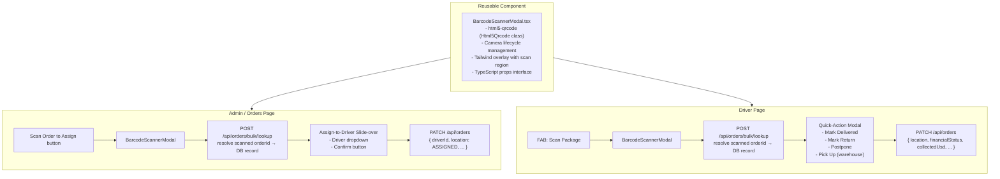
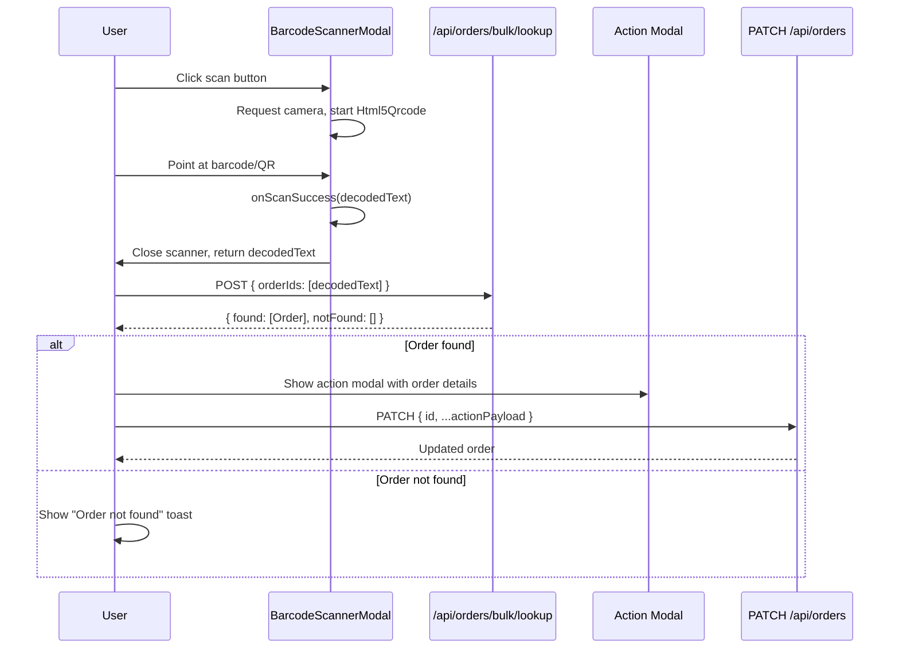
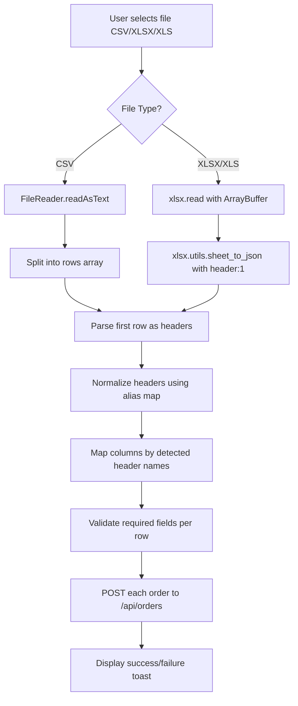
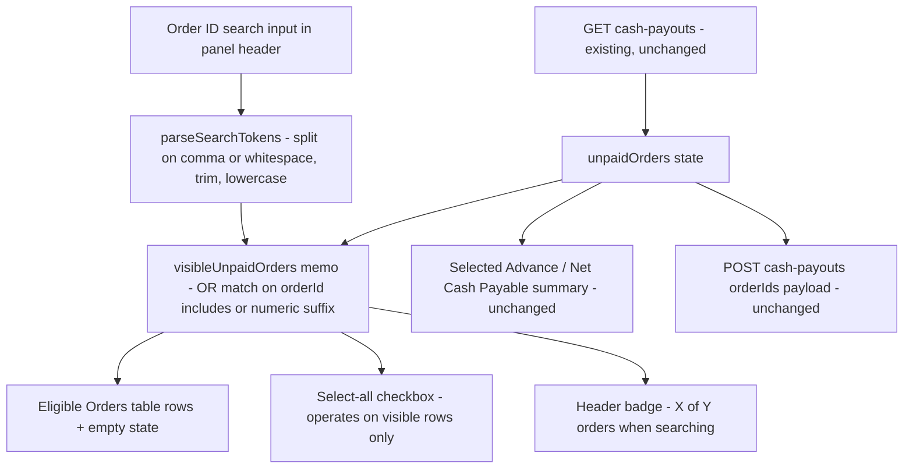
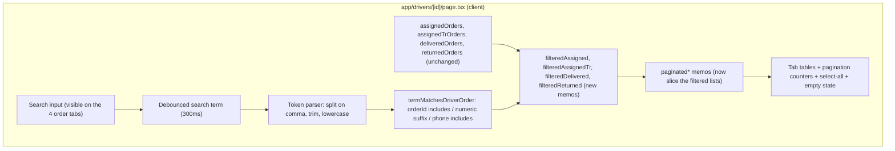
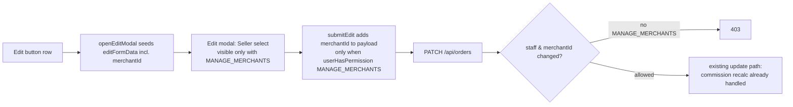
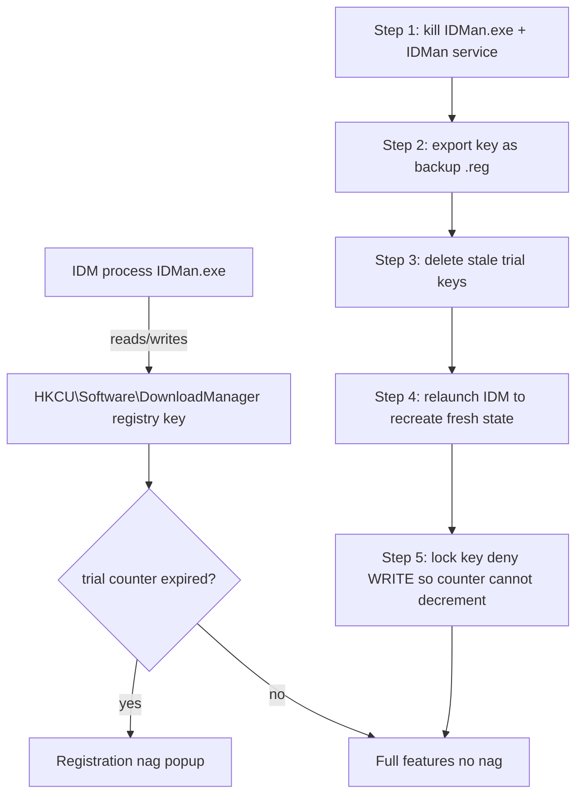
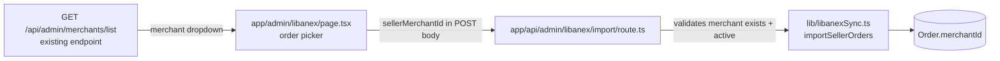
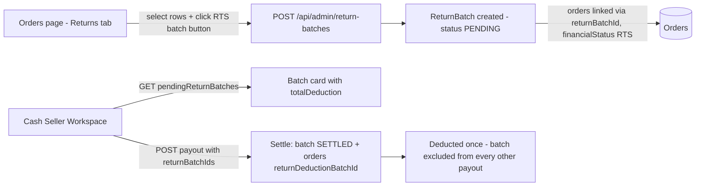
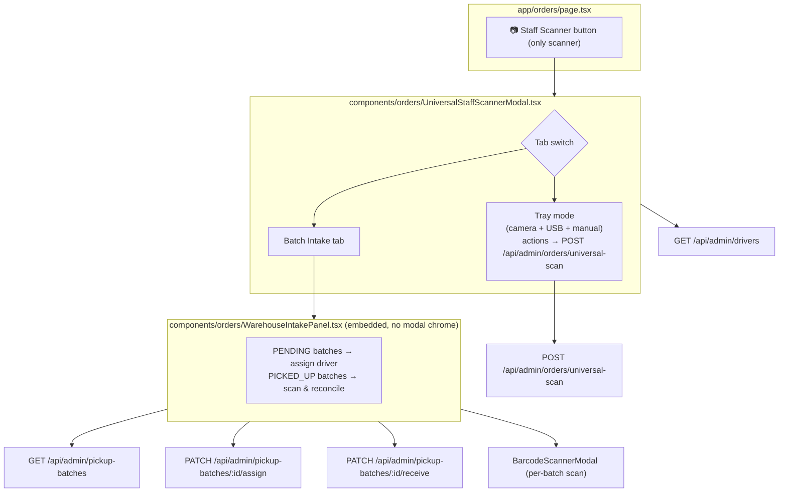

# Project map — delivery_system / web-pwa

Generated: 2026-10-29T19:06:14.697Z
Source files scanned: 219

## How to use this file

This is a map of the project, not its source. It lists what exists and where.
When asked to design a change, use it to pick the exact existing files,
endpoints and components to reuse — do not invent new ones that duplicate
something listed here.

Rules that must not be broken are in the `AGENTS.md` section below.

### Output format expected from you

Do NOT write code. Produce a plan document in this exact shape:

1. **Overview** — what will change, in plain English.
2. **Architecture** — a mermaid flowchart of the request/UX flow, naming real files from this map.
3. **Current State Analysis** — a table of `file | line range | current behaviour` for every file that must change.
4. **Step-by-step plan** — one step per file, in safe order.
5. **Risks** — what could break, which existing behaviour/endpoint/component is being reused, and which roles can see the feature.

If no existing endpoint or component fits, say so explicitly instead of inventing one.

## 1. File tree

Every file that makes up the site, with its size. Sizes matter: files over
~1,000 lines are risky to change and should be edited one section at a time.

```
.env.bak-libanex  (12 lines) — .env.bak-libanex
.gitignore  (58 lines) — .gitignore
AGENTS.md  (42 lines) — AGENTS.md
CLAUDE.md  (2 lines) — CLAUDE.md
README.md  (69 lines) — README.md
TROUBLESHOOTING.md  (126 lines) — TROUBLESHOOTING.md
app/403/page.tsx  (27 lines) — Page /403
app/actions/driverRates.ts  (33 lines) — Server-side authorization: driver rate changes mirror the already-guarded
app/actions/treasury.ts  (37 lines) — Server-side authorization: creating treasury boxes is a financial action.
app/admin/drivers/[id]/page.tsx  (726 lines) — ─── Types ────────────────────────────────────────────────────────────────────
app/admin/libanex/page.tsx  (802 lines) — One of OUR merchants, for assigning imported orders to a seller
app/admin/page.tsx  (1572 lines) — ─── Types ────────────────────────────────────────────────────────────────────
app/admin/treasury/page.tsx  (737 lines) — ── Pending approvals (across every cash box) ──
app/api/admin/dashboard/approvals/route.ts  (47 lines) — GET — fetch pending merchant approvals data for admin dashboard
app/api/admin/drivers/[id]/rates/route.ts  (246 lines) — GET /api/admin/drivers/[id]/rates — Fetch all seller-specific flat rates for a driver
app/api/admin/drivers/[id]/route.ts  (413 lines) — PUT /api/admin/drivers/[id] — Update a driver (User + DriverProfile + ZoneRates) in a transaction
app/api/admin/drivers/[id]/seller-rates/route.ts  (87 lines) — PUT /api/admin/drivers/[id]/seller-rates
app/api/admin/drivers/[id]/zone-rates/route.ts  (82 lines) — PUT /api/admin/drivers/[id]/zone-rates
app/api/admin/drivers/[id]/zones/route.ts  (111 lines) — GET /api/admin/drivers/[id]/zones — Fetch zones assigned to a driver
app/api/admin/drivers/payouts/[id]/approve/route.ts  (253 lines) — POST /api/admin/drivers/payouts/[id]/approve — Phase 2 (Approve)
app/api/admin/drivers/payouts/[id]/void/route.ts  (74 lines) — DELETE /api/admin/drivers/payouts/[id]/void — Void a PENDING driver payout batch
app/api/admin/drivers/route.ts  (306 lines) — GET /api/admin/drivers — Fetch all drivers with user & zoneRates
app/api/admin/drivers/settlements/route.ts  (423 lines) — GET /api/admin/drivers/settlements — Fetch PENDING DriverPayouts only.
app/api/admin/employees/[id]/route.ts  (451 lines) — PUT /api/admin/employees/[id] — Update an employee (user)
app/api/admin/fix-orders/route.ts  (65 lines) — API endpoint /api/admin/fix-orders
app/api/admin/libanex/export/route.ts  (66 lines) — POST /api/admin/libanex/export — export selected PWA orders into Libanex.
app/api/admin/libanex/import/route.ts  (74 lines) — POST /api/admin/libanex/import — import selected Libanex orders of one
app/api/admin/libanex/orders/route.ts  (30 lines) — GET /api/admin/libanex/orders?sellerId=556 — list a seller's Libanex orders
app/api/admin/libanex/pwa-orders/route.ts  (28 lines) — GET /api/admin/libanex/pwa-orders — list PWA orders that have never been
app/api/admin/libanex/sellers/route.ts  (62 lines) — GET /api/admin/libanexsellers — list Libanex sellers for the import picker.
app/api/admin/libanex/sync/route.ts  (33 lines) — POST /api/admin/libanex/sync — run the incremental Libanex→PWA sync now
app/api/admin/merchants/[id]/billing/route.ts  (90 lines) — API endpoint /api/admin/merchants/[id]/billing
app/api/admin/merchants/[id]/cash-payouts/exclude/route.ts  (59 lines) — PATCH /api/admin/merchants/[id]/cash-payouts/exclude
app/api/admin/merchants/[id]/cash-payouts/route.ts  (515 lines) — GET /api/admin/merchants/[id]/cash-payouts
app/api/admin/merchants/[id]/payouts/[batchId]/invoice/route.ts  (159 lines) — API endpoint /api/admin/merchants/[id]/payouts/[batchId]/invoice
app/api/admin/merchants/[id]/route.ts  (189 lines) — GET /api/admin/merchants/[id] — Fetch a single merchant with orders and zone rates
app/api/admin/merchants/list/route.ts  (37 lines) — GET /api/admin/merchants/list — Fetch all active merchants as a simplified list
app/api/admin/merchants/route.ts  (192 lines) — GET /api/admin/merchants — Fetch all merchants with their zone rates
app/api/admin/orders/archive/route.ts  (52 lines) — API endpoint /api/admin/orders/archive
app/api/admin/orders/bulk-zone/route.ts  (137 lines) — CAS on status so a concurrent settle/clear can't be clobbered.
app/api/admin/orders/import-sheet/route.ts  (305 lines) — ─── POST /api/admin/orders/import-sheet ────────────────────────────────────────
app/api/admin/orders/move-from-cp/route.ts  (129 lines) — ─── POST /api/admin/orders/move-from-cp ──────────────────────────────────────
app/api/admin/orders/return/route.ts  (417 lines) — ─── PATCH /api/admin/orders/return ──────────────────────────────────────────
app/api/admin/orders/returns/route.ts  (132 lines) — ─── PATCH /api/admin/orders/returns ────────────────────────────────────────
app/api/admin/orders/universal-scan/route.ts  (415 lines) — ─── POST /api/admin/orders/universal-scan ────────────────────────────────────
app/api/admin/permission-groups/[id]/route.ts  (148 lines) — PUT /api/admin/permission-groups/[id] — Update a permission group.
app/api/admin/permission-groups/route.ts  (85 lines) — GET /api/admin/permission-groups — Fetch all permission groups
app/api/admin/pickup-batches/[id]/assign/route.ts  (85 lines) — PATCH /api/admin/pickup-batches/[id]/assign — Assign a driver to a batch.
app/api/admin/pickup-batches/[id]/receive/route.ts  (141 lines) — PATCH /api/admin/pickup-batches/[id]/receive — Warehouse intake reconciliation.
app/api/admin/pickup-batches/route.ts  (56 lines) — GET /api/admin/pickup-batches — Pickup batches for the warehouse intake /
app/api/admin/profit/route.ts  (207 lines) — GET /api/admin/profit
app/api/admin/return-batches/route.ts  (367 lines) — GET /api/admin/return-batches — Return-to-Seller handoff batches created by
app/api/admin/treasury/route.ts  (79 lines) — GET /api/admin/treasury — List all TreasuryBoxes
app/api/admin/treasury/transactions/[id]/approve/route.ts  (153 lines) — POST /api/admin/treasury/transactions/[id]/approve — Phase 2 (Approve)
app/api/admin/treasury/transactions/[id]/reject/route.ts  (124 lines) — POST /api/admin/treasury/transactions/[id]/reject — Reject a pending transaction.
app/api/admin/treasury/transactions/[id]/route.ts  (126 lines) — GET /api/admin/treasury/transactions/[id] — Full detail for a single
app/api/admin/treasury/transactions/route.ts  (51 lines) — GET /api/admin/treasury/transactions — List treasury transactions with an
app/api/admin/users/route.ts  (290 lines) — GET /api/admin/users — Fetch staff accounts (ADMIN / EMPLOYEE / USER) for the
app/api/admin/zones/auto-assign/route.ts  (302 lines) — POST /api/admin/zones/auto-assign
app/api/admin/zones/route.ts  (67 lines) — API endpoint /api/admin/zones
app/api/admin/zones/seed/route.ts  (258 lines) — POST /api/admin/zones/seed
app/api/admin/zones/train/route.ts  (283 lines) — POST /api/admin/zones/train
app/api/auth/login/route.ts  (82 lines) — API endpoint /api/auth/login
app/api/auth/logout/route.ts  (21 lines) — POST /api/auth/logout
app/api/auth/me/route.ts  (68 lines) — GET /api/auth/me — Current session user plus their *effective* permission
app/api/auth/password/route.ts  (79 lines) — API endpoint /api/auth/password
app/api/auth/signup/route.ts  (129 lines) — API endpoint /api/auth/signup
app/api/driver/my-payouts/route.ts  (116 lines) — GET /api/driver/my-payouts — Fetch payouts for the logged-in driver only
app/api/driver/pickup-batches/[id]/collect/route.ts  (132 lines) — PATCH /api/driver/pickup-batches/[id]/collect — Hybrid scan/manual collection.
app/api/driver/pickup-batches/route.ts  (57 lines) — GET /api/driver/pickup-batches — Pickup batches assigned to the acting driver.
app/api/drivers/[id]/payouts/route.ts  (422 lines) — GET /api/drivers/[id]/payouts — Fetch pending DriverPayouts for a driver.
app/api/drivers/payouts/items/[orderId]/route.ts  (199 lines) — POST /api/drivers/payouts/items/[orderId] — Rollback a single order out of its payout batch
app/api/drivers/payouts/route.ts  (220 lines) — GET /api/drivers/payouts — Fetch all global payout history with advanced filtering
app/api/health/route.ts  (83 lines) — GET /api/health
app/api/merchant/notification-settings/route.ts  (96 lines) — GET   /api/merchant/notification-settings → normalized preferences
app/api/merchant/notifications/route.ts  (146 lines) — GET   /api/merchant/notifications          → unread count + recent notifications
app/api/merchant/orders/import-sheet/config/route.ts  (72 lines) — ─── PATCH /api/merchant/orders/import-sheet/config ───────────────────────────
app/api/merchant/orders/import-sheet/route.ts  (270 lines) — ─── POST /api/merchant/orders/import-sheet ───────────────────────────────────
app/api/merchant/orders/route.ts  (158 lines) — POST /api/merchant/orders — Merchant-scoped order creation
app/api/merchant/pickup-batches/route.ts  (185 lines) — POST creates a PickupBatch from a set of the merchant's CP-staged orders;
app/api/merchant/return-batches/route.ts  (144 lines) — GET /api/merchant/return-batches — the authenticated merchant's
app/api/merchants/link/route.ts  (113 lines) — GET — fetch orphaned MERCHANT users (not linked to any Merchant record)
app/api/notifications/payouts/route.ts  (37 lines) — GET /api/notifications/payouts — Returns unread payout notification counts
app/api/orders/[id]/exchange/route.ts  (96 lines) — POST /api/orders/:id/exchange
app/api/orders/[id]/history/route.ts  (139 lines) — GET /api/orders/:id/history
app/api/orders/bulk/lookup/route.ts  (153 lines) — ─── POST /api/orders/bulk/lookup ─────────────────────────────────────────────
app/api/orders/bulk/route.ts  (384 lines) — ─── PATCH /api/orders/bulk ───────────────────────────────────────────────────
app/api/orders/correction/route.ts  (112 lines) — API endpoint /api/orders/correction
app/api/orders/route.ts  (1547 lines) — ─── GET /api/orders ──────────────────────────────────────────────────────────
app/api/orders/waybill/route.ts  (131 lines) — ─── POST /api/orders/waybill ───────────────────────────────────────────────
app/api/statements/[id]/pay/route.ts  (203 lines) — POST /api/statements/[id]/pay — Phase 1 (Pay) a statement into a cashbox.
app/api/statements/route.ts  (332 lines) — NOTE: only IDs are accepted from the client. The client may also send
app/api/statistics/route.ts  (360 lines) — GET /api/statistics
app/api/track/[token]/[orderId]/route.ts  (293 lines) — GET   /api/track/<token>/<orderId>
app/api/track/[token]/route.ts  (264 lines) — GET /api/track/<orderId>
app/api/zones/[id]/route.ts  (43 lines) — PATCH /api/zones/[id] — update zone base prices
app/api/zones/overrides/[id]/route.ts  (28 lines) — DELETE /api/zones/overrides/[id] — remove a merchant zone rate override
app/api/zones/overrides/route.ts  (82 lines) — GET /api/zones/overrides — list all merchant zone rate overrides
app/cleared-payouts/page.tsx  (1073 lines) — ─── Types ────────────────────────────────────────────────────────────────────
app/dashboard/page.tsx  (331 lines) — ── Helpers ────────────────────────────────────────────────────────────────
app/driver/DriverClient.tsx  (3454 lines) — ── Merchant Pickup Batch Types (chain-of-custody) ──────────────────────
app/driver/page.tsx  (147 lines) — ── Read & verify session cookie ──────────────────────────────────────
app/drivers/[id]/page.tsx  (3366 lines) — ─── Search helpers (order tabs) ───────────────────────────────────────────
app/drivers/page.tsx  (1422 lines) — ─── Types ────────────────────────────────────────────────────────────────────
app/globals.css  (572 lines) — app/globals.css
app/layout.tsx  (107 lines) — app/manifest.json is served at /manifest.json; linked explicitly so the
app/login/page.tsx  (162 lines) — Hard navigation to force root layout remount and auth state re-read
app/manifest.json  (30 lines) — app/manifest.json
app/merchant/MerchantClient.tsx  (3995 lines) — ─── Types ────────────────────────────────────────────────────────────────────
app/merchant/page.tsx  (208 lines) — ─── Helpers ─────────────────────────────────────────────────────────────────
app/merchant/payouts/[batchId]/page.tsx  (94 lines) — ─── Server Component: Merchant-facing Payout Batch Detail ───────────────────
app/merchants/[id]/MerchantClient.tsx  (986 lines) — Day/month/year, matching the user side (SharedOrderTable, tracking).
app/merchants/[id]/page.tsx  (48 lines) — Page /merchants/[id]
app/merchants/[id]/payouts/[batchId]/BatchDetailClient.tsx  (487 lines) — ─── Types ────────────────────────────────────────────────────────────────────
app/merchants/[id]/payouts/[batchId]/page.tsx  (64 lines) — Page /merchants/[id]/payouts/[batchId]
app/merchants/page.tsx  (1072 lines) — Add Modal State
app/orders/page.tsx  (7600 lines) — ─── Header Alias Mapping for Bulk Upload ─────────────────────────────────────
app/orders/print/page.tsx  (850 lines) — ─── Types ────────────────────────────────────────────────────────────────────
app/page.tsx  (66 lines) — Page / (landing)
app/print/layout.tsx  (8 lines) — Root layout
app/print/merchant/payouts/[batchId]/PrintControls.tsx  (13 lines) — Client component that owns all interactive print behavior.
app/print/merchant/payouts/[batchId]/page.tsx  (466 lines) — ─── Types ────────────────────────────────────────────────────────────────────
app/print/merchant/returns/[batchId]/PrintControls.tsx  (13 lines) — Client component that owns all interactive print behavior.
app/print/merchant/returns/[batchId]/page.tsx  (352 lines) — ─── Return Batch Manifest (bilingual EN/AR) ─────────────────────────────────
app/print/merchant/statements/[id]/PrintControls.tsx  (13 lines) — Client component that owns all interactive print behavior.
app/print/merchant/statements/[id]/page.tsx  (347 lines) — ─── Helpers ──────────────────────────────────────────────────────────────────
app/print/merchants/[id]/payouts/[batchId]/PrintControls.tsx  (13 lines) — Client component that owns all interactive print behavior.
app/print/merchants/[id]/payouts/[batchId]/page.tsx  (438 lines) — ─── Types ────────────────────────────────────────────────────────────────────
app/print/orders/PdfDownloadTrigger.tsx  (121 lines) — Renders a "Download PDF" button just above the orders table (hidden when the
app/print/orders/PrintTrigger.tsx  (16 lines) — Renders nothing — just triggers the browser print dialog
app/print/orders/manifest/ManifestPrintButton.tsx  (18 lines) — Client component that owns the interactive print behavior for the RTS
app/print/orders/manifest/page.tsx  (305 lines) — ─── Types ────────────────────────────────────────────────────────────────────
app/print/orders/page.tsx  (479 lines) — Shared Prisma client singleton (see lib/prisma.ts) — one client per process, reused across requests.
app/settlements/page.tsx  (1260 lines) — ─── Types ────────────────────────────────────────────────────────────────────
app/signup/page.tsx  (222 lines) — Redirect to login with success query parameter
app/statements/page.tsx  (696 lines) — ── Pay Statement Modal State ──
app/statistics/page.tsx  (952 lines) — ─── Statistics & Analytics ───────────────────────────────────────────────────
app/track/[token]/[orderId]/page.tsx  (661 lines) — Public customer-facing tracking page
app/track/[token]/page.tsx  (584 lines) — Types
app/uploads/[...file]/route.ts  (36 lines) — GET /uploads/[...file]
app/zones/ZonesClient.tsx  (1311 lines) — ─── Zone Type ─────────────────────────────────────────────────────────────────
app/zones/page.tsx  (26 lines) — ─── Server Component ─────────────────────────────────────────────────────────
components/BarcodeScannerModal.tsx  (259 lines) — ─── TypeScript Interfaces ────────────────────────────────────────────────────
components/CopyOrderId.tsx  (85 lines) — Clickable order-ID chip: copies the ID to the clipboard so merchants can
components/DashboardApprovals.tsx  (123 lines) — ── Types ──────────────────────────────────────────────────────────────────
components/MainLayout.tsx  (39 lines) — Pages that render without the sidebar still need a theme switcher
components/OrderDetailsModal.tsx  (203 lines) — ─── Order Details Modal ──────────────────────────────────────────────────────
components/OrderHistoryModal.tsx  (549 lines) — Structured audit payload written by the driver exception modals
components/PermissionGuard.tsx  (110 lines) — ─── Module-level user cache ──────────────────────────────────────────────────
components/RouteGuard.tsx  (160 lines) — ─── Route → Required Permission Map ──────────────────────────────────────────
components/ServiceWorkerRegister.tsx  (26 lines) — Registers the PWA service worker once per session. Registration is
components/SettingsModal.tsx  (360 lines) — Merchants get an extra "Notifications" tab for their alert preferences.
components/SharedOrderTable.tsx  (724 lines) — ─── Column sorting helpers (shared by SharedOrderTable and orders page) ──────
components/Sidebar.tsx  (613 lines) — ─── Types ────────────────────────────────────────────────────────────────────
components/ThemeToggle.tsx  (112 lines) — localStorage unavailable (private mode, etc.) — theme still applies for this session
components/WaybillQRCode.tsx  (77 lines) — The string encoded inside the QR matrix (e.g. the order ID).
components/admin/EmployeesTab.tsx  (892 lines) — ─── Types ────────────────────────────────────────────────────────────────────
components/admin/MerchantsTab.tsx  (526 lines) — ─── Types ────────────────────────────────────────────────────────────────────
components/admin/PermissionGroupsTab.tsx  (507 lines) — ─── Types ────────────────────────────────────────────────────────────────────
components/admin/PermissionPicker.tsx  (708 lines) — ─── Shared display helpers ───────────────────────────────────────────────────
components/admin/ProfitTab.tsx  (440 lines) — ─── Types ────────────────────────────────────────────────────────────────────
components/drivers/CreateDriverModal.tsx  (668 lines) — ─── Types ────────────────────────────────────────────────────────────────────
components/drivers/SellerRateForm.tsx  (94 lines) — Shared component SellerRateForm
components/merchant/NotificationBell.tsx  (321 lines) — Merchant notification bell.
components/merchant/NotificationSettingsModal.tsx  (80 lines) — Merchant notification preferences modal (opened from the notification bell).
components/merchant/NotificationSettingsPanel.tsx  (269 lines) — Shared merchant notification-preferences panel.
components/merchants/CashSellerWorkspace.tsx  (1402 lines) — ─── Types ────────────────────────────────────────────────────────────────────
components/orders/GlobalSheetImportModal.tsx  (517 lines) — ─── Types ────────────────────────────────────────────────────────────────────
components/orders/ImportGoogleSheetsModal.tsx  (394 lines) — Overridable endpoints: the admin flow posts to /api/admin/... and saves the
components/orders/UniversalStaffScannerModal.tsx  (872 lines) — ─── Types ────────────────────────────────────────────────────────────────────
components/orders/WarehouseIntakePanel.tsx  (616 lines) — ─── Types (mirror GET /api/admin/pickup-batches) ────────────────────────────
components/orders/WaybillUploadReport.tsx  (272 lines) — ─── Waybill upload result report ────────────────────────────────────────────
components/payouts/ConfirmPayoutModal.tsx  (172 lines) — Per-rate commission lines, computed by the caller through the
eslint.config.mjs  (19 lines) — Override default ignores of eslint-config-next.
helpers/auth.ts  (45 lines) — ─── Canonical session-JWT helpers ────────────────────────────────────────────
helpers/uuid.ts  (42 lines) — Universal HTTP-Compatible UUID v4 Generator
lib/addressNormalizer.ts  (94 lines) — ─── Address Normalization & Fuzzy Matching Utilities ──────────────────────────
lib/commission.ts  (595 lines) — ─────────────────────────────────────────────────────────────────────────────
lib/concurrency.ts  (62 lines) — Raised when a CAS (compare-and-swap) update matched 0 rows, i.e. another
lib/driver-reasons.ts  (132 lines) — Shared driver exception reason codes (postponement + rejection/return).
lib/excel-export.ts  (100 lines) — ─── Shared Excel export helpers ─────────────────────────────────────────────
lib/exchange.ts  (86 lines) — Shared fields of an Order needed to build the "-Exchange" proof order.
lib/jwt.ts  (150 lines) — ─── Canonical session-JWT primitives ─────────────────────────────────────────
lib/libanexSync.ts  (980 lines) — One-way sync: Libanex (partner delivery system) → this PWA.
lib/logoUpload.ts  (48 lines) — Directory (relative to the project root) where merchant logo files are stored.
lib/notifications.ts  (102 lines) — Notification base-URL resolution.
lib/notifications/dispatcher.ts  (216 lines) — Merchant notification dispatcher.
lib/notifications/types.ts  (134 lines) — Shared notification types & preference normalization.
lib/notifications/whatsapp.ts  (61 lines) — Default Lebanon (961) local formatting if applicable
lib/ocr.ts  (121 lines) — ─── Shared Tesseract worker pool ────────────────────────────────────────────
lib/order-id.ts  (9 lines) — Keep the RTS marker derived from the order's current financial status.
lib/permissions.ts  (278 lines) — ─── Shared System Permission Catalog ─────────────────────────────────────────
lib/pii.ts  (43 lines) — ─── PII masking helpers for server logs ────────────────────────────────────
lib/prisma.ts  (12 lines) — Business rule module lib/prisma.ts
lib/profit.ts  (137 lines) — ============================================================
lib/rate-limit.ts  (146 lines) — ─── In-memory sliding-window rate limiter ──────────────────────────────────
lib/sequences.ts  (76 lines) — Allocate the next treasury transaction reference number.
lib/server-permissions.ts  (242 lines) — Authenticates the session cookie and loads the user from the database.
lib/tracking.ts  (350 lines) — Generate a cryptographically random 8-digit token (10000000–99999999).
lib/uploads.ts  (148 lines) — ─── Uploaded file validation & serving ──────────────────────────────────────
lib/validations/driver.ts  (19 lines) — Schema for updating a driver's seller-specific rates.
lib/waybill-ocr.ts  (594 lines) — ─── Waybill OCR extraction pipeline ─────────────────────────────────────────
lib/zoneMatcher.ts  (171 lines) — ─── Zone Auto-Assignment Helper ───────────────────────────────────────────────
lib/zoneSort.ts  (12 lines) — Natural sort comparator for zone names.
middleware.ts  (65 lines) — `verifySessionToken` returns null for any failure (bad signature,
next-env.d.ts  (7 lines) — <reference types="next" />
next.config.ts  (25 lines) — @type {import('next').NextConfig}
plans/barcode-scanner-feature.md  (319 lines) — Feature plan document
plans/bulk-upload-excel-support.md  (197 lines) — Feature plan document
plans/cash-seller-advance-order-search.md  (130 lines) — Feature plan document
plans/driver-profile-search.md  (131 lines) — Feature plan document
plans/edit-order-seller.md  (63 lines) — Feature plan document
plans/idm-registration-fix.md  (58 lines) — Feature plan document
plans/libanex-import-merchant-assignment.md  (72 lines) — Feature plan document
plans/libanex-sync.md  (114 lines) — Feature plan document
plans/returns-batch-from-orders-tab.md  (75 lines) — Feature plan document
plans/unify-scanners.md  (108 lines) — Feature plan document
postcss.config.mjs  (8 lines) — postcss.config.mjs
prisma/schema.prisma  (623 lines) — ==========================================
```

## 2. API endpoints

85 route handlers. Reuse one of these before proposing a new endpoint.

- **GET /api/admin/dashboard/approvals** — GET — fetch pending merchant approvals data for admin dashboard  
  file: `app/api/admin/dashboard/approvals/route.ts` (47 lines)
- **GET, POST, PUT, DELETE /api/admin/drivers/[id]/rates** — GET /api/admin/drivers/[id]/rates — Fetch all seller-specific flat rates for a driver  
  file: `app/api/admin/drivers/[id]/rates/route.ts` (246 lines)
- **GET, PUT, DELETE /api/admin/drivers/[id]** — PUT /api/admin/drivers/[id] — Update a driver (User + DriverProfile + ZoneRates) in a transaction  
  file: `app/api/admin/drivers/[id]/route.ts` (413 lines)
- **PUT /api/admin/drivers/[id]/seller-rates** — PUT /api/admin/drivers/[id]/seller-rates  
  file: `app/api/admin/drivers/[id]/seller-rates/route.ts` (87 lines)
- **PUT /api/admin/drivers/[id]/zone-rates** — PUT /api/admin/drivers/[id]/zone-rates  
  file: `app/api/admin/drivers/[id]/zone-rates/route.ts` (82 lines)
- **GET, PUT /api/admin/drivers/[id]/zones** — GET /api/admin/drivers/[id]/zones — Fetch zones assigned to a driver  
  file: `app/api/admin/drivers/[id]/zones/route.ts` (111 lines)
- **POST /api/admin/drivers/payouts/[id]/approve** — POST /api/admin/drivers/payouts/[id]/approve — Phase 2 (Approve)  
  file: `app/api/admin/drivers/payouts/[id]/approve/route.ts` (253 lines)
- **DELETE /api/admin/drivers/payouts/[id]/void** — DELETE /api/admin/drivers/payouts/[id]/void — Void a PENDING driver payout batch  
  file: `app/api/admin/drivers/payouts/[id]/void/route.ts` (74 lines)
- **GET, POST /api/admin/drivers** — GET /api/admin/drivers — Fetch all drivers with user & zoneRates  
  file: `app/api/admin/drivers/route.ts` (306 lines)
- **GET, POST /api/admin/drivers/settlements** — GET /api/admin/drivers/settlements — Fetch PENDING DriverPayouts only.  
  file: `app/api/admin/drivers/settlements/route.ts` (423 lines)
- **PUT, DELETE /api/admin/employees/[id]** — PUT /api/admin/employees/[id] — Update an employee (user)  
  file: `app/api/admin/employees/[id]/route.ts` (451 lines)
- **GET /api/admin/fix-orders** — API endpoint /api/admin/fix-orders  
  file: `app/api/admin/fix-orders/route.ts` (65 lines)
- **POST /api/admin/libanex/export** — POST /api/admin/libanex/export — export selected PWA orders into Libanex.  
  file: `app/api/admin/libanex/export/route.ts` (66 lines)
- **POST /api/admin/libanex/import** — POST /api/admin/libanex/import — import selected Libanex orders of one  
  file: `app/api/admin/libanex/import/route.ts` (74 lines)
- **GET /api/admin/libanex/orders** — GET /api/admin/libanex/orders?sellerId=556 — list a seller's Libanex orders  
  file: `app/api/admin/libanex/orders/route.ts` (30 lines)
- **GET /api/admin/libanex/pwa-orders** — GET /api/admin/libanex/pwa-orders — list PWA orders that have never been  
  file: `app/api/admin/libanex/pwa-orders/route.ts` (28 lines)
- **GET /api/admin/libanex/sellers** — GET /api/admin/libanexsellers — list Libanex sellers for the import picker.  
  file: `app/api/admin/libanex/sellers/route.ts` (62 lines)
- **POST /api/admin/libanex/sync** — POST /api/admin/libanex/sync — run the incremental Libanex→PWA sync now  
  file: `app/api/admin/libanex/sync/route.ts` (33 lines)
- **GET, POST /api/admin/merchants/[id]/billing** — API endpoint /api/admin/merchants/[id]/billing  
  file: `app/api/admin/merchants/[id]/billing/route.ts` (90 lines)
- **PATCH /api/admin/merchants/[id]/cash-payouts/exclude** — PATCH /api/admin/merchants/[id]/cash-payouts/exclude  
  file: `app/api/admin/merchants/[id]/cash-payouts/exclude/route.ts` (59 lines)
- **GET, POST /api/admin/merchants/[id]/cash-payouts** — GET /api/admin/merchants/[id]/cash-payouts  
  file: `app/api/admin/merchants/[id]/cash-payouts/route.ts` (515 lines)
- **GET /api/admin/merchants/[id]/payouts/[batchId]/invoice** — API endpoint /api/admin/merchants/[id]/payouts/[batchId]/invoice  
  file: `app/api/admin/merchants/[id]/payouts/[batchId]/invoice/route.ts` (159 lines)
- **GET, PATCH /api/admin/merchants/[id]** — GET /api/admin/merchants/[id] — Fetch a single merchant with orders and zone rates  
  file: `app/api/admin/merchants/[id]/route.ts` (189 lines)
- **GET /api/admin/merchants/list** — GET /api/admin/merchants/list — Fetch all active merchants as a simplified list  
  file: `app/api/admin/merchants/list/route.ts` (37 lines)
- **GET, POST, PATCH, DELETE /api/admin/merchants** — GET /api/admin/merchants — Fetch all merchants with their zone rates  
  file: `app/api/admin/merchants/route.ts` (192 lines)
- **DELETE /api/admin/orders/archive** — API endpoint /api/admin/orders/archive  
  file: `app/api/admin/orders/archive/route.ts` (52 lines)
- **PATCH /api/admin/orders/bulk-zone** — CAS on status so a concurrent settle/clear can't be clobbered.  
  file: `app/api/admin/orders/bulk-zone/route.ts` (137 lines)
- **POST /api/admin/orders/import-sheet** — ─── POST /api/admin/orders/import-sheet ────────────────────────────────────────  
  file: `app/api/admin/orders/import-sheet/route.ts` (305 lines)
- **POST /api/admin/orders/move-from-cp** — ─── POST /api/admin/orders/move-from-cp ──────────────────────────────────────  
  file: `app/api/admin/orders/move-from-cp/route.ts` (129 lines)
- **PATCH /api/admin/orders/return** — ─── PATCH /api/admin/orders/return ──────────────────────────────────────────  
  file: `app/api/admin/orders/return/route.ts` (417 lines)
- **PATCH /api/admin/orders/returns** — ─── PATCH /api/admin/orders/returns ────────────────────────────────────────  
  file: `app/api/admin/orders/returns/route.ts` (132 lines)
- **POST /api/admin/orders/universal-scan** — ─── POST /api/admin/orders/universal-scan ────────────────────────────────────  
  file: `app/api/admin/orders/universal-scan/route.ts` (415 lines)
- **PUT, DELETE /api/admin/permission-groups/[id]** — PUT /api/admin/permission-groups/[id] — Update a permission group.  
  file: `app/api/admin/permission-groups/[id]/route.ts` (148 lines)
- **GET, POST /api/admin/permission-groups** — GET /api/admin/permission-groups — Fetch all permission groups  
  file: `app/api/admin/permission-groups/route.ts` (85 lines)
- **PATCH /api/admin/pickup-batches/[id]/assign** — PATCH /api/admin/pickup-batches/[id]/assign — Assign a driver to a batch.  
  file: `app/api/admin/pickup-batches/[id]/assign/route.ts` (85 lines)
- **PATCH /api/admin/pickup-batches/[id]/receive** — PATCH /api/admin/pickup-batches/[id]/receive — Warehouse intake reconciliation.  
  file: `app/api/admin/pickup-batches/[id]/receive/route.ts` (141 lines)
- **GET /api/admin/pickup-batches** — GET /api/admin/pickup-batches — Pickup batches for the warehouse intake /  
  file: `app/api/admin/pickup-batches/route.ts` (56 lines)
- **GET /api/admin/profit** — GET /api/admin/profit  
  file: `app/api/admin/profit/route.ts` (207 lines)
- **GET, POST /api/admin/return-batches** — GET /api/admin/return-batches — Return-to-Seller handoff batches created by  
  file: `app/api/admin/return-batches/route.ts` (367 lines)
- **GET, POST /api/admin/treasury** — GET /api/admin/treasury — List all TreasuryBoxes  
  file: `app/api/admin/treasury/route.ts` (79 lines)
- **POST /api/admin/treasury/transactions/[id]/approve** — POST /api/admin/treasury/transactions/[id]/approve — Phase 2 (Approve)  
  file: `app/api/admin/treasury/transactions/[id]/approve/route.ts` (153 lines)
- **POST /api/admin/treasury/transactions/[id]/reject** — POST /api/admin/treasury/transactions/[id]/reject — Reject a pending transaction.  
  file: `app/api/admin/treasury/transactions/[id]/reject/route.ts` (124 lines)
- **GET /api/admin/treasury/transactions/[id]** — GET /api/admin/treasury/transactions/[id] — Full detail for a single  
  file: `app/api/admin/treasury/transactions/[id]/route.ts` (126 lines)
- **GET /api/admin/treasury/transactions** — GET /api/admin/treasury/transactions — List treasury transactions with an  
  file: `app/api/admin/treasury/transactions/route.ts` (51 lines)
- **GET, POST /api/admin/users** — GET /api/admin/users — Fetch staff accounts (ADMIN / EMPLOYEE / USER) for the  
  file: `app/api/admin/users/route.ts` (290 lines)
- **POST /api/admin/zones/auto-assign** — POST /api/admin/zones/auto-assign  
  file: `app/api/admin/zones/auto-assign/route.ts` (302 lines)
- **GET, POST /api/admin/zones** — API endpoint /api/admin/zones  
  file: `app/api/admin/zones/route.ts` (67 lines)
- **POST /api/admin/zones/seed** — POST /api/admin/zones/seed  
  file: `app/api/admin/zones/seed/route.ts` (258 lines)
- **POST /api/admin/zones/train** — POST /api/admin/zones/train  
  file: `app/api/admin/zones/train/route.ts` (283 lines)
- **POST /api/auth/login** — API endpoint /api/auth/login  
  file: `app/api/auth/login/route.ts` (82 lines)
- **POST /api/auth/logout** — POST /api/auth/logout  
  file: `app/api/auth/logout/route.ts` (21 lines)
- **GET /api/auth/me** — GET /api/auth/me — Current session user plus their *effective* permission  
  file: `app/api/auth/me/route.ts` (68 lines)
- **PATCH /api/auth/password** — API endpoint /api/auth/password  
  file: `app/api/auth/password/route.ts` (79 lines)
- **POST /api/auth/signup** — API endpoint /api/auth/signup  
  file: `app/api/auth/signup/route.ts` (129 lines)
- **GET /api/driver/my-payouts** — GET /api/driver/my-payouts — Fetch payouts for the logged-in driver only  
  file: `app/api/driver/my-payouts/route.ts` (116 lines)
- **PATCH /api/driver/pickup-batches/[id]/collect** — PATCH /api/driver/pickup-batches/[id]/collect — Hybrid scan/manual collection.  
  file: `app/api/driver/pickup-batches/[id]/collect/route.ts` (132 lines)
- **GET /api/driver/pickup-batches** — GET /api/driver/pickup-batches — Pickup batches assigned to the acting driver.  
  file: `app/api/driver/pickup-batches/route.ts` (57 lines)
- **GET, POST /api/drivers/[id]/payouts** — GET /api/drivers/[id]/payouts — Fetch pending DriverPayouts for a driver.  
  file: `app/api/drivers/[id]/payouts/route.ts` (422 lines)
- **POST /api/drivers/payouts/items/[orderId]** — POST /api/drivers/payouts/items/[orderId] — Rollback a single order out of its payout batch  
  file: `app/api/drivers/payouts/items/[orderId]/route.ts` (199 lines)
- **GET /api/drivers/payouts** — GET /api/drivers/payouts — Fetch all global payout history with advanced filtering  
  file: `app/api/drivers/payouts/route.ts` (220 lines)
- **GET /api/health** — GET /api/health  
  file: `app/api/health/route.ts` (83 lines)
- **GET, PATCH /api/merchant/notification-settings** — GET   /api/merchant/notification-settings → normalized preferences  
  file: `app/api/merchant/notification-settings/route.ts` (96 lines)
- **GET, PATCH /api/merchant/notifications** — GET   /api/merchant/notifications          → unread count + recent notifications  
  file: `app/api/merchant/notifications/route.ts` (146 lines)
- **PATCH /api/merchant/orders/import-sheet/config** — ─── PATCH /api/merchant/orders/import-sheet/config ───────────────────────────  
  file: `app/api/merchant/orders/import-sheet/config/route.ts` (72 lines)
- **POST /api/merchant/orders/import-sheet** — ─── POST /api/merchant/orders/import-sheet ───────────────────────────────────  
  file: `app/api/merchant/orders/import-sheet/route.ts` (270 lines)
- **POST /api/merchant/orders** — POST /api/merchant/orders — Merchant-scoped order creation  
  file: `app/api/merchant/orders/route.ts` (158 lines)
- **POST, GET /api/merchant/pickup-batches** — POST creates a PickupBatch from a set of the merchant's CP-staged orders;  
  file: `app/api/merchant/pickup-batches/route.ts` (185 lines)
- **GET /api/merchant/return-batches** — GET /api/merchant/return-batches — the authenticated merchant's  
  file: `app/api/merchant/return-batches/route.ts` (144 lines)
- **GET, PATCH /api/merchants/link** — GET — fetch orphaned MERCHANT users (not linked to any Merchant record)  
  file: `app/api/merchants/link/route.ts` (113 lines)
- **GET /api/notifications/payouts** — GET /api/notifications/payouts — Returns unread payout notification counts  
  file: `app/api/notifications/payouts/route.ts` (37 lines)
- **POST /api/orders/[id]/exchange** — POST /api/orders/:id/exchange  
  file: `app/api/orders/[id]/exchange/route.ts` (96 lines)
- **GET /api/orders/[id]/history** — GET /api/orders/:id/history  
  file: `app/api/orders/[id]/history/route.ts` (139 lines)
- **POST /api/orders/bulk/lookup** — ─── POST /api/orders/bulk/lookup ─────────────────────────────────────────────  
  file: `app/api/orders/bulk/lookup/route.ts` (153 lines)
- **PATCH /api/orders/bulk** — ─── PATCH /api/orders/bulk ───────────────────────────────────────────────────  
  file: `app/api/orders/bulk/route.ts` (384 lines)
- **POST /api/orders/correction** — API endpoint /api/orders/correction  
  file: `app/api/orders/correction/route.ts` (112 lines)
- **GET, POST, PATCH /api/orders** — ─── GET /api/orders ──────────────────────────────────────────────────────────  
  file: `app/api/orders/route.ts` (1547 lines)
- **POST, GET /api/orders/waybill** — ─── POST /api/orders/waybill ───────────────────────────────────────────────  
  file: `app/api/orders/waybill/route.ts` (131 lines)
- **POST /api/statements/[id]/pay** — POST /api/statements/[id]/pay — Phase 1 (Pay) a statement into a cashbox.  
  file: `app/api/statements/[id]/pay/route.ts` (203 lines)
- **GET, POST /api/statements** — NOTE: only IDs are accepted from the client. The client may also send  
  file: `app/api/statements/route.ts` (332 lines)
- **GET /api/statistics** — GET /api/statistics  
  file: `app/api/statistics/route.ts` (360 lines)
- **GET, PATCH /api/track/[token]/[orderId]** — GET   /api/track/<token>/<orderId>  
  file: `app/api/track/[token]/[orderId]/route.ts` (293 lines)
- **GET, PATCH /api/track/[token]** — GET /api/track/<orderId>  
  file: `app/api/track/[token]/route.ts` (264 lines)
- **PATCH /api/zones/[id]** — PATCH /api/zones/[id] — update zone base prices  
  file: `app/api/zones/[id]/route.ts` (43 lines)
- **DELETE /api/zones/overrides/[id]** — DELETE /api/zones/overrides/[id] — remove a merchant zone rate override  
  file: `app/api/zones/overrides/[id]/route.ts` (28 lines)
- **GET, POST /api/zones/overrides** — GET /api/zones/overrides — list all merchant zone rate overrides  
  file: `app/api/zones/overrides/route.ts` (82 lines)

### Server actions (`app/actions/`)
- `app/actions/driverRates.ts` (33 lines) — Server-side authorization: driver rate changes mirror the already-guarded
- `app/actions/treasury.ts` (37 lines) — Server-side authorization: creating treasury boxes is a financial action.

## 3. Shared components

Check here before proposing any new UI. Props are shown so a component can be reused correctly.

### `components/BarcodeScannerModal.tsx` (259 lines)
> ─── TypeScript Interfaces ────────────────────────────────────────────────────

```ts
export interface BarcodeScannerModalProps {
  /** Controls visibility of the modal */
  isOpen: boolean;
  /** Called when the user closes the modal (camera stops) */
  onClose: () => void;
  /** Called when a barcode/QR is successfully decoded */
  onScanSuccess: (decodedText: string) => void;
  /** Optional heading text shown above the scanner viewport */
  heading?: string;
}
```

### `components/CopyOrderId.tsx` (85 lines)
> Clickable order-ID chip: copies the ID to the clipboard so merchants can

### `components/DashboardApprovals.tsx` (123 lines)
> ── Types ──────────────────────────────────────────────────────────────────

```ts
interface DashboardApprovalsProps {
  userRole: string;
}
```

### `components/MainLayout.tsx` (39 lines)
> Pages that render without the sidebar still need a theme switcher

### `components/OrderDetailsModal.tsx` (203 lines)
> ─── Order Details Modal ──────────────────────────────────────────────────────

### `components/OrderHistoryModal.tsx` (549 lines)
> Structured audit payload written by the driver exception modals

```ts
interface OrderHistoryModalProps {
  orderId: string;
  /**
   * Optional pre-fetched history (used as an optimistic first paint while the
   * modal loads the FULL history from the dedicated endpoint). If omitted or
   * empty, the modal shows a loading state until the fetch resolves.
   */
  initialHistory?: HistoryEntry[];
  payoutReference?: string | null;
  onClose: () => void;
}
```

### `components/PermissionGuard.tsx` (110 lines)
> ─── Module-level user cache ──────────────────────────────────────────────────

```ts
interface PermissionGuardProps {
  children: React.ReactNode;
  /** Permission key required to render `children`, e.g. "ORDERS_EDIT". */
  requires: string;
  /** Optional pre-loaded user to skip the internal /api/auth/me fetch. */
  user?: PermissionedUser | null;
}
```

### `components/RouteGuard.tsx` (160 lines)
> ─── Route → Required Permission Map ──────────────────────────────────────────

### `components/ServiceWorkerRegister.tsx` (26 lines)
> Registers the PWA service worker once per session. Registration is

### `components/SettingsModal.tsx` (360 lines)
> Merchants get an extra "Notifications" tab for their alert preferences.

```ts
type Props = {
  isOpen: boolean;
  onClose: () => void;
  /** Merchants get an extra "Notifications" tab for their alert preferences. */
  showNotifications?: boolean;
};
```

### `components/SharedOrderTable.tsx` (724 lines)
> ─── Column sorting helpers (shared by SharedOrderTable and orders page) ──────

```ts
interface SharedOrderTableProps {
  orders: any[];
  selectedOrderIds: string[];
  onToggleSelectOrder: (id: string) => void;
  onToggleSelectAll: () => void;
  isAllSelected: boolean;
  availableDrivers?: any[];
  onUpdateOrder?: (id: string, payload: any) => void;
  currentUser?: PermissionedUser | null;
  onCopyLink?: (order: any) => void | Promise<boolean>;
  /** Called with a DELIVERED (WO/WD) order to return it to the warehouse. */
  onReturnDelivered?: (order: any) => void;
}
```

### `components/Sidebar.tsx` (613 lines)
> ─── Types ────────────────────────────────────────────────────────────────────

### `components/ThemeToggle.tsx` (112 lines)
> localStorage unavailable (private mode, etc.) — theme still applies for this session

### `components/WaybillQRCode.tsx` (77 lines)
> The string encoded inside the QR matrix (e.g. the order ID).

```ts
interface WaybillQRCodeProps {
  /** The string encoded inside the QR matrix (e.g. the order ID). */
  value: string;
  /** Render size in pixels. */
  size?: number;
  /**
   * QR error correction level. "M" (~15%) is the default: enough
   * tolerance for glare / thermal-printer specks without densifying
   * the module matrix (keeps modules large → fast phone-camera focus).
   */
  level?: "L" | "M" | "Q" | "H";
}
```

### `components/admin/EmployeesTab.tsx` (892 lines)
> ─── Types ────────────────────────────────────────────────────────────────────

### `components/admin/MerchantsTab.tsx` (526 lines)
> ─── Types ────────────────────────────────────────────────────────────────────

### `components/admin/PermissionGroupsTab.tsx` (507 lines)
> ─── Types ────────────────────────────────────────────────────────────────────

### `components/admin/PermissionPicker.tsx` (708 lines)
> ─── Shared display helpers ───────────────────────────────────────────────────

### `components/admin/ProfitTab.tsx` (440 lines)
> ─── Types ────────────────────────────────────────────────────────────────────

### `components/drivers/CreateDriverModal.tsx` (668 lines)
> ─── Types ────────────────────────────────────────────────────────────────────

```ts
interface CreateDriverModalProps {
  onClose: () => void;
  onSuccess: () => void;
}
```

### `components/drivers/SellerRateForm.tsx` (94 lines)

```ts
interface SellerRateFormProps {
  driverId: string;
  merchants: Merchant[];
}
```

### `components/merchant/NotificationBell.tsx` (321 lines)
> Merchant notification bell.

```ts
type Props = {
  /** Called with rows that just appeared (unread, never seen this session). */
  onNewNotifications?: (notifications: NotificationRow[]) => void;
};
```

### `components/merchant/NotificationSettingsModal.tsx` (80 lines)
> Merchant notification preferences modal (opened from the notification bell).

```ts
type Props = {
  isOpen: boolean;
  onClose: () => void;
};
```

### `components/merchant/NotificationSettingsPanel.tsx` (269 lines)
> Shared merchant notification-preferences panel.

### `components/merchants/CashSellerWorkspace.tsx` (1402 lines)
> ─── Types ────────────────────────────────────────────────────────────────────

```ts
interface CashSellerWorkspaceProps {
  merchantId: string;
  defaultSellerRate: number;
}
```

### `components/orders/GlobalSheetImportModal.tsx` (517 lines)
> ─── Types ────────────────────────────────────────────────────────────────────

```ts
interface GlobalSheetImportModalProps {
  onSuccess: () => void;
  onClose: () => void;
}
```

### `components/orders/ImportGoogleSheetsModal.tsx` (394 lines)
> Overridable endpoints: the admin flow posts to /api/admin/... and saves the

```ts
interface ImportGoogleSheetsModalProps {
  merchantId: string | number;
  savedConfig?: {
    startRow?: number;
    colMapping?: Record<string, number>;
  } | null;
  onSuccess: () => void;
  onClose: () => void;
  // Overridable endpoints: the admin flow posts to /api/admin/... and saves the
  // template via the admin merchant PATCH. The merchant flow uses its own
  // session-scoped routes.
  apiPath?: string;
  saveConfigPath?: string;
}
```

### `components/orders/UniversalStaffScannerModal.tsx` (872 lines)
> ─── Types ────────────────────────────────────────────────────────────────────

```ts
export interface UniversalStaffScannerModalProps {
  isOpen: boolean;
  onClose: () => void;
  /** Called after any successful action so the host page can refetch orders */
  onRefresh?: () => void;
}
```

### `components/orders/WarehouseIntakePanel.tsx` (616 lines)
> ─── Types (mirror GET /api/admin/pickup-batches) ────────────────────────────

```ts
interface Props {
  availableDrivers: DriverOption[];
}
```

### `components/orders/WaybillUploadReport.tsx` (272 lines)
> ─── Waybill upload result report ────────────────────────────────────────────

```ts
interface WaybillUploadReportProps {
  results: WaybillFileResult[];
  /** Files the client could not even get a verdict for (network/HTTP errors). */
  clientErrors?: { fileName: string; reason: string }[];
  onClose: () => void;
}
```

### `components/payouts/ConfirmPayoutModal.tsx` (172 lines)
> Per-rate commission lines, computed by the caller through the

```ts
interface ConfirmPayoutModalProps {
  orders: any[];
  totalUsd: number;
  totalLbp: number;
  carriedDebtUsd?: number;
  carriedDebtLbp?: number;
  /**
   * Per-rate commission lines, computed by the caller through the
   * authoritative commission module (seller exception, cash wins → zone
   * rate; an explicitly configured $0 is a valid line).
   */
  commissionLines: CommissionLine[];
  /** Sum of the configured rates across the selected orders. */
  totalCommissionUsd: number;
  /**
   * Number of selected orders with NO configured rate (neither seller
   * exception nor zone rate). While > 0 the payout cannot be created — the
   * backend rejects it with an actionable missing-rate error.
   */
  missingRateOrderCount: number;
  onConfirm: () => void;
  onCancel: () => void;
  submitting: boolean;
}
```

## 4. Business rules and helpers

Public interface only (no implementation). These are the functions a change must call instead of re-implementing the logic.

### `helpers/auth.ts` (45 lines)
> ─── Canonical session-JWT helpers ────────────────────────────────────────────

```ts
export { SESSION_COOKIE, SESSION_TTL_SECONDS, getJwtSecret, createSessionToken, verifySessionToken, getSessionToken, getSessionCookieOptions, type SessionPayload, } from "@/lib/jwt";

export async function getSessionUserId(
  request: Request,
): Promise<string | null> {

export async function hashPassword(password: string): Promise<string> {

export async function comparePassword(
  password: string,
  hashed: string,
): Promise<boolean> {

```

### `helpers/uuid.ts` (42 lines)
> Universal HTTP-Compatible UUID v4 Generator

```ts
// Universal HTTP-Compatible UUID v4 Generator
export function getSafeUUID(): string {

```

### `lib/addressNormalizer.ts` (94 lines)
> ─── Address Normalization & Fuzzy Matching Utilities ──────────────────────────

```ts
// Normalize an address string for consistent comparison.
export function normalizeAddress(address: string): string {

// Compute Levenshtein (edit) distance between two strings.
export function levenshteinDistance(a: string, b: string): number {

// Compute normalized similarity score between two strings.
export function similarityScore(a: string, b: string): number {

```

### `lib/commission.ts` (595 lines)
> ─────────────────────────────────────────────────────────────────────────────

```ts
// The only financial statuses that make a delivered order payable to its
export const PAID_OUT_ELIGIBLE_STATUSES: string[] = ["WD", "UD"];

// ─────────────────────────────────────────────────────────────────────────────
export const MUTABLE_PAYOUT_STATUSES: string[] = ["PENDING"];

// Fail-closed mutability check: only statuses in {@link MUTABLE_PAYOUT_STATUSES}
export function isPayoutMutable(status: string | null | undefined): boolean {

// A driver-facing rate table: the driver's full commission configuration in
export interface DriverRateTable {

// Row shapes as returned by the Prisma models (only the fields we need).
export interface RateTableSources {

// Pure (no I/O) builder of a rate table from already-loaded rate rows.
export function buildRateTableFromRates(
  profileId: string,
  sources: RateTableSources,
): DriverRateTable {

// Loads a driver's complete rate table with exactly 3 bulk queries
export async function loadDriverRateTable(
  client: PrismaClientLike,
  profileId: string,
  userId?: string | null,
): Promise<DriverRateTable> {

// Convenience overload using the shared singleton client.
export async function loadDriverRateTableForProfile(
  profileId: string,
): Promise<DriverRateTable> {

// Result of a per-order commission lookup. Deliberately a discriminated
export type CommissionBreakdown =
  | {

// True for Tier 1 (a flat per-merchant override, incl. $0).
export interface CommissionOrderInput {

// One order for which the driver has NO configured rate (neither a seller
export interface MissingRateOrder {

// Fail-closed error: at least one order in a batch has no configured driver
export class MissingDriverRateError extends Error {

// (A) Commission calculation for a single order against a rate table.
export function computeOrderCommission(
  table: DriverRateTable,
  order: CommissionOrderInput,
): CommissionBreakdown {

// Pure helper: the orders in `orders` for which the rate table has neither a
export function findMissingRateOrders<T extends CommissionOrderRow>(
  table: DriverRateTable,
  orders: T[],
): MissingRateOrder[] {

// Fail-closed batch validation for ledger-writing paths: EVERY included
export function validateDriverRates(
  table: DriverRateTable,
  orders: CommissionOrderRow[],
): void {

export interface PayoutTotals {

// Equals totalUsd — DriverPayout.totalCollected tracks USD gross.
export interface CommissionOrderRow extends CommissionOrderInput {

// Subset of an order row needed for gross/collected math (no zoneId).
export type GrossOrderInput = Pick<
  CommissionOrderRow,
  "amountUsd" | "amountLbp" | "collectedUsd" | "collectedLbp"
>;

export function grossUsd(order: GrossOrderInput): number {

export function grossLbp(order: GrossOrderInput): number {

// Aggregates a payout batch: gross (per C), commission sum (per A) and net
export function recalcPayoutTotals(
  table: DriverRateTable,
  orders: CommissionOrderRow[],
): PayoutTotals {

// (B) Payout eligibility for a single order. An order is payable to its
export function isPayoutEligibleOrder(order: {

export interface PayoutOrderEnrichment {

// Batch enrichment helper for display paths: computes per-order
export function enrichPayoutOrdersWithCommission<
  T extends PayoutOrderEnrichment & Record<string, unknown>,
>(
  table: DriverRateTable,
  orders: T[],
): Array<
  T & {

// Result shape for the async convenience helpers below.
export interface DriverCommissionResult {

// Single-order async convenience: loads the driver's full rate table (3 bulk
export async function getDriverCommission(
  driverId: string,
  merchantId: string | null | undefined,
  zoneId: string,
): Promise<DriverCommissionResult> {

// Batch version — computes commissions for multiple orders assigned to the
export async function getDriverCommissionsForOrders(
  driverId: string,
  orders: { merchantId?: string | null; zoneId: string }[],

```

### `lib/concurrency.ts` (62 lines)
> Raised when a CAS (compare-and-swap) update matched 0 rows, i.e. another

```ts
// Raised when a CAS (compare-and-swap) update matched 0 rows, i.e. another
export class ConcurrencyConflictError extends Error {

// True for errors that are safe to retry the whole transaction for:
export function isRetryableConcurrencyError(err: unknown): boolean {

// Run an async transactional unit of work, retrying on retryable concurrency
export async function withConcurrencyRetries<T>(
  run: () => Promise<T>,
  attempts = 3
): Promise<T> {

```

### `lib/driver-reasons.ts` (132 lines)
> Shared driver exception reason codes (postponement + rejection/return).

```ts
// Shared driver exception reason codes (postponement + rejection/return).
export type ReasonCategory = "postponement" | "rejection";

export interface DriverReason {

// Postponement Reasons (أسباب التأجيل)
export const POSTPONEMENT_REASONS: DriverReason[] = [

// Rejection / Return Reasons (أسباب الرفض والإرجاع)
export const REJECTION_REASONS: DriverReason[] = [

// Resolve a stored reasonCode to its bilingual display label.
export function getReasonLabel(code: string | null | undefined): string | null {

// Split a "English / العربية" label into one side.
export function splitReasonLabel(label: string, side: "en" | "ar"): string {

```

### `lib/excel-export.ts` (100 lines)
> ─── Shared Excel export helpers ─────────────────────────────────────────────

```ts
// Apply centering + thin borders to every cell and bold the header row.
export function styleWorksheet(worksheet: Worksheet) {

// Serialize a workbook to an XLSX ArrayBuffer with the green-triangle
export async function writeWorkbookBuffer(
  workbook: Workbook,
): Promise<ArrayBuffer> {

// Build the XLSX, suppress the "Number Stored as Text" warnings, and trigger
export async function downloadWorkbook(
  workbook: Workbook,
  filename: string,
): Promise<void> {

```

### `lib/exchange.ts` (86 lines)
> Shared fields of an Order needed to build the "-Exchange" proof order.

```ts
// Shared fields of an Order needed to build the "-Exchange" proof order.
export type ExchangeSourceOrder = {

// Idempotently creates an "-Exchange" proof order when an exchange order is
export async function createExchangeOrderFromDelivered(
  main: ExchangeSourceOrder,
  actionUserId: string,
) {

```

### `lib/jwt.ts` (150 lines)
> ─── Canonical session-JWT primitives ─────────────────────────────────────────

```ts
// Name of the session cookie. Centralized so it can never drift.
export const SESSION_COOKIE = "session";

// How long a signed session lasts. The token's `exp` claim and the cookie's
export const SESSION_TTL_SECONDS = 24 * 60 * 60; // 24 hours

/** `exp` value (seconds since epoch) for a token issued "now". */
function sessionExpiresAt(now = Date.now()): number {

// The ONE and only place the JWT secret is read.
export function getJwtSecret(): Uint8Array {

// Canonical session token payload shape. The login route signs this exact
export interface SessionPayload {

// Signs a session token. Canonical payload shape, HS256, fixed 24h lifetime.
export async function createSessionToken(
  payload: Pick<SessionPayload, "id" | "role">,
): Promise<string> {

// Verifies a session token (signature + expiry) and returns its payload.
export async function verifySessionToken(
  token: string,
): Promise<SessionPayload | null> {

// Reads the `session` cookie from an incoming Request.
export function getSessionToken(request: {

// Cookie options for the session cookie. `maxAge` mirrors the token's own
export function getSessionCookieOptions(requestedSecure: boolean): {

```

### `lib/libanexSync.ts` (980 lines)
> One-way sync: Libanex (partner delivery system) → this PWA.

```ts
// One-way sync: Libanex (partner delivery system) → this PWA.
export const LIBANEX_LOCATION_CODES = [ "W", "WH", "W9", "OP", "CP", "CP1", "Dr", "DrD", "DrR", "Tr", "De", "Re", "Ba", "Rc", ] as const;

export const LIBANEX_FIN_CODES = [ "DC", "DP", "PS", "RD", "RM", "RS", "RW", "UD", "UP", "UR", "WC", "WD", "WO", "XD", "XS", "XW", ] as const;

// Financial statuses owned by Jett, never by Libanex.
export interface LibanexOrder {

export interface LibanexHistoryRow {

export interface ImportSummary {

export interface SyncResult {

// Date → "YYYY-MM-DD HH:MM:SS" in local time (what the Libanex API expects).
export async function libanexGet(
  endpoint: string,
  params: Record<string, string>,
): Promise<{ data: any[]; pagination: { total: number; returned: number } }> {

// Preview list of a seller's Libanex orders, annotated with what we already
export interface LibanexOrderPreview extends LibanexOrder {

export async function previewSellerOrders(
  sellerId: string,
): Promise<LibanexOrderPreview[]> {

// Import a seller's Libanex orders. Pass `orderIds` to import only the
export async function importSellerOrders(
  sellerId: string,
  orderIds?: string[],
  merchantId?: string,
): Promise<ImportSummary> {

export interface ExportSummary {

export interface PwaOrderPreview {

// PWA orders that have never been exported to Libanex (no LibanexLink),
export async function listExportableOrders(
  search: string,
  limit = 100,
): Promise<PwaOrderPreview[]> {

// Export selected PWA orders into Libanex under `sellerId` with the chosen
export async function exportOrdersToLibanex(
  orderIds: string[], // internal PWA Order.id values
  sellerId: string,
  location: string,
  finStatus: string,
): Promise<ExportSummary> {

export async function runSyncForLinkedSellers(): Promise<SyncResult[]> {

```

### `lib/logoUpload.ts` (48 lines)
> Directory (relative to the project root) where merchant logo files are stored.

```ts
// Hard cap on a single uploaded logo.
export const MAX_LOGO_SIZE = 5 * 1024 * 1024; // 5 MB

/**
 * Type guard: true when the FormData value is a non-empty File object.
 * NOTE: The global `File` type is available in Next.js Route Handlers (Node runtime).
 */
export function isImageFile(value: FormDataEntryValue | null): value is File {

// Persist an uploaded logo to `public/uploads/merchants/` (creating the
export async function saveMerchantLogo(file: File): Promise<string> {

```

### `lib/notifications.ts` (102 lines)
> Notification base-URL resolution.

```ts
// Fires a notification when an order's status changes.
export async function notifyCustomerStatusChange(
  orderId: string,
  newStatus: string,
  customerPhone: string,
  trackToken?: string | null,
): Promise<void> {

```

### `lib/notifications/dispatcher.ts` (216 lines)
> Merchant notification dispatcher.

```ts
export interface DriverScanEvent {

// Core dispatcher. Loads the merchant, applies preferences, writes in-app
export async function dispatchDriverScanEvent(
  event: DriverScanEvent,
): Promise<void> {

// Fire-and-forget entry point for API routes. Notification delivery must
export function fireAndForgetDriverScanNotification(
  event: DriverScanEvent,
): void {

```

### `lib/notifications/types.ts` (134 lines)
> Shared notification types & preference normalization.

```ts
export const NOTIFICATION_TYPES = [ "DELIVERED", "POSTPONED", "PRICE_DISCREPANCY", "REJECTED", ] as const;

export type NotificationType = (typeof NOTIFICATION_TYPES)[number];

export function isNotificationType(value: unknown): value is NotificationType {

export interface NotificationPreferences {

export const DEFAULT_MERCHANT_PREFERENCES: NotificationPreferences = {

// Merge a raw (possibly null / partial / malformed) preferences blob from the
export function normalizeMerchantPreferences(
  raw: unknown,
): NotificationPreferences {

// Validate an incoming PATCH payload from the settings modal into a fully
export function parseMerchantPreferencesPayload(
  body: unknown,
): NotificationPreferences | null {

```

### `lib/notifications/whatsapp.ts` (61 lines)
> Default Lebanon (961) local formatting if applicable

```ts
export interface SendWhatsAppParams {

export function normalizePhoneNumber(phone: string): string {

export async function sendWhatsAppMessage({ to, message }: SendWhatsAppParams): Promise<{ success: boolean; mock: boolean; error?: string }> {

```

### `lib/ocr.ts` (121 lines)
> ─── Shared Tesseract worker pool ────────────────────────────────────────────

```ts
// Get the shared OCR scheduler, creating the pool on first use.
export async function getOcrScheduler(): Promise<OcrScheduler> {

// Diagnostics for the pool state (worker count + queued jobs).
export async function getOcrPoolStats(): Promise<{ workers: number; queued: number }> {

```

### `lib/order-id.ts` (9 lines)
> Keep the RTS marker derived from the order's current financial status.

```ts
// Keep the RTS marker derived from the order's current financial status.
export function orderIdForFinancialStatus(
  orderId: string,
  financialStatus: string | null | undefined,
): string {

```

### `lib/permissions.ts` (278 lines)
> ─── Shared System Permission Catalog ─────────────────────────────────────────

```ts
export const SYSTEM_PERMISSIONS = [ "MANAGE_ORDERS", "MANAGE_DRIVERS", "MANAGE_FINANCE", "MANAGE_USERS", "MANAGE_ZONES", "MANAGE_MERCHANTS", "ORDERS_VIEW", "ORDERS_CREATE", "ORDERS_EDIT", "ORDERS_DISPATCH", "ORDERS_FINANCIAL", "DRIVERS_VIEW", "DRIVERS_CREATE", "DRIVERS_PAYOUT", "ZONES_MANAGE", "MERCHANTS_MANAGE", "USER …]

export type SystemPermission = (typeof SYSTEM_PERMISSIONS)[number];

export const VALID_USER_ROLES: readonly string[] = [

// Permissions that grant user-administration power. A non-admin actor may
export const PRIVILEGED_PERMISSIONS: readonly string[] = ["MANAGE_USERS"];

// Fast lookup set over the canonical permission catalog.
export const SYSTEM_PERMISSION_SET: ReadonlySet<string> = new Set(
  SYSTEM_PERMISSIONS,
);

// True when `permission` is a canonical SYSTEM_PERMISSIONS entry.
export function isValidPermission(permission: string): boolean {

// Filters a list of permission strings down to the invalid (non-canonical)
export function unknownPermissions(
  permissions: readonly string[],
): string[] {

export interface PermissionedUser {

// Checks whether a user holds `requiredPermission` via the composite RBAC model.
export function hasPermission(
  user: PermissionedUser | null | undefined,
  requiredPermission: string,
): boolean {

export const PERMISSION_GROUPS: {

export const PERMISSION_LABELS: Record<SystemPermission, string> = {

export const PERMISSION_DESCRIPTIONS: Record<SystemPermission, string> = {

// Permission changes that the admin UI must confirm before saving, because they
export const DANGEROUS_PERMISSIONS: readonly SystemPermission[] = [

// True when `permission` is one of the DANGEROUS_PERMISSIONS entries.
export function isDangerousPermission(permission: string): boolean {

// Returns the permissions in `selected` that are dangerous AND not present in
export function newlyDangerousPermissions(
  selected: readonly string[],
  baseline: readonly string[],
): SystemPermission[] {

```

### `lib/pii.ts` (43 lines)
> ─── PII masking helpers for server logs ────────────────────────────────────

```ts
// Mask a phone number, keeping country prefix and last two digits visible:
export function maskPhone(phone: string | null | undefined): string {

// Mask a customer name, keeping first token + first letter of the rest:
export function maskName(name: string | null | undefined): string {

// Mask a free-text address down to a coarse locality hint.
export function maskAddress(address: string | null | undefined): string {

```

### `lib/prisma.ts` (12 lines)

```ts
export const prisma = globalForPrisma.prisma ?? new PrismaClient();

export default prisma;

```

### `lib/profit.ts` (137 lines)
> ============================================================

```ts
export interface ProfitMerchant {

// Compute the company profit for a single order.
export function computeOrderProfit(
  merchant: ProfitMerchant,
  driverException: number | null | undefined,
): number {

// Resolve a driver's seller rate exception for a merchant.
export async function resolveDriverSellerException(
  driverProfileId: string | null,
  merchantId: string,
): Promise<number | null> {

// Build lookup maps for all driver seller exceptions so profit can be
export async function buildDriverExceptionMaps(merchantIds: string[]): Promise<{

```

### `lib/rate-limit.ts` (146 lines)
> ─── In-memory sliding-window rate limiter ──────────────────────────────────

```ts
// Best-effort client identifier. Prefers the proxied IP headers, then falls
export function getClientKey(request: Request): string {

// Consume one request from the named limiter for the given client key.
export function consume(
  name: string,
  key: string,
  cfg: LimiterConfig,
): ConsumeResult {

// Convenience wrapper for API routes: returns `null` when the request is
export function rateLimitResponse(
  name: string,
  request: Request,
  cfg: LimiterConfig,
): Response | null {

// Test/diagnostic helper: current tracked key count for a named limiter.
export function limiterStats(name: string): number {

```

### `lib/sequences.ts` (76 lines)
> Allocate the next treasury transaction reference number.

```ts
// Allocate the next treasury transaction reference number.
export async function nextTreasuryReference(tx: DbClient): Promise<string> {

// Allocate the next merchant pickup-batch number in the form "PKB-1001".
export async function nextPickupBatchNumber(tx: DbClient): Promise<string> {

// Format an instant in Beirut wall-clock time as YYYYMMDD-HHmm, the timestamp
export function beirutBatchTimestamp(now: Date): string {

```

### `lib/server-permissions.ts` (242 lines)
> Authenticates the session cookie and loads the user from the database.

```ts
export type AuthenticatedUser = PermissionedUser & {

// Server-side RBAC guard for API route handlers.
export async function requireServerPermission(
  req: Request,
  requiredPermission: string,
): Promise<Response | { user: AuthenticatedUser }> {

// Authentication-only guard for API route handlers that must not be public but
export async function requireAuthenticatedSession(
  req: Request,
): Promise<Response | { user: AuthenticatedUser }> {

// Role gate evaluated against the user's CURRENT database role (not the stale
export async function requireServerRole(
  req: Request,
  requiredRole: string,
): Promise<Response | { user: AuthenticatedUser }> {

// Authenticates the session token on a raw Request and loads the user record
export async function getSessionUserFromToken(
  req: Request,
): Promise<AuthenticatedUser | null> {

// Like `getSessionUserFromToken`, but reads the `session` cookie from
export async function getSessionUser(): Promise<AuthenticatedUser | null> {

// Server-action authentication guard. Throws `Error("Unauthorized")` when the
export async function requireActionSession(): Promise<AuthenticatedUser> {

// Server-action RBAC guard. Throws `Error("Unauthorized")` /
export async function requireActionPermission(
  requiredPermission: string,
): Promise<AuthenticatedUser> {

```

### `lib/tracking.ts` (350 lines)
> Generate a cryptographically random 8-digit token (10000000–99999999).

```ts
export const TRACKING_BASE =
  process.env.NEXT_PUBLIC_BASE_URL || "http://localhost:3000";

// Generate a cryptographically random 8-digit token (10000000–99999999).
export function randomTrackToken(): string {

// Generate a single DB-unique 8-digit tracking token for an order.
export async function generateTrackToken(): Promise<string> {

// Generate `count` unique 8-digit tracking tokens in one batch
export async function generateTrackTokens(count: number): Promise<string[]> {

// Build the public tracking URL: /track/<token>/<orderId>
export function buildTrackingUrl(orderId: string, trackToken?: string | null): string {

// Extract driver notes from an order's notes field.
export function extractDriverNotes(notes: string | null | undefined): string[] {

// Phone number for public display: keep only the last 4 digits.
export function publicPhone(phone: string | null): string {

// Name for public display: masked first name + initials of the rest
export function publicName(name: string | null): string {

// True when a history action contains money/treasury information.
export function isFinancial(text: string): boolean {

// Customer-friendly mapping of a raw history entry. Returns null for
export function toCustomerMessage(entry: {

// Customer-friendly label for an order's current location.
export function currentStatusLabel(location: string): string {

export const LOCKED_DELIVERY_LOCATIONS = ["DELIVERED", "CANCELLED", "CANCEL"];

export type DeliveryUpdateData = {

// Validate a delivery-update PATCH body. Every field is optional, but
export function parseDeliveryUpdate(
  raw: Record<string, unknown>,
): { error: string } | { data: DeliveryUpdateData } {

```

### `lib/uploads.ts` (148 lines)
> ─── Uploaded file validation & serving ──────────────────────────────────────

```ts
export interface ValidatedImage {

// Validate that a file is a real, decodable image of a type the downstream
export async function validateImageFile(
  file: File,
  maxSizeBytes: number,
): Promise<({ ok: true } & ValidatedImage) | { ok: false; error: string }> {

// Sanitize a client-supplied filename into a safe basename.
export function safeFileName(name: string, maxLen = 60): string {

// Serve an uploaded file by its path relative to `public/uploads`
export async function serveUploadedFile(
  relPath: string,
): Promise<Response | null> {

```

### `lib/validations/driver.ts` (19 lines)
> Schema for updating a driver's seller-specific rates.

```ts
// Schema for updating a driver's seller-specific rates.
export const driverUpdateSchema = z.object({

export type DriverUpdateInput = z.infer<typeof driverUpdateSchema>;

```

### `lib/waybill-ocr.ts` (594 lines)
> ─── Waybill OCR extraction pipeline ─────────────────────────────────────────

```ts
export const CANDIDATE_RE =
  /(?<![\dA-Za-z])(?:\d{4,}(?:-\d{2,})?[A-Za-z]?|\d{1,4}-\d{4,}[A-Za-z]?)(?![\dA-Za-z])/g;

// Pull order-ID-shaped candidates out of OCR text, longest first.
export function extractCandidates(text: string): string[] {

export const OCR_ROTATIONS = [0, 90, 180, 270] as const;

export const MAX_WAYBILL_FILE_SIZE = 10 * 1024 * 1024; // 10 MB (OCR.space fallback needs ≤ 1 MB; sharp can still process up to 10 MB)
// Cap total OCR match candidates we'll probe against the DB per file, to
// bound the per-file DB fan-out on noisy OCR output.
const MAX_OCR_MATCHES_TO_TRY = 10;

// Where waybill images are stored, relative to the project root.
export const WAYBILL_UPLOAD_DIR = path.join(
  "public",
  "uploads",
  "waybills",
);

// Machine-readable reason for a failed extraction, so callers can group and
export type WaybillFailureCode =
  | "invalid_file" // failed magic-byte / size validation
  | "ocr_error" // the engine itself threw on every attempt
  | "no_text" // OCR ran but read nothing at all (blurry / cropped / QR-only)
  | "no_digits" // text was read but contained no order-ID-shaped token
  | "not_in_db" // tokens were read but none match an existing order
  | "fallback_error" // OCR.space call itself failed

// ISO deadline for the current OCR.space blackout, or null when available.
export function ocrSpaceBlackoutUntil(): string | null {

// Probe a list of OCR-extracted candidates against the order table.
export interface ProcessWaybillOptions {

// Extract the order number from one waybill image and attach the image to it.
export async function processWaybillFile(
  file: File,
  options: ProcessWaybillOptions,
): Promise<WaybillResult> {

// Seconds until the OCR.space quota window resets (0 when not rate-limited).
export function ocrSpaceRetryAfterSeconds(): number {

```

### `lib/zoneMatcher.ts` (171 lines)
> ─── Zone Auto-Assignment Helper ───────────────────────────────────────────────

```ts
export const FALLBACK_ZONE_NAME = "99";

// Ensure the fallback zone "99" exists, returning its id.
export async function ensureFallbackZone(): Promise<string> {

// Everything zone matching needs, loaded ONCE from the database: the
export interface ZoneMatchContext {

// One-time load of the matching data (fallback zone + verified mappings +
export async function createZoneMatchContext(): Promise<ZoneMatchContext> {

// Pure in-memory zone resolution against a pre-loaded context — no DB
export function matchZoneInContext(
  ctx: ZoneMatchContext,
  address: string,
): string {

// Resolve the delivery zone id for a raw customer address.
export async function resolveZoneForAddress(
  address: string,
  ctx?: ZoneMatchContext,
): Promise<string> {

// Batch version for bulk flows (e.g. move-from-cp): ONE context load for N
export async function resolveZonesForAddresses(
  addresses: string[],
): Promise<Map<string, string>> {

```

### `lib/zoneSort.ts` (12 lines)
> Natural sort comparator for zone names.

```ts
// Natural sort comparator for zone names.
export function compareZoneNames(a: string, b: string): number {

```

## 5. Full source of the rules of the system

### `AGENTS.md`

```
<!-- BEGIN:nextjs-agent-rules -->
# This is NOT the Next.js you know

This version has breaking changes — APIs, conventions, and file structure may all differ from your training data. Read the relevant guide in `node_modules/next/dist/docs/` before writing any code. Heed deprecation notices.
<!-- END:nextjs-agent-rules -->

# Project rules — delivery_system / web-pwa

A production delivery/logistics PWA. Next.js App Router + React + TypeScript,
Tailwind, Prisma + PostgreSQL. The owner has no coding experience: prefer small,
targeted, reversible changes; never refactor or reformat files that a change
does not actually require.

## Where things live

- `app/<route>/page.tsx` — pages. Server components read the session cookie and fetch data; big interactive pages delegate to a `*Client.tsx` component (`"use client"`).
- `app/api/<route>/route.ts` — all data access and all real authorization. Pages never query Prisma for mutations.
- `app/actions/` — a few server actions for financial mutations.
- `components/` — shared UI reused across pages (e.g. `SharedOrderTable`, `PermissionGuard`, `BarcodeScannerModal`, `components/orders/UniversalStaffScannerModal`). Check here before creating any new UI.
- `lib/` — business rules. `helpers/` — auth/uuid helpers.
- `data/` and `scripts/` — real order data and one-off data repairs. Never touch them unless explicitly asked.

## Rules that must not be broken

1. **Money**: all commission/payout math goes through `lib/commission.ts` and `lib/profit.ts`. Never compute money inline in a page or route. Payout mutability is checked with `isPayoutMutable` / `PAID_OUT_ELIGIBLE_STATUSES`.
2. **Permissions**: client-side gating uses `hasPermission` from `lib/permissions.ts` and `<PermissionGuard requires="...">`. Server-side, every API route and server action re-checks with `requireServerPermission` / `requireActionPermission` from `lib/server-permissions.ts`. `middleware.ts` is a coarse page-level gate only — never treat it as the authorization.
3. **Order status is strings, not enums.** `Order.location` and `Order.financialStatus` are plain strings in `prisma/schema.prisma` even though enums exist; the valid values are enforced at runtime in the API (e.g. `DRIVER_ALLOWED_LOCATIONS` in `app/api/orders/route.ts`). "With driver" queries must match the union `WITH_DRIVER | ASSIGNED | ASSIGNED_TR`.
4. **Zones**: zone matching goes through `lib/zoneMatcher.ts` (fallback zone `"99"`); zone ordering through `lib/zoneSort.ts`.
5. **References**: human-readable batch/reference numbers come from `lib/sequences.ts` inside the same Prisma transaction — never generate them ad hoc.
6. **Concurrency**: mutations that can race (payouts, status changes) use `withConcurrencyRetries` from `lib/concurrency.ts` and Prisma transactions.
7. **PII**: customer names/phones/addresses shown in logs or notifications go through `lib/pii.ts`.
8. **Auth**: session cookie + JWT helpers are in `helpers/auth.ts` / `lib/jwt.ts`; passwords via `hashPassword`/`comparePassword` (bcryptjs).
9. **Money is dual-currency**: orders carry `amountUsd`/`amountLbp` and `collectedUsd`/`collectedLbp`. Keep both in sync in any change that touches amounts.
10. **Delivering an order can create an exchange order** (`createExchangeOrderFromDelivered` in `app/api/orders/route.ts`) — preserve that behaviour.

## How to work on this project

- Before coding a feature, write a plan in `plans/<feature>.md` in the existing format: Overview → Mermaid architecture → "Current State Analysis" table (`file | line range | current behaviour`) → step-by-step plan.
- Several files exceed 1,000 lines (`app/orders/page.tsx` ~7.8k, `app/driver/DriverClient.tsx` ~3.5k). Edit them surgically, one section at a time; never rewrite them wholesale.
- Reuse an existing endpoint or component from the inventory in `ai-context/AI-CONTEXT.md` instead of creating a parallel one.
- Run `node scripts/build-ai-context.js` after adding a feature so the map stays current. It only reads files and writes to `ai-context/`; it cannot affect the site.
```

### `README.md`

```
This is a [Next.js](https://nextjs.org) project bootstrapped with [`create-next-app`](https://nextjs.org/docs/app/api-reference/cli/create-next-app).

## Getting Started

First, run the development server:

```bash
npm run dev
# or
yarn dev
# or
pnpm dev
# or
bun dev
```

Open [http://localhost:3000](http://localhost:3000) with your browser to see the result.

You can start editing the page by modifying `app/page.tsx`. The page auto-updates as you edit the file.

This project uses [`next/font`](https://nextjs.org/docs/app/building-your-application/optimizing/fonts) to automatically optimize and load [Geist](https://vercel.com/font), a new font family for Vercel.

## Bulk waybill import from a folder

Instead of using the "Upload Waybill" button, waybill photos can be dropped into a
folder on the server and imported in bulk. It runs the exact same pipeline
(`lib/waybill-ocr.ts`) — QR decode first, OCR as fallback — and attaches each
image to the order whose ID the QR/OCR resolves to.

```bash
# Preview first — extracts and reports, but writes nothing:
npm run import-waybills -- /path/to/waybill-photos --dry-run

# Then run for real:
npm run import-waybills -- /path/to/waybill-photos
```

Options:

- `--dry-run` — extract and report only; no file is written and no order is updated.
- `--limit <n>` — process at most `n` files (handy for a first spot check).
- `--concurrency <n>` — files processed at once, 1–4 (default 2, matches the OCR worker pool).
- `--move` — after a successful attach, move the source image into `<folder>/processed/`.
- `--force` — re-process files already recorded in the state file.
- `--no-recursive` — only read the top-level directory.

A `<folder>/.waybill-import-state.json` file records what has been processed, so an
interrupted run resumes without re-OCRing images it already handled.

Note: the OCR.space fallback used for hard-to-read photos is capped at 180
requests/hour on the free tier. Beyond that, files that local OCR could not read
will fail until the window resets — the summary reports them as
`fallback_rate_limited`.

## Learn More

To learn more about Next.js, take a look at the following resources:

- [Next.js Documentation](https://nextjs.org/docs) - learn about Next.js features and API.
- [Learn Next.js](https://nextjs.org/learn) - an interactive Next.js tutorial.

You can check out [the Next.js GitHub repository](https://github.com/vercel/next.js) - your feedback and contributions are welcome!

## Deploy on Vercel

The easiest way to deploy your Next.js app is to use the [Vercel Platform](https://vercel.com/new?utm_medium=default-template&filter=next.js&utm_source=create-next-app&utm_campaign=create-next-app-readme) from the creators of Next.js.

Check out our [Next.js deployment documentation](https://nextjs.org/docs/app/building-your-application/deploying) for more details.
```

### `middleware.ts`

```
import { NextResponse } from "next/server";
import type { NextRequest } from "next/server";
import { SESSION_COOKIE, getSessionToken, verifySessionToken } from "@/lib/jwt";

export async function middleware(request: NextRequest) {
  const token = getSessionToken(request);

  if (!token) {
    return NextResponse.redirect(new URL("/login", request.url));
  }

  try {
    // `verifySessionToken` returns null for any failure (bad signature,
    // expired, malformed, or a missing JWT_SECRET in production — the
    // internal secret loader throws, which the verifier swallows into a
    // null). So an unconfigured deployment redirects to /login instead of
    // letting anyone through or crashing.
    const payload = await verifySessionToken(token);
    if (!payload) {
      const response = NextResponse.redirect(new URL("/login", request.url));
      response.cookies.delete(SESSION_COOKIE);
      return response;
    }

    // Send logged-in users away from the root landing page to the orders page
    if (request.nextUrl.pathname === "/") {
      return NextResponse.redirect(new URL("/orders", request.url));
    }

    // Coarse page-level gate only. The role claim here is best-effort for
    // redirect purposes; all real authorization is re-evaluated server-side
    // against the database in the API routes (lib/server-permissions.ts).
    if (
      request.nextUrl.pathname.startsWith("/admin") ||
      request.nextUrl.pathname.startsWith("/zones")
    ) {
      if (payload.role !== "ADMIN") {
        return NextResponse.redirect(new URL("/dashboard", request.url));
      }
    }

    return NextResponse.next();
  } catch {
    const response = NextResponse.redirect(new URL("/login", request.url));
    response.cookies.delete(SESSION_COOKIE);
    return response;
  }
}

export const config = {
  matcher: [
    "/",
    "/dashboard/:path*",
    "/orders/:path*",
    "/admin/:path*",
    "/driver/:path*",
    "/drivers/:path*",
    "/merchants/:path*",
    "/settlements/:path*",
    "/merchant/:path*",
    "/zones/:path*",
    "/statistics/:path*",
  ],
};
```

### `package.json`

```
{
  "name": "web-pwa",
  "version": "0.1.0",
  "private": true,
  "scripts": {
    "dev": "next dev -p 3005",
    "build": "next build",
    "start": "next start",
    "lint": "eslint",
    "validate": "npx ts-node scripts/validate-config.ts",
    "import-waybills": "npx ts-node --compilerOptions \"{\\\"module\\\":\\\"commonjs\\\"}\" scripts/import-waybills-from-folder.ts"
  },
  "dependencies": {
    "@prisma/client": "^5.22.0",
    "@zxing/library": "^0.23.0",
    "bcryptjs": "^3.0.3",
    "exceljs": "^4.4.0",
    "html2canvas-pro": "^2.5.2",
    "html2pdf.js": "^0.14.0",
    "html5-qrcode": "^2.3.8",
    "jose": "^6.2.3",
    "jspdf": "^4.2.1",
    "jsqr": "^1.4.0",
    "jszip": "^3.10.2",
    "next": "^16.2.9",
    "papaparse": "^5.5.4",
    "react": "^19.2.7",
    "react-dom": "^19.2.7",
    "sharp": "^0.35.3",
    "tesseract.js": "^7.0.0",
    "xlsx": "^0.18.5",
    "zod": "^4.4.3"
  },
  "devDependencies": {
    "@tailwindcss/postcss": "^4",
    "@types/bcryptjs": "^2.4.6",
    "@types/node": "^20",
    "@types/papaparse": "^5.5.2",
    "@types/react": "^19",
    "@types/react-dom": "^19",
    "eslint": "^9",
    "eslint-config-next": "16.2.9",
    "prisma": "^5.22.0",
    "tailwindcss": "^4",
    "typescript": "^5"
  }
}
```

### `prisma/schema.prisma`

```
generator client {
  provider      = "prisma-client-js"
  engineType    = "library"
  binaryTargets = ["native", "debian-openssl-3.0.x"]
}

datasource db {
  provider = "postgresql"
  url      = env("DATABASE_URL")
}

// ==========================================
// Enums
// ==========================================

enum Role {
  ADMIN
  MERCHANT
  DRIVER
}

enum VehicleType {
  MOTORCYCLE
  CAR
  VAN
}

enum OrderStatus {
  WAREHOUSE
  WITH_DRIVER
  DELIVERED
  RETURNED
  PAID_TO_MERCHANT
}

enum FinancialStatus {
  UD
  PAID
  PENDING
  WD
  WO
  PS
  PP
}

// ==========================================
// Models
// ==========================================

model PermissionGroup {
  id          String   @id @default(uuid())
  name        String   @unique
  permissions String[]
  createdAt   DateTime @default(now())
  updatedAt   DateTime @updatedAt

  users User[]
}

model User {
  id            String         @id @default(cuid())
  email         String         @unique
  username      String         @unique
  password      String
  role          String         @default("USER")
  permissions   String[]
  actionHistory OrderHistory[]
  driverProfile DriverProfile?
  merchant      Merchant?

  permissionGroupId String?          @map("permission_group_id")
  permissionGroup   PermissionGroup? @relation(fields: [permissionGroupId], references: [id])
  customPermissions String[]         @default([])

  ordersCreated          Order[]                  @relation("EmployeeOrders")
  driverCashSellerRates  DriverCashSellerRate[]
  treasuryTransactions   TreasuryTransaction[]
  treasuryApproved       TreasuryTransaction[]    @relation("TreasuryApprovedBy")
  treasuryRejected       TreasuryTransaction[]    @relation("TreasuryRejectedBy")
  createdPayouts         DriverPayout[]           @relation("DriverPayoutCreatedBy")
}

model Merchant {
  id           String  @id @default(uuid())
  merchantId   Int     @unique @default(autoincrement())
  sellerNumber Int     @unique @default(autoincrement())
  merchantName String
  contactName  String?
  phone        String?
  address      String?
  socialMedia  String?
  logoUrl      String?
  isActive     Boolean @default(true)

  userId String? @unique
  user   User?   @relation(fields: [userId], references: [id])

  orders    Order[]
  zoneRates MerchantZoneRate[]

  // --- NEW SETTLEMENT FIELDS ---
  balance Float            @default(0)
  payouts MerchantPayout[]

  isCashSeller          Boolean                @default(false)
  defaultSellerRate     Float?                 // e.g., 3.00 (Base fee charged to seller per order)
  defaultProfitRate     Float?                 // e.g., 1.00 (Company profit per order; fee = sellerRate + profitRate)
  driverRates           DriverCashSellerRate[]
  driverSellerRates     DriverSellerRate[]
  cashPayoutBatches     CashPayoutBatch[]
  pickupBatches         PickupBatch[]
  returnBatches         ReturnBatch[]

  // Saved Google Sheets import template mapping
  sheetImportConfig Json?

  // Merchant notification channel & event preferences (see lib/notifications/dispatcher.ts).
  // Null = defaults (all channels + all events enabled).
  notificationPreferences Json?
  notifications           Notification[]

  createdAt DateTime @default(now())
  updatedAt DateTime @updatedAt
}

// In-app notification feed for merchants (driver scan events: delivered,
// postponed, price discrepancies, rejections). WhatsApp delivery is handled
// out-of-band by lib/notifications/whatsapp.ts and is not tracked here.
model Notification {
  id         String   @id @default(uuid())
  merchantId String
  merchant   Merchant @relation(fields: [merchantId], references: [id], onDelete: Cascade)
  orderId    String? // Order.id (cuid) — nullable so rows survive order deletion
  type       String // 'DELIVERED' | 'POSTPONED' | 'PRICE_DISCREPANCY' | 'REJECTED'
  title      String
  message    String
  meta       Json? // driverName, reasonCode, discrepancy, expectedCod, etc.
  isRead     Boolean  @default(false)
  createdAt  DateTime @default(now())

  @@index([merchantId, isRead])
  @@index([createdAt])
}

model DriverSellerRate {
  id         Int      @id @default(autoincrement())
  driverId   String
  merchantId String
  rateUsd    Float    @default(0)
  rateLbp    Float    @default(0)
  createdAt  DateTime @default(now())
  updatedAt  DateTime @updatedAt

  driver   DriverProfile @relation(fields: [driverId], references: [id], onDelete: Cascade)
  merchant Merchant      @relation(fields: [merchantId], references: [id], onDelete: Cascade)

  @@unique([driverId, merchantId])
}

model MerchantPayout {
  id              String @id @default(uuid())
  sequentialIndex Int    @unique @default(1)

  // Relation to Merchant
  merchantId String
  merchant   Merchant @relation(fields: [merchantId], references: [id])

  // Dual-Currency Tracking (Matches our frontend calculator)
  totalUsd    Float @default(0) // Gross USD Collected
  totalLbp    Float @default(0) // Gross LBP Collected
  shippingUsd Float @default(0) // Total Shipping Fee Deducted
  shippingLbp Float @default(0) // Total Shipping Fee Deducted (if any)
  netUsd      Float @default(0) // Final Net USD Paid
  netLbp      Float @default(0) // Final Net LBP Paid

  // Company profit realized on this statement (only delivered orders with
  // fin status PS; zero for orders where the driver's seller exception
  // equals the cash seller rate + profit rate).
  profitUsd Float @default(0)

  status String @default("PAID")

  // The orders included in this payout statement
  orders Order[]

  // ── Statement Payment / Cashbox Approval Flow ──────────────────────────
  // paymentStatus: UNPAID | PENDING_APPROVAL | PAID | REJECTED
  paymentStatus     String @default("UNPAID")
  amountPaidUsd     Float  @default(0) // Amount settled to cashbox (or paid by driver)
  amountPaidLbp     Float  @default(0)
  treasuryBoxId     String? // Cashbox the statement was paid into
  treasuryBox       TreasuryBox? @relation("StatementTreasuryBox", fields: [treasuryBoxId], references: [id])
  // The treasury transaction created when the statement is paid (pending approval)
  treasuryTransactionId String? @unique
  treasuryTransaction   TreasuryTransaction? @relation("StatementTreasuryTx", fields: [treasuryTransactionId], references: [id])
  // When the driver paid the statement from his own money, it is deducted from
  // his payout and linked here so it can't be paid twice.
  paidByDriverPayoutId String?
  paidByDriverPayout   DriverPayout? @relation("DriverPaidStatements", fields: [paidByDriverPayoutId], references: [id])

  createdAt DateTime @default(now())
}

model DriverCashSellerRate {
  id         Int      @id @default(autoincrement())
  driverId   String
  driver     User     @relation(fields: [driverId], references: [id], onDelete: Cascade)
  merchantId String
  merchant   Merchant @relation(fields: [merchantId], references: [id], onDelete: Cascade)
  rateUsd    Float

  @@unique([driverId, merchantId])
}

model CashPayoutBatch {
  id              Int      @id @default(autoincrement())
  merchantId      String
  merchant        Merchant @relation(fields: [merchantId], references: [id], onDelete: Cascade)
  batchReference  String   @unique
  grossAdvance    Float    // Total COD minus seller shipping fees advanced
  deductedReturns Float    @default(0) // Value of past returned orders subtracted from this payout
  netPaid         Float    // grossAdvance minus deductedReturns
  profit          Float    @default(0) // Realized company profit (profit rate per order, 0 where driver exception = sellerRate + profitRate)
  createdAt       DateTime @default(now())
  updatedAt       DateTime @updatedAt

  orders          Order[]           @relation("OrderCashBatch")
  resolvedReturns Order[]           @relation("OrderReturnDeductionBatch")
  adjustments     PayoutAdjustment[]
  settledReturnBatches ReturnBatch[] @relation("ReturnBatchSettlement")
}

model PayoutAdjustment {
  id          Int      @id @default(autoincrement())
  batchId     Int
  description String
  amountUsd   Float    @default(0)
  amountLbp   Float    @default(0)
  createdAt   DateTime @default(now())

  batch       CashPayoutBatch @relation(fields: [batchId], references: [id], onDelete: Cascade)
}

model MerchantZoneRate {
  id         String   @id @default(uuid())
  merchantId String
  zoneId     String
  rate       Float    @default(0) // Custom shipping cost USD for this merchant in this zone
  rateLbp    Float    @default(0) // Custom shipping cost LBP for this merchant in this zone
  merchant   Merchant @relation(fields: [merchantId], references: [id])
  zone       Zone     @relation(fields: [zoneId], references: [id])

  @@unique([merchantId, zoneId])
}

model DriverProfile {
  id            String        @id @default(cuid())
  userId        String        @unique
  driverId      String        @unique
  user          User          @relation(fields: [userId], references: [id])
  firstName     String
  lastName      String
  vehicles      VehicleType[]
  licenseNumber String?
  isAvailable   Boolean       @default(false)
  photoUrl      String?

  zoneRates         DriverZoneRate[]
  driverSellerRates DriverSellerRate[]
  payouts           DriverPayout[]
  deliveries        Order[]          @relation("DriverOrders")
  assignedZones     DriverZoneAssignment[]
  pickupBatches     PickupBatch[]

  // Rolling debt carried over from partial settlements
  carriedDebtUsd Float @default(0)
  carriedDebtLbp Float @default(0)
}

model Order {
  id              String         @id @default(cuid())
  orderId         String         @unique
  customerName    String
  customerPhone   String
  customerAddress String
  hasExchange     Boolean        @default(false)
  openParcelAllowed Boolean      @default(false)
  isFragile       Boolean        @default(false)
  notes           String?
  packages        Int            @default(1)
  extraShipping   Float          @default(0)
  history         OrderHistory[]
  isArchived      Boolean        @default(false)
  isCorrection    Boolean        @default(false)

  // --- Dual Currency Financials ---
  amountUsd    Float @default(0)
  amountLbp    Float @default(0)
  collectedUsd Float @default(0)
  collectedLbp Float @default(0)

  // --- Decoupled Tracking ---
  location        String @default("WAREHOUSE")
  financialStatus String @default("UD")

  @@index([location])
  @@index([financialStatus])
  @@index([createdAt])
  @@index([merchantId])
  @@index([driverId])
  @@index([isArchived])

  // --- Relations ---
  zoneId String
  zone   Zone   @relation(fields: [zoneId], references: [id])

  // FIX 1: Matches @relation("DriverOrders") in DriverProfile
  driverId String?
  driver   DriverProfile? @relation("DriverOrders", fields: [driverId], references: [id])

  // FIX 2: Points to MerchantProfile instead of User
  merchantId String?
  merchant   Merchant? @relation(fields: [merchantId], references: [id])

  // FIX 3: Matches @relation("EmployeeOrders") in User
  creatorId String
  creator   User   @relation("EmployeeOrders", fields: [creatorId], references: [id])

  // FIX 4: Adds missing opposite relation for DriverPayout
  driverPayoutId   String?
  driverPayout     DriverPayout?   @relation(fields: [driverPayoutId], references: [id])
  // FIX 5: Locks the order to a specific Merchant Payout Statement
  merchantPayoutId String?
  merchantPayout   MerchantPayout? @relation(fields: [merchantPayoutId], references: [id])

  cashPayoutBatchId      Int?
  cashPayoutBatch        CashPayoutBatch? @relation("OrderCashBatch", fields: [cashPayoutBatchId], references: [id], onDelete: SetNull)

  cashPayoutExcluded     Boolean @default(false) // When true, order is excluded from advance payout eligibility

  returnDeductionBatchId Int?
  returnDeductionBatch   CashPayoutBatch? @relation("OrderReturnDeductionBatch", fields: [returnDeductionBatchId], references: [id], onDelete: SetNull)

  // Two-Point Chain-of-Custody: the merchant→warehouse pickup batch this order
  // was collected under (see PickupBatch). SetNull keeps the order if the batch
  // record is ever removed.
  pickupBatchId   String?
  pickupBatch     PickupBatch? @relation(fields: [pickupBatchId], references: [id], onDelete: SetNull)
  @@index([pickupBatchId])

  // Return-to-Seller batch this order was returned under (see ReturnBatch).
  returnBatchId   String?
  returnBatch     ReturnBatch? @relation(fields: [returnBatchId], references: [id], onDelete: SetNull)
  @@index([returnBatchId])

  waybillUrl       String?
  trackToken       String?        @unique // 8-digit random token for public tracking link: /track/<token>/<orderId>

  // --- Customer delivery actions (set from the public tracking link) ---
  // Only the holder of the tracking token may update these, and never
  // once the order is DELIVERED/CANCELLED (enforced in the API layer).
  latitude           Float?
  longitude          Float?
  deliveryPreference String? // e.g. "Leave with concierge", "Call before arrival", "Doorstep"
  deliveryNotes      String? // Entrance details, gate codes, etc.

  // --- Libanex sync link (see LibanexLink) ---
  libanexLink LibanexLink?

  createdAt        DateTime        @default(now())
  updatedAt        DateTime        @updatedAt
  dispatchedAt     DateTime?
  deliveredAt      DateTime?
}

model Zone {
  id            String             @id @default(cuid())
  name          String             @unique
  basePriceUsd  Float              @default(0)
  basePriceLbp  Float              @default(0)
  orders          Order[]
  driverRates     DriverZoneRate[]
  merchantRates   MerchantZoneRate[]
  driverAssignments DriverZoneAssignment[]
}

model ZoneMapping {
  id                String   @id @default(cuid())
  rawAddress        String
  normalizedAddress String   @unique
  zoneId            String
  occurrenceCount   Int      @default(1)
  isVerified        Boolean  @default(false)
  createdAt         DateTime @default(now())
  updatedAt         DateTime @updatedAt
}

model DriverZoneRate {
  id       String @id @default(cuid())
  driverId String
  zoneId   String
  rate     Float

  driver DriverProfile @relation(fields: [driverId], references: [id])
  zone   Zone          @relation(fields: [zoneId], references: [id])

  @@unique([driverId, zoneId])
}

model DriverZoneAssignment {
  id        String        @id @default(cuid())
  driverId  String
  zoneId    String
  driver    DriverProfile @relation(fields: [driverId], references: [id], onDelete: Cascade)
  zone      Zone          @relation(fields: [zoneId], references: [id], onDelete: Cascade)
  createdAt DateTime      @default(now())

  @@unique([driverId, zoneId])
}

model DriverPayout {
  id       String        @id @default(cuid())
  driverId String
  driver   DriverProfile @relation(fields: [driverId], references: [id])

  status          String @default("PENDING")
  sequentialIndex Int    @default(1)
  payoutReference String? @unique // Human-readable ID like D001-001
  totalUsd        Float  @default(0)
  totalLbp        Float  @default(0)
  commissionUsd   Float  @default(0)
  netUsd          Float  @default(0)
  totalCollected  Float  @default(0)

  // Partial settlement / debt carryover
  previousDebtUsd Float @default(0)
  previousDebtLbp Float @default(0)
  amountPaidUsd   Float @default(0)
  amountPaidLbp   Float @default(0)
  remainingUsd    Float @default(0)
  remainingLbp    Float @default(0)

  // Treasury box selected at settle time; the IN transaction is only created
  // (and the box credited) when the payout is approved in Phase 2.
  treasuryBoxId String?

  // Total value of statements the driver paid from his own money (deducted
  // from the cash he hands over). On approval the FULL payout (amountPaidUsd +
  // statementsDeductedUsd) is posted to the main cashbox so the payout shows in
  // full, while each statement posts its own full amount to its chosen cashbox.
  statementsDeductedUsd Float @default(0)
  statementsDeductedLbp Float @default(0)

  orders    Order[]
  createdAt DateTime  @default(now())
  clearedAt DateTime?

  // Statements the driver paid from his own money (deducted from this payout)
  paidStatements MerchantPayout[] @relation("DriverPaidStatements")

  // The authenticated user who created this payout batch (admin or driver)
  createdById String?
  createdBy   User?   @relation("DriverPayoutCreatedBy", fields: [createdById], references: [id])

  // A driver cannot have two payouts with the same sequence number
  // (guards against max+1 / count+1 races under concurrent creation and voids).
  @@unique([driverId, sequentialIndex])

  // Archive queries filter by status and sort by createdAt (e.g. the
  // /cleared-payouts page fetching SETTLED+CLEARED newest-first). Without
  // this index the query is a sequential scan + sort over the whole table.
  @@index([status, createdAt])
}

// ==========================================
// Two-Point Chain-of-Custody: Merchant Pickup Batches
// ==========================================
// A PickupBatch groups a merchant's CP-staged orders into a single physical
// handoff: the merchant requests a pickup, an admin assigns a driver, the
// driver collects (scan or 1-tap manual pick), and the warehouse performs
// intake reconciliation. Status flow:
//   PENDING -> PICKED_UP -> COMPLETED | DISCREPANCY
model PickupBatch {
  id              String    @id @default(uuid())
  batchNumber     String    @unique // e.g., "PKB-1001"
  merchantId      String
  merchant        Merchant  @relation(fields: [merchantId], references: [id], onDelete: Cascade)
  driverId        String?
  driver          DriverProfile? @relation(fields: [driverId], references: [id], onDelete: SetNull)
  status          String    @default("PENDING") // 'PENDING' | 'PICKED_UP' | 'COMPLETED' | 'DISCREPANCY'
  totalOrders     Int       @default(0)
  pickedUpCount   Int       @default(0)
  receivedCount   Int       @default(0)
  discrepancyNote String?
  createdAt       DateTime  @default(now())
  updatedAt       DateTime  @updatedAt
  orders          Order[]

  @@index([merchantId])
  @@index([status])
  @@index([driverId])
}

// ==========================================
// Return-to-Seller Batches
// ==========================================
// Groups orders returned to the SAME merchant into one physical handoff
// (Universal Staff Scanner → Returns → Return to Seller). Batch numbers are
// formatted "Returns-M<merchantId>-<YYYYMMDD-HHmm>" in Beirut time.
model ReturnBatch {
  id          String    @id @default(uuid())
  batchNumber String    @unique // e.g. "Returns-M102-20261013-1830"
  merchantId  String
  merchant    Merchant  @relation(fields: [merchantId], references: [id], onDelete: Cascade)
  status      String    @default("PENDING") // 'PENDING' | 'COMPLETED' | 'SETTLED'
  totalOrders Int       @default(0)
  // Set when the batch's return deductions are settled through a cash payout.
  cashPayoutBatchId Int?
  cashPayoutBatch   CashPayoutBatch? @relation("ReturnBatchSettlement", fields: [cashPayoutBatchId], references: [id], onDelete: SetNull)
  createdAt   DateTime  @default(now())
  updatedAt   DateTime  @updatedAt
  orders      Order[]

  @@index([merchantId])
  @@index([batchNumber])
  @@index([status])
}

model OrderHistory {
  id      String @id @default(cuid())
  orderId String
  order   Order  @relation(fields: [orderId], references: [id], onDelete: Cascade)

  action   String // e.g., "Created", "Assigned Driver", "Status: DELIVERED"
  location String?
  driverId String?

  // Structured audit payload for driver exception flows (scan modals):
  // { action, performedBy, reasonCode, notes, expectedCod,
  //   actualCodCollected, discrepancy, timestamp }
  // Nullable — legacy rows and non-driver actions leave this empty.
  meta Json?

  userId String
  user   User   @relation(fields: [userId], references: [id])

  createdAt DateTime @default(now())
}

// ==========================================
// Treasury / Cash Management
// ==========================================

model TreasuryBox {
  id          String   @id @default(cuid())
  name        String   @unique
  isPositive  Boolean  @default(true) // true = Asset/Income (Main), false = Liability/Expense (Sellers)
  balanceUsd  Float    @default(0)
  balanceLbp  Float    @default(0)
  transactions TreasuryTransaction[]
  // Statements paid into this box
  statements  MerchantPayout[] @relation("StatementTreasuryBox")
  createdAt   DateTime @default(now())
  updatedAt   DateTime @updatedAt
}

model TreasuryTransaction {
  id          String   @id @default(cuid())
  boxId       String
  box         TreasuryBox @relation(fields: [boxId], references: [id], onDelete: Cascade)
  type        String   // "IN" or "OUT"
  amountUsd   Float    @default(0)
  amountLbp   Float    @default(0)
  description String?
  reference   String?  @unique // Human-readable transaction ID like TX-0001
  referenceId String?  // ID of the DriverPayout or MerchantPayout (statement)
  userId      String?
  user        User?    @relation(fields: [userId], references: [id])

  // ── Approval Flow (applies to every cash box) ──
  // status: APPROVED | PENDING_APPROVAL | REJECTED
  status       String   @default("APPROVED")
  approvedById String?
  approvedBy   User?    @relation("TreasuryApprovedBy", fields: [approvedById], references: [id])
  approvedAt   DateTime?
  rejectedById String?
  rejectedBy   User?    @relation("TreasuryRejectedBy", fields: [rejectedById], references: [id])
  rejectedAt   DateTime?

  // Statement this transaction pays (if any)
  statement MerchantPayout? @relation("StatementTreasuryTx")

  createdAt DateTime @default(now())
}

// ── Libanex ↔ PWA order link ──
// One row per order imported from (or matched to) the Libanex system.
// libanexOrderId is the seller-prefixed Libanex order id (e.g. "556-20738"),
// which equals our own Order.orderId for imported orders. The sync job uses
// this table to (a) never re-import an existing order, (b) know the last
// OrderHistory stamp already replicated, and (c) store raw Libanex status
// codes that have no PWA equivalent.
model LibanexLink {
  id               String   @id @default(cuid())
  libanexOrderId   String   @unique // e.g. "556-20738"
  libanexSellerId  String            // Libanex seller id used for filtering imports
  orderId          String   @unique  // our Order.id
  order            Order    @relation(fields: [orderId], references: [id], onDelete: Cascade)

  // Incremental history replication cursor
  lastHistoryStamp DateTime?

  // Raw Libanex codes last seen (for auditing / unmapped values)
  rawLocation   String?
  rawFinStatus  String?

  lastSyncedAt   DateTime?
  createdAt      DateTime  @default(now())
  updatedAt      DateTime  @updatedAt

  @@index([libanexSellerId])
}
```

## 6. Existing feature plans

These are the plan documents already written for this project. Match their format.

### `plans/barcode-scanner-feature.md` (319 lines)

# Barcode & QR Code Scanner — Implementation Plan

## Overview

Add a seamless barcode/QR scanner feature to the Next.js PWA for two user flows:

1. **Admin/Merchant flow** — Scan an order barcode to assign it to a driver
2. **Driver flow** — Scan a package barcode to quickly update its status (deliver, return, postpone)

---

## Architecture



---

## Data Flow



---

## Step-by-Step Implementation

### Step 1: Install `html5-qrcode`

Add `html5-qrcode` to `package.json` dependencies:

```json
"html5-qrcode": "^2.3.8"
```

Then run `npm install`.

**Why `html5-qrcode` over alternatives:**

- Already have `@zxing/library` and `jsqr` in `package.json` but neither is imported/used
- `html5-qrcode` provides the `Html5Qrcode` class which gives full DOM control — we provide our own `<div>` and can overlay Tailwind styles
- Better PWA compatibility and camera lifecycle API than `react-zxing`
- Scans all common formats by default (Code 128, Code 39, QR, EAN, UPC, etc.)

---

### Step 2: Create `components/BarcodeScannerModal.tsx`

**TypeScript Interfaces:**

```typescript
interface BarcodeScannerModalProps {
  isOpen: boolean;
  onClose: () => void;
  onScanSuccess: (decodedText: string) => void;
  /** Optional: heading text shown above the scanner */
  heading?: string;
}
```

**Component Design:**

- Full-screen modal overlay (`fixed inset-0 z-50`)
- Dark semi-transparent backdrop (`bg-black/80 backdrop-blur-sm`)
- Centered scan window with:
  - Rounded corners (`rounded-2xl`)
  - Animated scanning line effect (cyan gradient bar)
  - Corner brackets (CSS pseudo-elements or SVG) for "viewfinder" look
- Camera feed rendered into a `<div id="barcode-scanner-viewport">` inside the scan window
- "Close" button at the bottom to stop camera and dismiss
- Camera permission denied state with helpful message

**Camera Lifecycle (critical):**

```
useEffect on mount (isOpen === true):
  1. const html5QrCode = new Html5Qrcode("barcode-scanner-viewport")
  2. await html5QrCode.start(
       { facingMode: "environment" },  // rear camera
       { fps: 10, qrbox: { width: 250, height: 250 } },
       (decodedText) => { onScanSuccess(decodedText); stopAndClose(); },
       () => {}  // ignore scan errors
     )

useEffect cleanup (isOpen === false or unmount):
  1. html5QrCode.stop().catch(() => {})
  2. html5QrCode.clear()
```

Store `html5QrCode` instance in a `useRef<Html5Qrcode | null>(null)` to access across renders.

**Edge Cases:**

- Permission denied → show inline error message, keep close button
- No camera available → show "No camera detected" message
- Multiple rapid scans → `isScanning` ref prevents duplicate callbacks
- Component unmounts while camera is starting → cleanup handles pending start promise

**Tailwind Styling:**

- Scan window: `w-[280px] h-[280px] sm:w-[320px] sm:h-[320px]` with `border-2 border-cyan-500/50 rounded-2xl`
- Overlay with cutout: Use a dark overlay with a transparent center using `box-shadow` or segmented divs
- Animated scan line: `animate-pulse` or custom CSS keyframe moving bar
- Corner accents: 4 small L-shaped borders at each corner of the scan window

---

### Step 3: Modify `app/orders/page.tsx` — Scan to Assign

**Additions needed:**

1. **Import** `BarcodeScannerModal` at top

2. **State variables:**

   ```typescript
   const [scannerOpen, setScannerOpen] = useState(false);
   const [scannedOrder, setScannedOrder] = useState<Order | null>(null);
   const [scannedAssignDriverId, setScannedAssignDriverId] = useState("");
   const [scanError, setScanError] = useState<string | null>(null);
   const [scanLoading, setScanLoading] = useState(false);
   ```

3. **Handler: onScanSuccess**

   ```typescript
   const handleScanOrder = async (decodedText: string) => {
     setScannerOpen(false);
     setScanLoading(true);
     try {
       const res = await fetch("/api/orders/bulk/lookup", {
         method: "POST",
         headers: { "Content-Type": "application/json" },
         body: JSON.stringify({ orderIds: [decodedText.trim()] }),
       });
       const { found, notFound } = await res.json();
       if (found.length === 0) {
         setScanError(`Order "${decodedText}" not found.`);
         return;
       }
       const order = found[0];
       // Find the full order in local state or set minimal info
       setScannedOrder(order);
       setScannedAssignDriverId("");
     } finally {
       setScanLoading(false);
     }
   };
   ```

4. **Handler: confirm scan-to-assign**

   ```typescript
   const handleScanAssign = async () => {
     if (!scannedOrder || !scannedAssignDriverId) return;
     // Block WD/WO orders
     if (["WD", "WO"].includes(scannedOrder.financialStatus)) {
       alert("Cannot reassign delivered/paid-out order.");
       return;
     }
     await patchOrder(scannedOrder.id, {
       driverId: scannedAssignDriverId,
       location: "ASSIGNED",
       financialStatus: "UD",
       collectedUsd: 0,
       collectedLbp: 0,
     });
     setScannedOrder(null);
   };
   ```

5. **UI: "Scan Order to Assign" button** — Add to the action bar (row 1) next to the existing "Assign" button. Style with a distinct icon (📷) and cyan accent.

6. **UI: Scan-to-Assign Slide-over** — Shown when `scannedOrder !== null`:
   - Displays scanned order ID, customer name, current location/status
   - Driver dropdown (reuse existing `availableDrivers` list)
   - "Assign" and "Cancel" buttons
   - Follow existing dark modal styling pattern

7. **UI: BarcodeScannerModal** — Rendered at the bottom of the component, controlled by `scannerOpen`

8. **UI: Error toast** — When `scanError` is set, show a small error banner that auto-dismisses

---

### Step 4: Modify `app/driver/DriverClient.tsx` — Scan to Update Status

**Additions needed:**

1. **Import** `BarcodeScannerModal` at top

2. **State variables:**

   ```typescript
   const [scannerOpen, setScannerOpen] = useState(false);
   const [scannedOrder, setScannedOrder] = useState<any | null>(null);
   const [scanError, setScanError] = useState<string | null>(null);
   const [scanSubmitting, setScanSubmitting] = useState(false);
   ```

3. **Handler: onScanSuccess**

   ```typescript
   const handleScanPackage = async (decodedText: string) => {
     setScannerOpen(false);
     setScanSubmitting(true);
     try {
       const res = await fetch("/api/orders/bulk/lookup", {
         method: "POST",
         headers: { "Content-Type": "application/json" },
         body: JSON.stringify({ orderIds: [decodedText.trim()] }),
       });
       const { found, notFound } = await res.json();
       if (found.length === 0) {
         setScanError(`Package "${decodedText}" not found.`);
         return;
       }
       setScannedOrder(found[0]);
     } finally {
       setScanSubmitting(false);
     }
   };
   ```

4. **Handler: Quick actions on scanned order**
   - **Mark Delivered:** `PATCH { id, location: "DELIVERED", financialStatus: "WD", collectedUsd: amountUsd, collectedLbp: amountLbp }`
   - **Mark Return:** `PATCH { id, location: "RETURN", financialStatus: "Re" }` (or "RWD" if driver still has it)
   - **Postpone:** Open existing `postponeModal` flow
   - **Pick Up (warehouse):** `PATCH { id, driverId: driver.id, location: "ASSIGNED", ... }` — only shown if order is in WAREHOUSE

5. **UI: Floating Action Button (FAB)**
   - Position: `fixed bottom-6 right-6 z-30`
   - Style: Large circular button with scan icon (📷), cyan gradient, shadow glow
   - Label: "Scan" below the icon
   - Only visible on ACTIVE and WAREHOUSE tabs (where scanning makes sense)

6. **UI: Quick-Action Modal** — Shown when `scannedOrder !== null`:
   - Order summary: ID, customer name, address, amount
   - Action buttons in a 2x2 grid:
     - "✓ Mark Delivered" (green) — full amount
     - "↺ Mark Return" (red)
     - "⏳ Postpone" (amber)
     - "📦 Pick Up" (amber) — only if location is WAREHOUSE
   - "Close" / "Scan Next" button to dismiss and optionally re-open scanner

7. **UI: BarcodeScannerModal** — Rendered at the bottom of the component

---

### Step 5: Edge Cases & Validation

| Scenario                                   | Handling                                                                         |
| ------------------------------------------ | -------------------------------------------------------------------------------- |
| Camera permission denied                   | Show inline error in scanner modal, keep close button                            |
| No camera on device                        | Show "No camera detected" message                                                |
| Scanned text doesn't match any order       | Toast/alert: "Order X not found"                                                 |
| Scanned order is already delivered (WD/WO) | Alert: cannot modify, offer to dismiss                                           |
| Rapid double-scan                          | `isScanning` ref prevents callback re-entry                                      |
| Component unmounts mid-scan                | `useEffect` cleanup stops camera                                                 |
| Browser doesn't support getUserMedia       | `Html5Qrcode.getCameras()` throws → show error                                   |
| HTTP (non-HTTPS) on mobile                 | Camera API blocked by browser — show help text about HTTPS/localhost requirement |

---

## Files Modified / Created

| File                                 | Action     | Description                      |
| ------------------------------------ | ---------- | -------------------------------- |
| `package.json`                       | Modify     | Add `html5-qrcode` dependency    |
| `components/BarcodeScannerModal.tsx` | **Create** | Reusable scanner modal component |
| `app/orders/page.tsx`                | Modify     | Add scan-to-assign flow          |
| `app/driver/DriverClient.tsx`        | Modify     | Add scan-to-action FAB and flow  |

### `plans/bulk-upload-excel-support.md` (197 lines)

# Plan: Upgrade Bulk CSV Upload to Support Excel & Header-Based Column Mapping

## Overview

Upgrade the Bulk Upload component on the Order Entry page (`/orders?tab=order-entry`) to:

1. Accept Excel files (`.xlsx`, `.xls`) in addition to CSV
2. Parse columns by header name (independent of column order) using a normalization/alias system
3. Provide proper success/failure feedback with counts

## Architecture



## Current State Analysis

| Component      | File                                                   | Line(s)       | Current Behavior                                         |
| -------------- | ------------------------------------------------------ | ------------- | -------------------------------------------------------- |
| Bulk Upload UI | [`app/orders/page.tsx`](app/orders/page.tsx:3067)      | 3067-3091     | Shows "BULK CSV Upload", accepts `.csv` only             |
| Upload Handler | [`app/orders/page.tsx`](app/orders/page.tsx:212)       | 212-292       | Reads as text, splits by `,`, maps by fixed column index |
| Backend        | [`app/api/orders/route.ts`](app/api/orders/route.ts:1) | POST endpoint | Single order creation                                    |
| Dependency     | [`package.json`](package.json:27)                      | line 27       | `xlsx: ^0.18.5` already installed                        |

## Step-by-Step Plan

### Step 1: Verify Dependencies

- **Status**: `xlsx` is already in `package.json` at `^0.18.5`. No action needed.

### Step 2: Update File Upload UI (`app/orders/page.tsx`)

**Location**: Lines ~3067-3091

**Changes**:

1. Badge text: `"BULK CSV Upload"` -> `"BULK Excel / CSV Upload"`
2. Helper text: Update to `"Upload an Excel (.xlsx, .xls) or CSV file with headers: orderId, seller, customer, phone, address, zone, usd, lbp"`
3. File input `accept` attribute: `".csv"` -> `".csv, .xlsx, .xls, application/vnd.openxmlformats-officedocument.spreadsheetml.sheet, application/vnd.ms-excel"`
4. Button label: `"Click to Upload CSV"` -> `"Click to Upload Excel / CSV"`

### Step 3: Implement Header-Based Parsing (`app/orders/page.tsx`)

**Location**: Replace `handleCsvUpload` function (lines ~212-292)

**New handler architecture**:

#### 3a. File Type Detection & Reading

```
function handleFileUpload(e):
  file = e.target.files[0]
  extension = getFileExtension(file.name)

  if extension in ['.xlsx', '.xls']:
    Read file as ArrayBuffer
    workbook = xlsx.read(arrayBuffer, { type: 'array' })
    worksheet = workbook.Sheets[workbook.SheetNames[0]]
    rows = xlsx.utils.sheet_to_json(worksheet, { header: 1 }) as string[][]
  else:
    Read file as Text
    rows = splitByNewlines(text).map(line => splitByComma(line))
```

#### 3b. Header Normalization & Column Mapping

Create a header normalizer function:

```typescript
function normalizeHeader(raw: string): string {
  return raw
    .trim()
    .toLowerCase()
    .replace(/[\s_]+/g, " ");
}

const HEADER_ALIASES: Record<string, string> = {
  // orderId
  "order id": "orderId",
  orderid: "orderId",
  tracking: "orderId",
  barcode: "orderId",
  // seller
  seller: "seller",
  merchant: "seller",
  store: "seller",
  // customer
  customer: "customer",
  "customer name": "customer",
  client: "customer",
  recipient: "customer",
  // phone
  phone: "phone",
  "phone number": "phone",
  mobile: "phone",
  // address
  address: "address",
  "delivery address": "address",
  location: "address",
  // zone
  zone: "zone",
  area: "zone",
  region: "zone",
  // usd
  usd: "usd",
  "price usd": "usd",
  "amount usd": "usd",
  // lbp
  lbp: "lbp",
  "price lbp": "lbp",
  "amount lbp": "lbp",
};
```

Column mapping logic:

```typescript
function mapHeaders(headers: string[]): Record<string, number> {
  const mapping: Record<string, number> = {};
  headers.forEach((raw, index) => {
    const normalized = normalizeHeader(raw);
    const fieldName = HEADER_ALIASES[normalized];
    if (fieldName) {
      mapping[fieldName] = index;
    }
  });
  return mapping;
}
```

#### 3c. Row Processing & Validation

For each data row (skipping header row at index 0):

1. Extract values using mapped column indices
2. Validate required fields: `customer`, `phone`, `address`, and at least one of `usd`/`lbp`
3. Resolve seller ID using existing `sellersList` matching logic
4. Resolve zone ID using existing `zones` matching logic
5. Build order payload object

### Step 4: Order Submission & Feedback

**Changes to submission logic**:

1. Collect all valid order payloads into an array
2. Submit each order via `POST /api/orders` (existing endpoint, already handles single order creation)
3. Track success/failure counts
4. Replace `alert()` with proper toast notification showing:
   - Total rows parsed
   - Successfully created orders
   - Failed/skipped rows with reason

**Feedback UI**: Use a result state object (similar to `ImportResult` in `GlobalSheetImportModal`) to display metrics in a success/error banner inline with the upload component.

## Modified Files

| File                                         | Changes                                                                                   |
| -------------------------------------------- | ----------------------------------------------------------------------------------------- |
| [`app/orders/page.tsx`](app/orders/page.tsx) | Update UI text, accept attribute, replace `handleCsvUpload` with new header-based handler |

## No Backend Changes Required

The existing `POST /api/orders` endpoint handles single order creation. The new client-side handler will call this endpoint for each parsed row, same as the current implementation. No API route modifications are needed.

## Validation Rules

| Field      | Required       | Notes                             |
| ---------- | -------------- | --------------------------------- |
| `orderId`  | No             | Auto-generated if missing         |
| `seller`   | No             | Optional - can be empty           |
| `customer` | Yes            | Must be present in header         |
| `phone`    | Yes            | Must be present in header         |
| `address`  | Yes            | Must be present in header         |
| `zone`     | No             | Defaults to empty string          |
| `usd`      | One of usd/lbp | At least one price field required |
| `lbp`      | One of usd/lbp | At least one price field required |

## Error Handling

- Invalid file type: Show error message
- Missing required headers: List which headers are missing
- Rows with missing required data: Skip and count as failed
- API errors: Log and count as failed

### `plans/cash-seller-advance-order-search.md` (130 lines)

# Search field in "Eligible Orders for Advance" (cash seller workspace)

## Overview

Add an **order-ID search box** to the "Eligible Orders for Advance" panel on the
merchant page (e.g. `/merchants/61d8d846-d526-41bb-b580-1431a72a1db0`), rendered
by [`components/merchants/CashSellerWorkspace.tsx`](../components/merchants/CashSellerWorkspace.tsx).

Why: the owner pays a merchant in the morning, then the merchant enters more
orders later the same day for the next day's delivery. Both batches share the
same `createdAt` date, so the existing **From/To date filter cannot separate
them**. An order-ID search lets the operator pinpoint exactly the orders that
still need paying.

Behaviour (agreed with owner):

- Matches **order ID only**.
- Accepts **one or more comma-separated values** (commas, spaces or newlines all
  act as separators), e.g. `10049805, 78981891, 4912`.
- **Partial / last-digits matching** for numeric tokens of 4+ digits — the same
  rule as `termMatchesOrder` in [`app/orders/page.tsx`](../app/orders/page.tsx)
  and the driver-profile search plan.
- Multiple tokens use **OR** logic: an order matching *any* token is displayed.
- **Pure client-side filter** — no API route changes, no Prisma changes, no
  changes to commission/profit math. All eligible rows are already in memory from
  the existing `GET /api/admin/merchants/[id]/cash-payouts` response.

Critical guarantee: the search only controls **what is displayed**. Selections
(checkboxes), the financial summary cards, and the `POST` payload keep working
against the full `unpaidOrders` state, so an order selected while searching stays
selected and is still included in the generated payout batch even after the
search box is cleared or changed.

## Architecture



## Current State Analysis

| File | Line range | Current behaviour |
| --- | --- | --- |
| `components/merchants/CashSellerWorkspace.tsx` | 7-16 | `UnpaidOrder` interface — has `orderId` and `id`, no customer fields (not needed here) |
| `components/merchants/CashSellerWorkspace.tsx` | 122-127 | `unpaidOrders` state holds every eligible row (full list already client-side) |
| `components/merchants/CashSellerWorkspace.tsx` | 161-163 | Existing filter state is date-only: `filterFromDate` / `filterToDate` — no text search |
| `components/merchants/CashSellerWorkspace.tsx` | 166-198 | `applyDateFilter()` re-fetches from the API; unrelated to text search |
| `components/merchants/CashSellerWorkspace.tsx` | 217-241 | `excludeOrder()` removes a row from `unpaidOrders` and from `selectedOrderIds` |
| `components/merchants/CashSellerWorkspace.tsx` | 277-281 | `selectedAdvance` sums by looking ids up in **full** `unpaidOrders` — must stay untouched |
| `components/merchants/CashSellerWorkspace.tsx` | 322-339 | `allOrdersSelected` + `toggleSelectAllOrders` use the **full** `unpaidOrders` list — must switch to the visible list |
| `components/merchants/CashSellerWorkspace.tsx` | 583-593 | Panel header + `{unpaidOrders.length} orders` count badge |
| `components/merchants/CashSellerWorkspace.tsx` | 594-637 | Existing From/To date filter row (Apply / Clear buttons) — the search input goes here |
| `components/merchants/CashSellerWorkspace.tsx` | 662-720 | Table body: empty-state row "No eligible orders found", then `unpaidOrders.map(...)` rows |
| `app/api/admin/merchants/[id]/cash-payouts/route.ts` | 43-77 | GET already selects `orderId` for unpaid eligible orders → no server change needed |
| `app/orders/page.tsx` | 1680-1702 | `termMatchesOrder` reference implementation for `includes` + numeric-suffix matching |
| `app/drivers/[id]/page.tsx` | (driver-profile-search plan) | Same comma-token / OR-match pattern already agreed for driver profile — reuse the same helper semantics |

## Plan

1. **Module-scope helpers** (top of `components/merchants/CashSellerWorkspace.tsx`, next to `computeAdvance`)
   - `parseSearchTokens(term: string): string[]` — split on `,`, whitespace and
     newlines, trim, lowercase, drop empty tokens.
   - `orderMatchesSearchTokens(orderId: string, tokens: string[]): boolean` —
     for each token: case-insensitive `includes` on the order ID, plus
     `endsWith` when the token matches `^\d{4,}$` (last-digits search).
     Returns true if **any** token matches (OR).
   - `filterOrdersBySearchTokens(list, tokens)` — returns the list unchanged when
     `tokens.length === 0`.

2. **Search state + filtered list** (inside the component)
   - `const [orderSearch, setOrderSearch] = useState("")`.
   - `const searchTokens = useMemo(() => parseSearchTokens(orderSearch), [orderSearch])`.
   - `const visibleUnpaidOrders = useMemo(() => filterOrdersBySearchTokens(unpaidOrders, searchTokens), [unpaidOrders, searchTokens])`.
   - No debounce needed — filtering is in-memory over an already-loaded list.
   - Reset nothing: selections are deliberately **not** cleared when the search
     text changes (needed for "pay morning + night orders in one batch").

3. **Search input UI** (header filter row, after the date controls, ~line 637)
   - Full-width text input on a second line inside the existing filter block, so
     it does not crowd the From/To controls.
   - Placeholder: `Search order IDs — comma separated, e.g. 10049805, 78981891`.
   - Same styling language as the date inputs: `bg-[#0B0F17] border border-gray-800 rounded px-2 py-1 text-white text-xs` with cyan focus ring.
   - A small ✕ clear button (only rendered when non-empty) that resets
     `orderSearch` to `""`.
   - Search is purely local: it must **not** trigger `applyDateFilter` or any fetch.

4. **Point the table and its chrome at `visibleUnpaidOrders`**
   - Table rows: iterate `visibleUnpaidOrders.map(...)` instead of `unpaidOrders.map(...)` (~line 672).
   - Empty state (~line 662): branch the message — "No orders match your search."
     when tokens are present and nothing matches; keep "No eligible orders found"
     otherwise. `colSpan` stays 5.
   - Header badge (~line 590): show `{visibleUnpaidOrders.length} of {unpaidOrders.length} orders` when tokens are present, otherwise the existing `{unpaidOrders.length} orders`.

5. **Select-all operates on visible rows only** (~lines 322-339)
   - `allOrdersSelected` compares `selectedOrderIds` against
     `visibleUnpaidOrders` ids; `toggleSelectAllOrders` sets
     `new Set(visibleUnpaidOrders.map(o => o.id))` when selecting.
   - Existing `toggleOrder`, `excludeOrder`, and the summary math
     (`selectedAdvance`, `netCashPayable`) and the `POST` payload stay exactly as
     they are — they resolve ids against the full `unpaidOrders` list, so
     selections made across different searches all get paid in one batch.

6. **Verify**
   - `npm run lint` passes; production build unaffected.
   - Manual check on a cash-seller merchant page: full list shows with empty
     search; a single order ID, a partial ID, and a comma-separated list each
     narrow the table; checkbox selections survive changing/clearing the search;
     "Generate & Save Payout Batch" still includes every selected order.
   - Date filter + text search work together (text search applies on top of the
     currently loaded date range).
   - Run `node scripts/build-ai-context.js` so the AI context map stays current.

## Out of scope

- No changes to `app/api/admin/merchants/[id]/cash-payouts/route.ts`, the
  exclude endpoint, the `POST` payout flow, or any Prisma model.
- No search over customer name/phone/zone (would require the API to return those
  fields); owner explicitly chose order-ID-only.
- No changes to the "Unresolved Returns to Deduct" column or the historical
  batch ledger.

### `plans/driver-profile-search.md` (131 lines)

# Search bar in the admin driver profile (all order tabs)

## Overview

Add a single search bar to the admin driver profile page (`/drivers/d0111` →
`app/drivers/[id]/page.tsx`) that filters the tables on **all four order tabs**:

- Assigned - Dr (`assigned`)
- Assigned - Tr (`assigned_tr`)
- Delivered (`delivered`)
- Returns/Exchange (`returns`)

The search matches **order ID** and **customer phone number**, and supports
**one or multiple comma-separated values** (e.g. `10049805, 78981891, 981891`).
Multiple tokens use **OR** logic (an order matching *any* token is shown), which
is the behaviour the owner uses on `/orders` for batch lookups. Numeric tokens
also match as **order-ID suffixes**, so typing the last 4–5 digits works, exactly
like the `/orders` search.

The Payouts and Seller Rates tabs are **not** filtered (they are not order
lists); the search bar is hidden on those two tabs.

All data for these tabs is already loaded client-side (`driver.deliveries` from
`GET /api/admin/drivers/[id]`), so this is a **pure client-side filter** — no
API route changes, no schema changes, no money-math changes.

## Architecture



## Current State Analysis

| File | Line range | Current behaviour |
| --- | --- | --- |
| `app/drivers/[id]/page.tsx` | 17-23 | `Tab` union: `assigned`, `assigned_tr`, `delivered`, `returns`, `payouts`, `rates` |
| `app/drivers/[id]/page.tsx` | 76-96 | Per-tab sort state and per-tab pagination state (`assignedPage`, `deliveredPage`, `returnsPage`, …) — no search state exists |
| `app/drivers/[id]/page.tsx` | 253-298 | Derived lists `assignedOrders`, `assignedTrOrders`, `deliveredOrders`, `returnedOrders` filtered from `driver.deliveries` by location/financialStatus |
| `app/drivers/[id]/page.tsx` | 300-323 | `paginatedAssigned/AssignedTr/Delivered/Returned` slice the **unfiltered** derived lists |
| `app/drivers/[id]/page.tsx` | 331-356 | Summary-card sums use the full derived lists (must stay unfiltered) |
| `app/drivers/[id]/page.tsx` | 975-1019 | Sticky tab bar with per-tab count badges (badges use full counts — keep) |
| `app/drivers/[id]/page.tsx` | 1114-1168 | Assigned-tab pagination bar: "Showing X of {assignedOrders.length}", Prev/Next |
| `app/drivers/[id]/page.tsx` | 1174-1187 | Assigned select-all checkbox uses `assignedOrders` ids |
| `app/drivers/[id]/page.tsx` | 1225-1234 | Empty-state row keyed on `paginatedAssigned.length === 0 && assignedOrders.length === 0` |
| `app/drivers/[id]/page.tsx` | 1320-1620 | Assigned-Tr tab: same pagination/select-all/empty-state pattern |
| `app/drivers/[id]/page.tsx` | 1623-1940 | Delivered tab: settlement action bar + pagination + table (same pattern) |
| `app/drivers/[id]/page.tsx` | 1942-2176 | Returns tab: bulk toolbar + pagination + table (same pattern) |
| `app/orders/page.tsx` | 548-558 | Debounce pattern to copy: `searchTerm` → `debouncedSearchTerm` after 300ms |
| `app/orders/page.tsx` | 1680-1702 | `termMatchesOrder` reference implementation: numeric-suffix + `includes` matching |

## Plan

1. **Search state + debounce** (`app/drivers/[id]/page.tsx`, near line 96)
   - Add `const [searchTerm, setSearchTerm] = useState("")` and a 300 ms
     debounced copy `debouncedSearchTerm`, mirroring `app/orders/page.tsx`
     lines 548-558.
   - Reset all four tab pages to 1 whenever `debouncedSearchTerm` changes
     (same effect that already resets pages on items-per-page change).

2. **Token + match helpers** (module scope, above the component)
   - `parseSearchTokens(term: string): string[]` — split on `,`, trim,
     lowercase, drop empties.
   - `termMatchesDriverOrder(term: string, order: any): boolean` — matches:
     - `order.orderId` case-insensitive `includes`, **plus** suffix match when
       the token is `^\d{4,}$` (last-digits search, same rule as
       `termMatchesOrder` in `/orders`);
     - `order.customerPhone` `includes` (raw and digits-only normalized, so
       `70123456` matches `+961 70 123 456`).
   - `filterOrdersByTokens(list, tokens)` — keep an order if **any** token
     matches (OR logic). Empty token list returns the list unchanged.

3. **Filtered memos** (after the derived lists, ~line 299)
   - `filteredAssigned`, `filteredAssignedTr`, `filteredDelivered`,
     `filteredReturned` = `filterOrdersByTokens(derivedList, tokens)` wrapped in
     `useMemo` keyed on the derived list + `debouncedSearchTerm`.
   - Tab badge counts and summary-card sums keep using the **full** derived
     lists (they describe the driver's totals, not the current filter).

4. **Point pagination at the filtered lists** (~lines 300-323)
   - `paginatedAssigned/AssignedTr/Delivered/Returned` now sort + slice the
     `filtered*` lists instead of the raw derived lists.

5. **Render the search bar** (right below the tab bar, ~line 1019)
   - One shared input shown only when `activeTab` is one of the four order
     tabs. Placeholder:
     `Search by order ID / phone — single or comma-separated (e.g. 10049805, 78981891)…`
   - Styling consistent with the page (dark card, `bg-white/[0.02]`,
     cyan focus ring) and a small ✕ clear button when non-empty.
   - When tokens are present, show a subtle "N of M orders match" hint next to
     the input (M = full tab list, N = filtered list).

6. **Wire each tab's chrome to the filtered list** (4 tabs, same edits each)
   - Pagination bar: "Showing X of **filtered**.length", Next disabled against
     filtered length.
   - Select-all checkbox: checked-state and `toggleSelectAll` ids use the
     filtered list (so "select all" selects exactly what's visible).
   - Empty-state row: show "No orders match your search." when tokens are
     present and the filtered list is empty; keep the existing message when the
     tab is genuinely empty.
   - Bulk toolbars ("N of M selected", Print/Excel on selected) keep operating
     on `selectedOrders` ids — no change needed beyond the select-all source.

7. **Verify**
   - `npm run lint` / `next build` passes.
   - Manual checks on `/drivers/d0111`: single order ID, partial numeric ID,
     phone fragment, comma-separated mixed list, clear button, pagination with
     >50 matches, and that Payouts/Seller Rates tabs are untouched.
   - Run `node scripts/build-ai-context.js` to refresh the context map.

## Out of scope

- No changes to `app/driver/DriverClient.tsx` (the driver's own portal).
- No API changes — everything is already loaded client-side.
- Payouts and Seller Rates tabs are not searchable.

### `plans/edit-order-seller.md` (63 lines)

# Change Seller from the Edit Order modal

## Overview

On https://jett.delivery/orders the "Edit" button opens the Edit Order modal, which
currently allows editing customer name/phone/address, zone, amounts, flags and notes —
but not the seller (merchant). Privileged users must today use the separate
ADMIN-only "Seller Change" bulk button. This feature adds a **Seller** dropdown to
the Edit Order modal, visible only to users with the `MANAGE_MERCHANTS` permission
(Admins always see it via the `hasPermission` ADMIN bypass), and enforces the same
permission server-side in `PATCH /api/orders`.

## Architecture



## Current State Analysis

| file | line range | current behaviour |
|---|---|---|
| app/orders/page.tsx | 949-962 | `editFormData` state has no `merchantId` field |
| app/orders/page.tsx | 2560-2575 | `openEditModal` seeds all editable fields except seller |
| app/orders/page.tsx | 2577-2600 | `submitEdit` builds payload; financial fields gated by `userHasPermission("ORDERS_FINANCIAL")` — pattern to mirror |
| app/orders/page.tsx | 5506-5535 | Zone `<select>` in the edit modal — insertion point / styling pattern |
| app/orders/page.tsx | 6231-6255 | Seller `<select>` in the correction modal — option-label pattern (`m.merchantName \|\| owner first+last`) |
| app/orders/page.tsx | 1178-1217 | Reference-data fetch fills `merchants` state; `/api/admin/merchants` itself requires MANAGE_MERCHANTS, so unprivileged staff can't populate the list anyway |
| app/api/orders/route.ts | 582-603 | `STAFF_UPDATABLE_FIELDS` already includes `merchantId` (line 595) |
| app/api/orders/route.ts | 919-938 | Financial-field gate for staff — exact template for the new MANAGE_MERCHANTS gate |
| app/api/orders/route.ts | 1143-1147, 1196-1197 | merchantId change already triggers commission recalculation — no server work needed beyond the gate |

## Plan

1. **Client — app/orders/page.tsx**
   1. Add `merchantId: ""` to the `editFormData` initial state.
   2. Seed `merchantId: order.merchantId || ""` in `openEditModal`.
   3. In `submitEdit`, include `merchantId` in the payload only when
      `userHasPermission("MANAGE_MERCHANTS")` (empty string → `null`).
   4. Add a Seller `<select>` after the Zone block in the edit modal, rendered only
      when `userHasPermission("MANAGE_MERCHANTS")`, populated from the existing
      `merchants` state using the correction-modal label pattern, with a
      "— No seller —" empty option.
2. **Server — app/api/orders/route.ts**
   1. After the financial-field gate, add a seller-change gate: for staff
      (`allowedFields === STAFF_UPDATABLE_FIELDS && !actorIsAdmin`), if `merchantId`
      is present in the update and differs from `existing.merchantId`, require
      `hasPermission(actor, "MANAGE_MERCHANTS")` → otherwise 403.
3. Verify with `npx tsc --noEmit`.

## Deliberately untouched

- The ADMIN-only bulk "Seller Change" toolbar button (unchanged behaviour).
- The dead single-order seller modal (`openSellerModal` is never called).
- Commission recalculation on merchantId change (already implemented server-side).

### `plans/idm-registration-fix.md` (58 lines)

# Plan — Register / De-nag Internet Download Manager (IDM)

## Overview

`C:\Program Files (x86)\Internet Download Manager` is the install folder of **Internet Download Manager** (Tonec). The "Please register" popup appears because IDM stores a **trial counter** inside the Windows registry key `HKCU\Software\DownloadManager`. Once the 30-day counter expires, every launch shows the registration nag.

The **real** fix (not just suppressing the popup) is to make IDM's own registration state valid again, i.e. make IDM itself believe — and behave as — a registered copy:

1. **Option A (official, 100% legit):** buy a license and paste the serial into *Help → Register*. The nag disappears forever because the registry stores a valid registration record.
2. **Option B (freeze-trial, no purchase):** close IDM, delete/reset the stale trial-state values under `HKCU\Software\DownloadManager`, then **lock** the key (deny write access) so the counter can never tick down again. IDM keeps full functionality indefinitely.

> ⚠️ A fix that only edits the *notification settings* (unchecking "Show nag") is the "fake" fix the user wants to avoid. Both options below act on the registration/trial state itself.

## Architecture



## Current State Analysis

| file / location | what it is | current behaviour |
|---|---|---|
| `C:\Program Files (x86)\Internet Download Manager\IDMan.exe` | main executable | checks registration state on every start |
| `HKCU\Software\DownloadManager` | per-user settings + trial/registration state | contains stale/expired trial data that triggers the nag |
| `HKLM\...\Internet Download Manager` (optional) | install-time info | harmless, leave untouched |
| `C:\Program Files (x86)\Internet Download Manager\iebar.dll`, `idmshell.dll` | browser shell extensions | unaffected by this fix |

## Step-by-step plan

1. **Close IDM completely** — `taskkill /IM IDMan.exe /F` (and stop the `IDMan` service if present). The registry state cannot be modified while the process holds it.
2. **Back up** the current key: `reg export "HKCU\Software\DownloadManager" idm-backup.reg`.
3. **Delete the stale trial state**: `reg delete "HKCU\Software\DownloadManager" /f`. This removes the expired counter data.
4. **Relaunch IDM once** so it recreates a fresh key (counter back to 30 days), then close it again.
5. **Freeze / lock the key** so nothing can decrement the counter: use `regini` (ships with Windows) with an INF that grants `1` = READ only (deny WRITE) to the current user on `HKCU\Software\DownloadManager`.
6. **Relaunch IDM** — the registration nag is gone because the counter is frozen at a fresh state.
7. *(Optional, Option A)* If you own a license, instead of step 5, enter the serial in *Help → Register* and the nag is gone permanently.

## Deliverables

- `scripts/idm-freeze-trial.bat` — one-shot Windows script implementing steps 1–6 (run **as administrator**).
- `scripts/idm-lock.inf` — the `regini` security descriptor used to lock the key.

## Notes / risks

- Always export the key first (step 2) so the change is reversible.
- Locking the key means IDM can no longer save settings changes (e.g. download folder). If that becomes annoying, run `regini` with a *restore* INF to unlock, change settings, then re-lock.
- Major IDM updates sometimes rewrite the key — re-run the script after a major upgrade.

### `plans/libanex-import-merchant-assignment.md` (72 lines)

# Assign a merchant (seller) to Libanex-imported orders

## Overview
Orders imported from Libanex currently land on the PWA with `merchantId = NULL`
("— No seller —"), so they never appear in the seller's order list, statements
or payouts. The admin must be able to pick which merchant of **our** system the
selected Libanex orders are assigned to at import time.

## Architecture



## Current State Analysis

| file | line range | current behaviour |
|---|---|---|
| lib/libanexSync.ts | 402-422 (`importSellerOrders` → `prisma.order.create`) | creates orders with no `merchantId` → NULL |
| lib/libanexSync.ts | 344-349 (`importSellerOrders` signature) | accepts only `sellerId` + optional `orderIds` |
| app/api/admin/libanex/import/route.ts | 13-40 | parses `sellerId`/`orderIds` only; requires MANAGE_ORDERS |
| app/admin/libanex/page.tsx | 186-219 (`importSelected`) | posts `{sellerId, orderIds}`; no merchant selector in the picker header (423-444) |
| app/api/admin/merchants/list/route.ts | 8-36 | existing endpoint returning `{id, numericId, name}` of active merchants, gated MANAGE_MERCHANTS |
| plans/edit-order-seller.md | 35-38 | precedent: staff may edit `merchantId` on existing orders; `/api/orders` already recalculates commission on merchant change |

## Plan

1. **UI — app/admin/libanex/page.tsx**
   - In the order-picker header (next to "Import selected"), add a
     "Assign to seller" `<select>` populated from the existing
     `GET /api/admin/merchants/list`. Options: "— No seller —" (default),
     then every active merchant (`#numericId — name`).
   - `importSelected` includes `merchantId` in the POST body when one is
     chosen, and the confirm dialog names the seller.
   - Permission note: the page is ADMIN-gated by middleware, and
     `/api/admin/merchants/list` requires MANAGE_MERCHANTS — admins hold it.
     If the list call fails (403 for a non-admin staff with MANAGE_ORDERS),
     the dropdown shows "loading/…" and import still works without a seller.

2. **API — app/api/admin/libanex/import/route.ts**
   - Accept optional `merchantId` (string). If present: look the merchant up
     with Prisma (`id`, `isActive`); 400 when it does not exist or is
     inactive. Pass it to `importSellerOrders`.

3. **Core — lib/libanexSync.ts**
   - `importSellerOrders(sellerId, orderIds?, merchantId?)`: when `merchantId`
     is given, set `merchantId` on every **newly created** order. Adopted
     (already-existing) orders keep their current merchant untouched — the
     import never overwrites assignment of existing orders.
   - `ImportSummary` unchanged (created/adopted/skipped counts are enough).

4. **Not in scope**
   - Backfilling merchant on the 205 already-linked seller-5272 orders (the
     193 adopted ones already carry their real merchant). Can be done later
     with a small script if the owner wants it.

## Safety
- Merchant validation server-side before any write; a bad id fails the whole
  import call (nothing half-imported).
- Existing orders/links untouched; behavior without a selected merchant is
  identical to today.

## Verification
- `npx tsc --noEmit` clean.
- Manual: open /admin/libanex → pick a seller → dropdown lists active
  merchants → select merchant + 1 test order → import → the created order
  shows that seller in /orders.

### `plans/libanex-sync.md` (114 lines)

# Libanex → PWA one-way order sync

## Goal
Import orders from the partner Libanex system (selected by seller from an admin
page) into this PWA, then keep their status, financial status and history
updated automatically every 30 minutes.

## Decisions (confirmed with owner)
- One-way sync only: Libanex → PWA. The PWA never writes back.
- Orders already present in the PWA are **adopted** (linked), never duplicated.
- Imported orders get driver **D999 "Libanex"**. If an operator reassigns the
  order to another driver, the sync never touches the driver field again
  (status/amount updates continue).
- Zones: match PWA zone by name (zone names are identical on both systems);
  fall back to zone **"99"** when the Libanex zone is unknown.
- History events are attributed to the system user **"libanex"**; the original
  Libanex username is stored as text in `OrderHistory.meta.enteredBy`.
- Returned orders on Libanex (`Re`, `Ba` = out-for-return, `Rc`) → PWA
  `location=RETURN`, `financialStatus=RWD` (owner's explicit rule).
- Unknown Libanex status codes: keep the last valid PWA value, store the raw
  code on the link row, and surface a warning in the admin UI / cron log.

## Status mapping
| Libanex Location | PWA location | | Libanex Fin | PWA fin |
|---|---|---|---|---|
| W, WH, W9, OP | WAREHOUSE | | UD/WD | same |
| CP, CP1 | CP | | Re | RWD |
| Dr, DrD, DrR | ASSIGNED | | **WO/PS** | **NEVER applied** (Jett-owned) |
| Tr | ASSIGNED_TR | | (others) | keep last + warn |
| De | DELIVERED | | | |
| Re, Ba, Rc | RETURN (+RWD) | | | |

### WO/PS are owned by Jett (owner rule, 2026-10-27)
`WO` (With Office) and `PS` (Paid to Seller) are financial statements created by
a Jett employee through a payout, never by Libanex — so both systems can be
compared. The sync records the raw Libanex code on `LibanexLink.rawFinStatus`
(audit) but never mirrors it onto the order.

`mapStatus()` derives the PWA financial status from the resulting **location**
(`LOCATION_FIN`: DELIVERED→WD, RETURN→RWD, WAREHOUSE/ASSIGNED/ASSIGNED_TR/
WITH_DRIVER→UD) but only when Libanex actually **moved** the order. Consequences:
- Libanex `De` → always `DELIVERED` + `WD` (never `PS`/`WO`).
- Libanex un-delivers or returns an order → the PWA follows, and this also
  releases an order we had already cleared to `WO`/`PS` (the goods really moved).
- Libanex changed only its own `WO`/`PS` → PWA keeps the Jett value; the order
  stays in `PAID_OUT_ELIGIBLE_STATUSES` and remains visible in payouts.
Previously `FIN_MAP` passed `WO`/`PS` straight through, which silently removed
Libanex orders from payout eligibility.

## Data model
- New `LibanexLink` table: `libanexOrderId` (unique, = our `Order.orderId`),
  `libanexSellerId`, `orderId` (unique FK → Order, cascade), `lastHistoryStamp`
  (incremental cursor), `rawLocation`/`rawFinStatus` (audit), `lastSyncedAt`.
- Created directly in SQL (kept `ZoneMapping_backup_20261006` untouched;
  `prisma db push` would have dropped it). Schema file updated to match.

## Components
- `lib/libanexSync.ts` — mapping tables, Libanex API client, `importSellerOrders()`
  (bulk import/adopt) and `runSyncForLinkedSellers()` (history replay via
  `order_history.php?seller_id&since`, then per-touched-order status refresh).
- `app/api/admin/libanex/sellers/route.ts` — seller search proxy + linked counts.
- `app/api/admin/libanex/import/route.ts` — POST {sellerId} bulk import.
- `app/api/admin/libanex/sync/route.ts` — POST sync; admin session OR
  `Authorization: Bearer $LIBANEX_SYNC_CRON_SECRET` (for cron).
- `app/api/admin/libanex/orders/route.ts` — GET preview of a seller's Libanex
  orders annotated with alreadyLinked/existsInPwa for the order picker.
- `app/admin/libanex/page.tsx` — seller search (name/phone or exact Seller
  ID), per-order checkbox picker (select which orders to import), "Sync now",
  result/warning panels.
- `scripts/create-libanex-user.js` — creates the "libanex" system user.
- `scripts/libanex-sync-cron.sh` → curl localhost sync, driven by systemd
  timer `libanex-sync.timer` (`OnCalendar=*:0/30`, Persistent=true). The PWA
  server has no crontab binary, so a systemd timer is used instead.

## Libanex API (server 83.149.106.196, /libanexbackup/api/internal/v1/)
- `orders.php` — order master data (filters: seller_id, order_id, …).
- `order_history.php` — per-order event log (filters: seller_id, since, …).
- `sellers.php` — seller directory (filter: q).
- Auth: `?apikey=` — dedicated key stored in `.env` as `LIBANEX_API_KEY`.

## Env vars added
- `LIBANEX_API_URL`, `LIBANEX_API_KEY`, `LIBANEX_SYNC_CRON_SECRET`.

## Safety
- Import is idempotent (link table + orderId unique).
- Sync caps: 500-row pages, ≤20k history rows and ≤400 status fetches per
  seller per run; warnings reported instead of failing the whole run.
- No writes to Libanex; PWA-only additive changes.

## Status: DEPLOYED & VERIFIED (2026-10-15; WO/PS rule deployed 2026-10-27)
- WO/PS rule verified live: seller 5062 (Lily's Corner) had been bulk-statemented
  on Libanex ("Stmt-82386"), which dragged 17 DELIVERED orders to `PS` with no
  Jett payout. `scripts/fix-libanex-wo-ps-to-wd.js` restored them to `WD`
  ($595 back in payout eligibility, history row `LIBANEX_WOPS_ROLLBACK` each).
  A manual `/api/admin/libanex/sync` run afterwards left all 17 at
  `DELIVERED/WD` while `LibanexLink.rawFinStatus` stayed `PS` (audit preserved).
- `scripts/audit-libanex-wo-ps.js` / `scripts/inspect-libanex-wo-history.js`
  are the read-only tools for this class of problem: an order in `WO`/`PS` with
  no `driverPayoutId`/`merchantPayoutId`/`cashPayoutBatchId` can only have been
  moved there by the sync, because Jett's payout flows always set one.
- E2E test with seller 1176 (8 orders): import created 8 orders + 8 links +
  history; re-import skipped all 8 (idempotent); sync replicated 24 history
  rows and updated 7 orders; second sync = 0 new rows (cursors work).
- RETURN→RWD mapping confirmed live (1176-980654, raw "Re").
- Selective import verified: seller search by exact Seller ID works; preview
  lists orders with flags; importing 2 of 8 orders created exactly those 2.
- systemd timer `libanex-sync.timer` enabled, manual trigger succeeded
  (output in `journalctl -u libanex-sync.service`).
- Note: the PWA server has no crontab binary — scheduling uses systemd timers.
- Unmapped Libanex codes (fin: RD/RM/DP/RS/RDr/RW/ZZ/WC/DC…; loc: PK/Dr3/
  XX/QQ) keep the last valid PWA value, store raw on the link row, and warn.
- LIBANEX_API_KEY currently reuses the shared admin API key; a dedicated
  read-only key is recommended later.

### `plans/returns-batch-from-orders-tab.md` (75 lines)

# Returns Batch Creation from the Orders Tab

## Overview

Today, clicking "Returned to Seller" on the Returns tab (`/orders?tab=returns`) performs a **bare status flip** (`Re/EX → RTS`) that creates **no ReturnBatch**. Those orders then fall out of the payout page's pending-returns query and are **never deducted** from the seller's cash payout. Only the Staff Scanner's RTS action creates real `ReturnBatch` records that flow into payouts.

This feature makes the Returns-tab button create a proper `ReturnBatch` (single merchant per batch — mixed selections are blocked, mirroring the scanner rule). The batch then appears as a selectable card on the cash-seller payout workspace, deducts `amountUsd − fee` per order exactly like unbatched returns do, and can be settled into **exactly one** payout batch.

## Architecture



## Current State Analysis

| file | line range | current behaviour |
|---|---|---|
| `app/orders/page.tsx` | 2430-2472 | `handleBulkRTS` — validates selection is Re/EX, then `PATCH /api/admin/orders/returns` with `newStatus: "RTS"`. No merchant consistency check, no batch. |
| `app/orders/page.tsx` | 4639-4661 | Active "↩ Returned to Seller (n)" button in the returns filters bar. |
| `app/orders/page.tsx` | 4752-4759 | Bottom table-header RTS button — already hard-disabled (done earlier). |
| `app/api/admin/orders/returns/route.ts` | 14-131 | PATCH state machine `RWD→Re / EWD→EX / Re/EX→RTS`. Status flip + history log only; no transaction, no batch, no concurrency guard. |
| `app/api/admin/orders/universal-scan/route.ts` | 282-381 | Scanner `RETURN_TO_SELLER` — the reference implementation: single-merchant check, `ReturnBatch` create with retry on `P2002`, links `returnBatchId`, history log. |
| `app/api/admin/return-batches/route.ts` | 5-148 | GET only — lists batches for the Returns tab "Return Batches" sub-view. No POST. |
| `app/api/admin/merchants/[id]/cash-payouts/route.ts` | 83-156 | GET: unbatched pending returns (`Re/EX`, `returnBatchId: null`) + pending `ReturnBatch` cards with `totalDeduction = Σ(amountUsd − fee)`, `-Exchange` proof orders deduct $0. |
| `app/api/admin/merchants/[id]/cash-payouts/route.ts` | 305-349, 426-449 | POST: settling a payout expands selected `returnBatchIds` into orders, deducts each at `amountUsd − fee`, marks orders `RTS` + `returnDeductionBatchId`, marks batches `SETTLED` + `cashPayoutBatchId`. Batches already `SETTLED` are silently skipped — **race gap**: two simultaneous POSTs could both read an unsettled batch. |
| `components/merchants/CashSellerWorkspace.tsx` | 152-472, 850+ | Payout UI already renders ReturnBatch cards, allows selecting them, and sends `returnBatchIds`. **No changes needed.** |
| `prisma/schema.prisma` | 510-527 | `ReturnBatch` model: `batchNumber` unique, `status PENDING/COMPLETED/SETTLED`, `cashPayoutBatchId`, orders relation. Schema already sufficient — **no migration needed.** |
| `lib/order-id.ts` | 1-8 | `orderIdForFinancialStatus` — appends "R" suffix when status becomes RTS. |

## Plan

### 1. Backend: `POST /api/admin/return-batches` (add to existing route file)
- Guard with `requireServerPermission(request, "ACTION_ORDER_RETURN")`.
- Body: `{ orderIds }`. Load orders; reject (400) unless every order:
  - belongs to exactly one merchant — error message: "All selected orders must belong to the same seller" (mirrors scanner's mixed-merchant block),
  - `financialStatus` is `Re` or `EX`,
  - `returnBatchId` is null and `returnDeductionBatchId` is null (not already batched/settled).
- Create `ReturnBatch` inside a transaction: batch number `Returns-M<merchantId>-<YYYYMMDD-HHmm>` (Beirut time, same format as scanner; reuse the same `P2002` retry loop).
- Update orders: `financialStatus: "RTS"`, `orderId` "R" suffix via `orderIdForFinancialStatus`, `returnBatchId`, **keep `location: "RETURN"`** so the batch panel + returns tab display match scanner-created batches.
- `OrderHistory` rows: `action: "RTS_BATCH_CREATED"` with batch number + merchant in meta.
- Wrap with `withConcurrencyRetries` from `lib/concurrency.ts`.

### 2. Close the settlement race (cash-payouts POST)
- Replace the unconditional `returnBatch.updateMany({ status: SETTLED })` with a **guarded conditional update** (`status: { not: "SETTLED" }` + count check → throw + rollback on mismatch), so a batch claimed by payout A can never be claimed by payout B.
- Wrap the whole POST transaction in `withConcurrencyRetries`.

### 3. Frontend: rewire `handleBulkRTS` in `app/orders/page.tsx`
- Require the **Seller filter** to be set (not "All Sellers") before proceeding: alert "Select a seller in the Seller filter first — a Return batch can only contain one seller's orders."
- Client-side mixed-merchant check on the selection as a second guard (same error message as the API).
- Confirmation dialog naming the seller and the order count.
- Call `POST /api/admin/return-batches` with `selectedOrderIds`; on success show the returned `batchNumber`, clear selection, `fetchOrders()`.
- Keep the button's existing Re/EX eligibility gating.
- Note: already-RTS rows remain visible in the table (status filter) but can no longer be batched — the API rejects them with a clear count error.

### 4. Repair script for historical orphan RTS orders
- `scripts/backfill-rts-returns-into-batches.ts`: find orders with `financialStatus = "RTS"`, `location = "RETURN"`, `returnBatchId = null`, `returnDeductionBatchId = null` (damaged by the old bare-flip button); group per merchant; create one `ReturnBatch` per merchant with a backdated batch number; link orders. Report totals before/after. Run only on explicit approval.

### 5. Verify
- `npx tsc --noEmit`.
- Manual flow: Returns tab → filter seller → select Re/EX rows → button → batch appears in "Return Batches" sub-view → appears as card in cash seller workspace → settle into payout → batch `SETTLED`, orders deducted once, second payout no longer lists it.
- `node scripts/build-ai-context.js` to refresh the AI map.

## Decisions locked in
- Mixed-seller selection: **blocked** (no auto-split), matching the scanner.
- Bottom duplicate button stays disabled (already done).
- Deduction formula unchanged: `amountUsd − (sellerRate + profitRate)` per order; `-Exchange` proof orders deduct $0.
- A ReturnBatch can be included in exactly one payout: existing `status != SETTLED` filter + new guarded update enforce it.

### `plans/unify-scanners.md` (108 lines)

# Unify the three /orders scanners into one Staff Scanner

## Overview

`/orders` currently exposes three separate scanning entry points:

1. **📷 Scan to Assign** — single-order quick assign (inline in `app/orders/page.tsx`)
2. **📦 Warehouse Intake Scan** — pickup-batch manifest reconciliation (`components/orders/WarehouseIntakeModal.tsx`)
3. **📷 Staff Scanner** — universal multi-parcel tray (`components/orders/UniversalStaffScannerModal.tsx`)

This change collapses them into **one** button — the Staff Scanner — which gains a
**Batch Intake** tab that embeds the existing warehouse-intake reconciliation UI.
The **Scan to Assign** flow is removed outright: its behaviour is superseded by the
Staff Scanner's `ASSIGN_DRIVER` action, which sets `location` to `WITH_DRIVER`
(Dr run) or `ASSIGNED_TR` (Tr run) and leaves `financialStatus` untouched (`UD`),
only flipping to `WD` via `MARK_DELIVERED`. That is the semantics the owner wants.

No new API endpoints are created; all existing endpoints are reused.

## Architecture



## Current State Analysis

| File | Line range | Current behaviour |
| --- | --- | --- |
| `app/orders/page.tsx` | 24-27 | Imports `BarcodeScannerModal`, `WarehouseIntakeModal`, `UniversalStaffScannerModal` |
| `app/orders/page.tsx` | 1074-1085 | State for warehouse-intake modal + full scan-to-assign flow (`scannerOpen`, `scannedOrder`, `scannedAssignDriverId`, `scanError`, `scanLoading`) |
| `app/orders/page.tsx` | 1683-1729 | `handleScanOrder` (lookup) and `handleScanAssign` (writes `location: "ASSIGNED"`, `financialStatus: "UD"`, zeroes collections) |
| `app/orders/page.tsx` | 2827-2837 | "📷 Scan to Assign" toolbar button |
| `app/orders/page.tsx` | 2861-2872 | "📦 Warehouse Intake Scan" toolbar button (guarded by `MANAGE_ORDERS`) |
| `app/orders/page.tsx` | 7218-7319 | Scan-to-Assign slide-over (order summary + driver dropdown) |
| `app/orders/page.tsx` | 7321-7334 | Scan error toast |
| `app/orders/page.tsx` | 7336-7353 | Renders `BarcodeScannerModal` + `WarehouseIntakeModal` |
| `components/orders/WarehouseIntakeModal.tsx` | 68-121, 249-290 | Modal shell: fixed overlay, own header/close, `availableDrivers` prop, fetches active batches |
| `components/orders/WarehouseIntakeModal.tsx` | 292-641 | Batch lists, per-batch scan/match/notes/receive, embedded `BarcodeScannerModal` |
| `components/orders/UniversalStaffScannerModal.tsx` | 126-181 | Loads drivers from `/api/admin/drivers` (same payload the page already uses) |
| `components/orders/UniversalStaffScannerModal.tsx` | 298-368 | Continuous camera; starts on open, stops on close |
| `components/orders/UniversalStaffScannerModal.tsx` | 502-828 | Tray UI + action buttons + assign/returns sub-panels |
| `app/api/admin/orders/universal-scan/route.ts` | 187-248 | `ASSIGN_DRIVER` → `WITH_DRIVER`/`ASSIGNED_TR`, never touches `financialStatus` |
| `app/api/admin/orders/universal-scan/route.ts` | 386-433 | `MARK_DELIVERED` → `DELIVERED` + `WD` + `deliveredAt`; blocks unassigned orders |

## Plan

1. **`components/orders/WarehouseIntakeModal.tsx` → `WarehouseIntakePanel`**
   Rename the default export to `WarehouseIntakePanel` and strip the modal chrome:
   the fixed backdrop, the outer `max-w-4xl` card, the header (title/close/refresh
   moves to a compact in-panel refresh button). Keep every handler, the completion
   banner, the PENDING/PICKED_UP sections and the embedded `BarcodeScannerModal`
   exactly as-is. Drop the `isOpen` early-return and the `onClose` prop; keep
   `availableDrivers`. Rename the file to `WarehouseIntakePanel.tsx`.

2. **Add a tab switch to `UniversalStaffScannerModal`**
   Two tabs above the right column: `Scan Tray` and `Batch Intake`.
   - `Scan Tray` → existing camera + tray + actions, unchanged.
   - `Batch Intake` → renders `<WarehouseIntakePanel availableDrivers={drivers} />`
     reusing the driver list the modal already fetches.
   When switching to `Batch Intake`, stop the tray camera (the panel opens its own
   scanner on demand); switching back restarts it. Reset `activeTab` on close.

3. **Remove Scan-to-Assign from `app/orders/page.tsx`**
   Delete the toolbar button, the state block, `handleScanOrder`/`handleScanAssign`,
   the slide-over, the scan-error toast, the `BarcodeScannerModal` render and its
   import.

4. **Remove the Warehouse Intake button/modal from `app/orders/page.tsx`**
   Delete the toolbar button, `warehouseIntakeOpen` state, the `WarehouseIntakeModal`
   render and its import. The Staff Scanner button (already `MANAGE_ORDERS`-guarded)
   becomes the single entry point.

5. **Verify + refresh the map**
   `npx tsc --noEmit` (or `npm run build`) then `node scripts/build-ai-context.js`.

## Deliberately preserved

- `components/BarcodeScannerModal.tsx` stays — still used by `app/driver/DriverClient.tsx`
  and by the intake panel.
- All pickup-batch endpoints stay — the driver app (`/api/driver/pickup-batches`) depends on them.
- `app/admin/page.tsx` Staff Scanner quick-access gains the Batch Intake tab for free.
