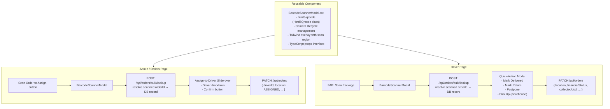
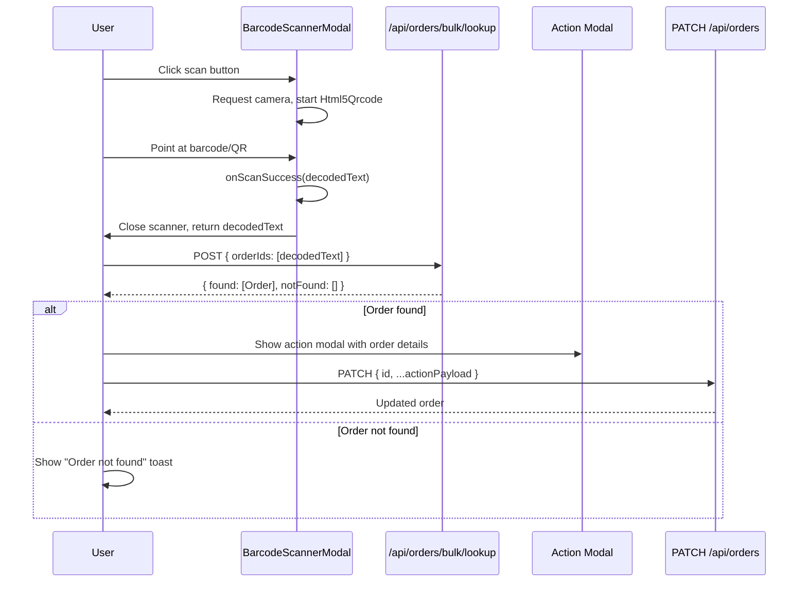

# Barcode & QR Code Scanner — Implementation Plan

## Overview

Add a seamless barcode/QR scanner feature to the Next.js PWA for two user flows:

1. **Admin/Merchant flow** — Scan an order barcode to assign it to a driver
2. **Driver flow** — Scan a package barcode to quickly update its status (deliver, return, postpone)

---

## Architecture



---

## Data Flow



---

## Step-by-Step Implementation

### Step 1: Install `html5-qrcode`

Add `html5-qrcode` to `package.json` dependencies:

```json
"html5-qrcode": "^2.3.8"
```

Then run `npm install`.

**Why `html5-qrcode` over alternatives:**

- Already have `@zxing/library` and `jsqr` in `package.json` but neither is imported/used
- `html5-qrcode` provides the `Html5Qrcode` class which gives full DOM control — we provide our own `<div>` and can overlay Tailwind styles
- Better PWA compatibility and camera lifecycle API than `react-zxing`
- Scans all common formats by default (Code 128, Code 39, QR, EAN, UPC, etc.)

---

### Step 2: Create `components/BarcodeScannerModal.tsx`

**TypeScript Interfaces:**

```typescript
interface BarcodeScannerModalProps {
  isOpen: boolean;
  onClose: () => void;
  onScanSuccess: (decodedText: string) => void;
  /** Optional: heading text shown above the scanner */
  heading?: string;
}
```

**Component Design:**

- Full-screen modal overlay (`fixed inset-0 z-50`)
- Dark semi-transparent backdrop (`bg-black/80 backdrop-blur-sm`)
- Centered scan window with:
  - Rounded corners (`rounded-2xl`)
  - Animated scanning line effect (cyan gradient bar)
  - Corner brackets (CSS pseudo-elements or SVG) for "viewfinder" look
- Camera feed rendered into a `<div id="barcode-scanner-viewport">` inside the scan window
- "Close" button at the bottom to stop camera and dismiss
- Camera permission denied state with helpful message

**Camera Lifecycle (critical):**

```
useEffect on mount (isOpen === true):
  1. const html5QrCode = new Html5Qrcode("barcode-scanner-viewport")
  2. await html5QrCode.start(
       { facingMode: "environment" },  // rear camera
       { fps: 10, qrbox: { width: 250, height: 250 } },
       (decodedText) => { onScanSuccess(decodedText); stopAndClose(); },
       () => {}  // ignore scan errors
     )

useEffect cleanup (isOpen === false or unmount):
  1. html5QrCode.stop().catch(() => {})
  2. html5QrCode.clear()
```

Store `html5QrCode` instance in a `useRef<Html5Qrcode | null>(null)` to access across renders.

**Edge Cases:**

- Permission denied → show inline error message, keep close button
- No camera available → show "No camera detected" message
- Multiple rapid scans → `isScanning` ref prevents duplicate callbacks
- Component unmounts while camera is starting → cleanup handles pending start promise

**Tailwind Styling:**

- Scan window: `w-[280px] h-[280px] sm:w-[320px] sm:h-[320px]` with `border-2 border-cyan-500/50 rounded-2xl`
- Overlay with cutout: Use a dark overlay with a transparent center using `box-shadow` or segmented divs
- Animated scan line: `animate-pulse` or custom CSS keyframe moving bar
- Corner accents: 4 small L-shaped borders at each corner of the scan window

---

### Step 3: Modify `app/orders/page.tsx` — Scan to Assign

**Additions needed:**

1. **Import** `BarcodeScannerModal` at top

2. **State variables:**

   ```typescript
   const [scannerOpen, setScannerOpen] = useState(false);
   const [scannedOrder, setScannedOrder] = useState<Order | null>(null);
   const [scannedAssignDriverId, setScannedAssignDriverId] = useState("");
   const [scanError, setScanError] = useState<string | null>(null);
   const [scanLoading, setScanLoading] = useState(false);
   ```

3. **Handler: onScanSuccess**

   ```typescript
   const handleScanOrder = async (decodedText: string) => {
     setScannerOpen(false);
     setScanLoading(true);
     try {
       const res = await fetch("/api/orders/bulk/lookup", {
         method: "POST",
         headers: { "Content-Type": "application/json" },
         body: JSON.stringify({ orderIds: [decodedText.trim()] }),
       });
       const { found, notFound } = await res.json();
       if (found.length === 0) {
         setScanError(`Order "${decodedText}" not found.`);
         return;
       }
       const order = found[0];
       // Find the full order in local state or set minimal info
       setScannedOrder(order);
       setScannedAssignDriverId("");
     } finally {
       setScanLoading(false);
     }
   };
   ```

4. **Handler: confirm scan-to-assign**

   ```typescript
   const handleScanAssign = async () => {
     if (!scannedOrder || !scannedAssignDriverId) return;
     // Block WD/WO orders
     if (["WD", "WO"].includes(scannedOrder.financialStatus)) {
       alert("Cannot reassign delivered/paid-out order.");
       return;
     }
     await patchOrder(scannedOrder.id, {
       driverId: scannedAssignDriverId,
       location: "ASSIGNED",
       financialStatus: "UD",
       collectedUsd: 0,
       collectedLbp: 0,
     });
     setScannedOrder(null);
   };
   ```

5. **UI: "Scan Order to Assign" button** — Add to the action bar (row 1) next to the existing "Assign" button. Style with a distinct icon (📷) and cyan accent.

6. **UI: Scan-to-Assign Slide-over** — Shown when `scannedOrder !== null`:
   - Displays scanned order ID, customer name, current location/status
   - Driver dropdown (reuse existing `availableDrivers` list)
   - "Assign" and "Cancel" buttons
   - Follow existing dark modal styling pattern

7. **UI: BarcodeScannerModal** — Rendered at the bottom of the component, controlled by `scannerOpen`

8. **UI: Error toast** — When `scanError` is set, show a small error banner that auto-dismisses

---

### Step 4: Modify `app/driver/DriverClient.tsx` — Scan to Update Status

**Additions needed:**

1. **Import** `BarcodeScannerModal` at top

2. **State variables:**

   ```typescript
   const [scannerOpen, setScannerOpen] = useState(false);
   const [scannedOrder, setScannedOrder] = useState<any | null>(null);
   const [scanError, setScanError] = useState<string | null>(null);
   const [scanSubmitting, setScanSubmitting] = useState(false);
   ```

3. **Handler: onScanSuccess**

   ```typescript
   const handleScanPackage = async (decodedText: string) => {
     setScannerOpen(false);
     setScanSubmitting(true);
     try {
       const res = await fetch("/api/orders/bulk/lookup", {
         method: "POST",
         headers: { "Content-Type": "application/json" },
         body: JSON.stringify({ orderIds: [decodedText.trim()] }),
       });
       const { found, notFound } = await res.json();
       if (found.length === 0) {
         setScanError(`Package "${decodedText}" not found.`);
         return;
       }
       setScannedOrder(found[0]);
     } finally {
       setScanSubmitting(false);
     }
   };
   ```

4. **Handler: Quick actions on scanned order**
   - **Mark Delivered:** `PATCH { id, location: "DELIVERED", financialStatus: "WD", collectedUsd: amountUsd, collectedLbp: amountLbp }`
   - **Mark Return:** `PATCH { id, location: "RETURN", financialStatus: "Re" }` (or "RWD" if driver still has it)
   - **Postpone:** Open existing `postponeModal` flow
   - **Pick Up (warehouse):** `PATCH { id, driverId: driver.id, location: "ASSIGNED", ... }` — only shown if order is in WAREHOUSE

5. **UI: Floating Action Button (FAB)**
   - Position: `fixed bottom-6 right-6 z-30`
   - Style: Large circular button with scan icon (📷), cyan gradient, shadow glow
   - Label: "Scan" below the icon
   - Only visible on ACTIVE and WAREHOUSE tabs (where scanning makes sense)

6. **UI: Quick-Action Modal** — Shown when `scannedOrder !== null`:
   - Order summary: ID, customer name, address, amount
   - Action buttons in a 2x2 grid:
     - "✓ Mark Delivered" (green) — full amount
     - "↺ Mark Return" (red)
     - "⏳ Postpone" (amber)
     - "📦 Pick Up" (amber) — only if location is WAREHOUSE
   - "Close" / "Scan Next" button to dismiss and optionally re-open scanner

7. **UI: BarcodeScannerModal** — Rendered at the bottom of the component

---

### Step 5: Edge Cases & Validation

| Scenario                                   | Handling                                                                         |
| ------------------------------------------ | -------------------------------------------------------------------------------- |
| Camera permission denied                   | Show inline error in scanner modal, keep close button                            |
| No camera on device                        | Show "No camera detected" message                                                |
| Scanned text doesn't match any order       | Toast/alert: "Order X not found"                                                 |
| Scanned order is already delivered (WD/WO) | Alert: cannot modify, offer to dismiss                                           |
| Rapid double-scan                          | `isScanning` ref prevents callback re-entry                                      |
| Component unmounts mid-scan                | `useEffect` cleanup stops camera                                                 |
| Browser doesn't support getUserMedia       | `Html5Qrcode.getCameras()` throws → show error                                   |
| HTTP (non-HTTPS) on mobile                 | Camera API blocked by browser — show help text about HTTPS/localhost requirement |

---

## Files Modified / Created

| File                                 | Action     | Description                      |
| ------------------------------------ | ---------- | -------------------------------- |
| `package.json`                       | Modify     | Add `html5-qrcode` dependency    |
| `components/BarcodeScannerModal.tsx` | **Create** | Reusable scanner modal component |
| `app/orders/page.tsx`                | Modify     | Add scan-to-assign flow          |
| `app/driver/DriverClient.tsx`        | Modify     | Add scan-to-action FAB and flow  |
