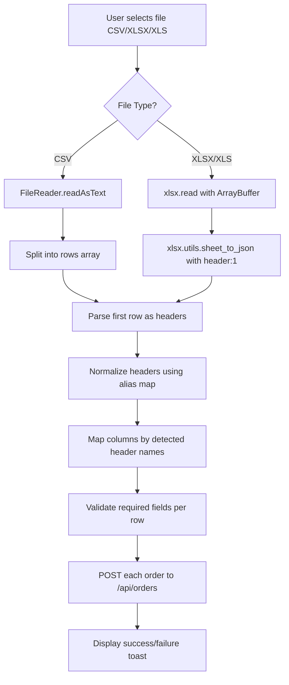

# Plan: Upgrade Bulk CSV Upload to Support Excel & Header-Based Column Mapping

## Overview

Upgrade the Bulk Upload component on the Order Entry page (`/orders?tab=order-entry`) to:

1. Accept Excel files (`.xlsx`, `.xls`) in addition to CSV
2. Parse columns by header name (independent of column order) using a normalization/alias system
3. Provide proper success/failure feedback with counts

## Architecture



## Current State Analysis

| Component      | File                                                   | Line(s)       | Current Behavior                                         |
| -------------- | ------------------------------------------------------ | ------------- | -------------------------------------------------------- |
| Bulk Upload UI | [`app/orders/page.tsx`](app/orders/page.tsx:3067)      | 3067-3091     | Shows "BULK CSV Upload", accepts `.csv` only             |
| Upload Handler | [`app/orders/page.tsx`](app/orders/page.tsx:212)       | 212-292       | Reads as text, splits by `,`, maps by fixed column index |
| Backend        | [`app/api/orders/route.ts`](app/api/orders/route.ts:1) | POST endpoint | Single order creation                                    |
| Dependency     | [`package.json`](package.json:27)                      | line 27       | `xlsx: ^0.18.5` already installed                        |

## Step-by-Step Plan

### Step 1: Verify Dependencies

- **Status**: `xlsx` is already in `package.json` at `^0.18.5`. No action needed.

### Step 2: Update File Upload UI (`app/orders/page.tsx`)

**Location**: Lines ~3067-3091

**Changes**:

1. Badge text: `"BULK CSV Upload"` -> `"BULK Excel / CSV Upload"`
2. Helper text: Update to `"Upload an Excel (.xlsx, .xls) or CSV file with headers: orderId, seller, customer, phone, address, zone, usd, lbp"`
3. File input `accept` attribute: `".csv"` -> `".csv, .xlsx, .xls, application/vnd.openxmlformats-officedocument.spreadsheetml.sheet, application/vnd.ms-excel"`
4. Button label: `"Click to Upload CSV"` -> `"Click to Upload Excel / CSV"`

### Step 3: Implement Header-Based Parsing (`app/orders/page.tsx`)

**Location**: Replace `handleCsvUpload` function (lines ~212-292)

**New handler architecture**:

#### 3a. File Type Detection & Reading

```
function handleFileUpload(e):
  file = e.target.files[0]
  extension = getFileExtension(file.name)

  if extension in ['.xlsx', '.xls']:
    Read file as ArrayBuffer
    workbook = xlsx.read(arrayBuffer, { type: 'array' })
    worksheet = workbook.Sheets[workbook.SheetNames[0]]
    rows = xlsx.utils.sheet_to_json(worksheet, { header: 1 }) as string[][]
  else:
    Read file as Text
    rows = splitByNewlines(text).map(line => splitByComma(line))
```

#### 3b. Header Normalization & Column Mapping

Create a header normalizer function:

```typescript
function normalizeHeader(raw: string): string {
  return raw
    .trim()
    .toLowerCase()
    .replace(/[\s_]+/g, " ");
}

const HEADER_ALIASES: Record<string, string> = {
  // orderId
  "order id": "orderId",
  orderid: "orderId",
  tracking: "orderId",
  barcode: "orderId",
  // seller
  seller: "seller",
  merchant: "seller",
  store: "seller",
  // customer
  customer: "customer",
  "customer name": "customer",
  client: "customer",
  recipient: "customer",
  // phone
  phone: "phone",
  "phone number": "phone",
  mobile: "phone",
  // address
  address: "address",
  "delivery address": "address",
  location: "address",
  // zone
  zone: "zone",
  area: "zone",
  region: "zone",
  // usd
  usd: "usd",
  "price usd": "usd",
  "amount usd": "usd",
  // lbp
  lbp: "lbp",
  "price lbp": "lbp",
  "amount lbp": "lbp",
};
```

Column mapping logic:

```typescript
function mapHeaders(headers: string[]): Record<string, number> {
  const mapping: Record<string, number> = {};
  headers.forEach((raw, index) => {
    const normalized = normalizeHeader(raw);
    const fieldName = HEADER_ALIASES[normalized];
    if (fieldName) {
      mapping[fieldName] = index;
    }
  });
  return mapping;
}
```

#### 3c. Row Processing & Validation

For each data row (skipping header row at index 0):

1. Extract values using mapped column indices
2. Validate required fields: `customer`, `phone`, `address`, and at least one of `usd`/`lbp`
3. Resolve seller ID using existing `sellersList` matching logic
4. Resolve zone ID using existing `zones` matching logic
5. Build order payload object

### Step 4: Order Submission & Feedback

**Changes to submission logic**:

1. Collect all valid order payloads into an array
2. Submit each order via `POST /api/orders` (existing endpoint, already handles single order creation)
3. Track success/failure counts
4. Replace `alert()` with proper toast notification showing:
   - Total rows parsed
   - Successfully created orders
   - Failed/skipped rows with reason

**Feedback UI**: Use a result state object (similar to `ImportResult` in `GlobalSheetImportModal`) to display metrics in a success/error banner inline with the upload component.

## Modified Files

| File                                         | Changes                                                                                   |
| -------------------------------------------- | ----------------------------------------------------------------------------------------- |
| [`app/orders/page.tsx`](app/orders/page.tsx) | Update UI text, accept attribute, replace `handleCsvUpload` with new header-based handler |

## No Backend Changes Required

The existing `POST /api/orders` endpoint handles single order creation. The new client-side handler will call this endpoint for each parsed row, same as the current implementation. No API route modifications are needed.

## Validation Rules

| Field      | Required       | Notes                             |
| ---------- | -------------- | --------------------------------- |
| `orderId`  | No             | Auto-generated if missing         |
| `seller`   | No             | Optional - can be empty           |
| `customer` | Yes            | Must be present in header         |
| `phone`    | Yes            | Must be present in header         |
| `address`  | Yes            | Must be present in header         |
| `zone`     | No             | Defaults to empty string          |
| `usd`      | One of usd/lbp | At least one price field required |
| `lbp`      | One of usd/lbp | At least one price field required |

## Error Handling

- Invalid file type: Show error message
- Missing required headers: List which headers are missing
- Rows with missing required data: Skip and count as failed
- API errors: Log and count as failed
