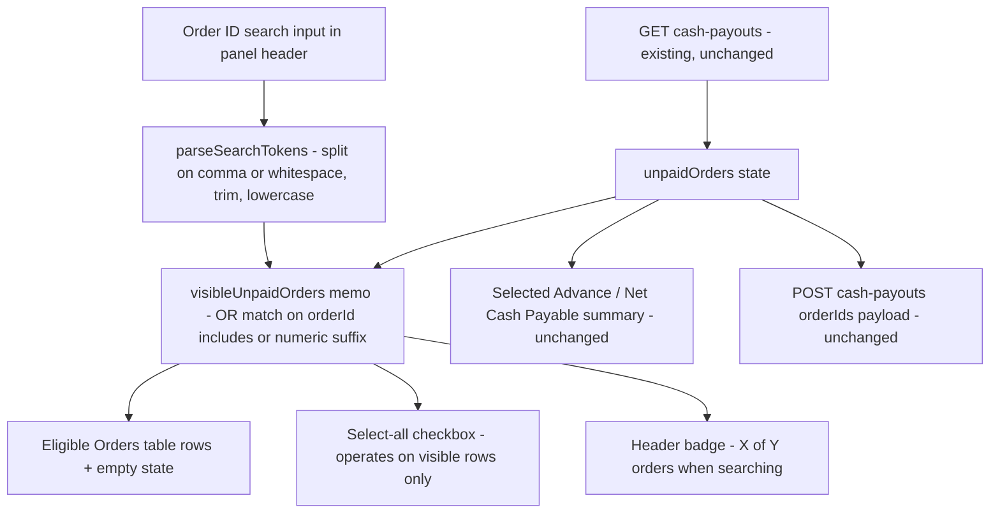

# Search field in "Eligible Orders for Advance" (cash seller workspace)

## Overview

Add an **order-ID search box** to the "Eligible Orders for Advance" panel on the
merchant page (e.g. `/merchants/61d8d846-d526-41bb-b580-1431a72a1db0`), rendered
by [`components/merchants/CashSellerWorkspace.tsx`](../components/merchants/CashSellerWorkspace.tsx).

Why: the owner pays a merchant in the morning, then the merchant enters more
orders later the same day for the next day's delivery. Both batches share the
same `createdAt` date, so the existing **From/To date filter cannot separate
them**. An order-ID search lets the operator pinpoint exactly the orders that
still need paying.

Behaviour (agreed with owner):

- Matches **order ID only**.
- Accepts **one or more comma-separated values** (commas, spaces or newlines all
  act as separators), e.g. `10049805, 78981891, 4912`.
- **Partial / last-digits matching** for numeric tokens of 4+ digits — the same
  rule as `termMatchesOrder` in [`app/orders/page.tsx`](../app/orders/page.tsx)
  and the driver-profile search plan.
- Multiple tokens use **OR** logic: an order matching *any* token is displayed.
- **Pure client-side filter** — no API route changes, no Prisma changes, no
  changes to commission/profit math. All eligible rows are already in memory from
  the existing `GET /api/admin/merchants/[id]/cash-payouts` response.

Critical guarantee: the search only controls **what is displayed**. Selections
(checkboxes), the financial summary cards, and the `POST` payload keep working
against the full `unpaidOrders` state, so an order selected while searching stays
selected and is still included in the generated payout batch even after the
search box is cleared or changed.

## Architecture

## Current State Analysis

| File | Line range | Current behaviour |
| --- | --- | --- |
| `components/merchants/CashSellerWorkspace.tsx` | 7-16 | `UnpaidOrder` interface — has `orderId` and `id`, no customer fields (not needed here) |
| `components/merchants/CashSellerWorkspace.tsx` | 122-127 | `unpaidOrders` state holds every eligible row (full list already client-side) |
| `components/merchants/CashSellerWorkspace.tsx` | 161-163 | Existing filter state is date-only: `filterFromDate` / `filterToDate` — no text search |
| `components/merchants/CashSellerWorkspace.tsx` | 166-198 | `applyDateFilter()` re-fetches from the API; unrelated to text search |
| `components/merchants/CashSellerWorkspace.tsx` | 217-241 | `excludeOrder()` removes a row from `unpaidOrders` and from `selectedOrderIds` |
| `components/merchants/CashSellerWorkspace.tsx` | 277-281 | `selectedAdvance` sums by looking ids up in **full** `unpaidOrders` — must stay untouched |
| `components/merchants/CashSellerWorkspace.tsx` | 322-339 | `allOrdersSelected` + `toggleSelectAllOrders` use the **full** `unpaidOrders` list — must switch to the visible list |
| `components/merchants/CashSellerWorkspace.tsx` | 583-593 | Panel header + `{unpaidOrders.length} orders` count badge |
| `components/merchants/CashSellerWorkspace.tsx` | 594-637 | Existing From/To date filter row (Apply / Clear buttons) — the search input goes here |
| `components/merchants/CashSellerWorkspace.tsx` | 662-720 | Table body: empty-state row "No eligible orders found", then `unpaidOrders.map(...)` rows |
| `app/api/admin/merchants/[id]/cash-payouts/route.ts` | 43-77 | GET already selects `orderId` for unpaid eligible orders → no server change needed |
| `app/orders/page.tsx` | 1680-1702 | `termMatchesOrder` reference implementation for `includes` + numeric-suffix matching |
| `app/drivers/[id]/page.tsx` | (driver-profile-search plan) | Same comma-token / OR-match pattern already agreed for driver profile — reuse the same helper semantics |

## Plan

1. **Module-scope helpers** (top of `components/merchants/CashSellerWorkspace.tsx`, next to `computeAdvance`)
   - `parseSearchTokens(term: string): string[]` — split on `,`, whitespace and
     newlines, trim, lowercase, drop empty tokens.
   - `orderMatchesSearchTokens(orderId: string, tokens: string[]): boolean` —
     for each token: case-insensitive `includes` on the order ID, plus
     `endsWith` when the token matches `^\d{4,}$` (last-digits search).
     Returns true if **any** token matches (OR).
   - `filterOrdersBySearchTokens(list, tokens)` — returns the list unchanged when
     `tokens.length === 0`.

2. **Search state + filtered list** (inside the component)
   - `const [orderSearch, setOrderSearch] = useState("")`.
   - `const searchTokens = useMemo(() => parseSearchTokens(orderSearch), [orderSearch])`.
   - `const visibleUnpaidOrders = useMemo(() => filterOrdersBySearchTokens(unpaidOrders, searchTokens), [unpaidOrders, searchTokens])`.
   - No debounce needed — filtering is in-memory over an already-loaded list.
   - Reset nothing: selections are deliberately **not** cleared when the search
     text changes (needed for "pay morning + night orders in one batch").

3. **Search input UI** (header filter row, after the date controls, ~line 637)
   - Full-width text input on a second line inside the existing filter block, so
     it does not crowd the From/To controls.
   - Placeholder: `Search order IDs — comma separated, e.g. 10049805, 78981891`.
   - Same styling language as the date inputs: `bg-[#0B0F17] border border-gray-800 rounded px-2 py-1 text-white text-xs` with cyan focus ring.
   - A small ✕ clear button (only rendered when non-empty) that resets
     `orderSearch` to `""`.
   - Search is purely local: it must **not** trigger `applyDateFilter` or any fetch.

4. **Point the table and its chrome at `visibleUnpaidOrders`**
   - Table rows: iterate `visibleUnpaidOrders.map(...)` instead of `unpaidOrders.map(...)` (~line 672).
   - Empty state (~line 662): branch the message — "No orders match your search."
     when tokens are present and nothing matches; keep "No eligible orders found"
     otherwise. `colSpan` stays 5.
   - Header badge (~line 590): show `{visibleUnpaidOrders.length} of {unpaidOrders.length} orders` when tokens are present, otherwise the existing `{unpaidOrders.length} orders`.

5. **Select-all operates on visible rows only** (~lines 322-339)
   - `allOrdersSelected` compares `selectedOrderIds` against
     `visibleUnpaidOrders` ids; `toggleSelectAllOrders` sets
     `new Set(visibleUnpaidOrders.map(o => o.id))` when selecting.
   - Existing `toggleOrder`, `excludeOrder`, and the summary math
     (`selectedAdvance`, `netCashPayable`) and the `POST` payload stay exactly as
     they are — they resolve ids against the full `unpaidOrders` list, so
     selections made across different searches all get paid in one batch.

6. **Verify**
   - `npm run lint` passes; production build unaffected.
   - Manual check on a cash-seller merchant page: full list shows with empty
     search; a single order ID, a partial ID, and a comma-separated list each
     narrow the table; checkbox selections survive changing/clearing the search;
     "Generate & Save Payout Batch" still includes every selected order.
   - Date filter + text search work together (text search applies on top of the
     currently loaded date range).
   - Run `node scripts/build-ai-context.js` so the AI context map stays current.

## Out of scope

- No changes to `app/api/admin/merchants/[id]/cash-payouts/route.ts`, the
  exclude endpoint, the `POST` payout flow, or any Prisma model.
- No search over customer name/phone/zone (would require the API to return those
  fields); owner explicitly chose order-ID-only.
- No changes to the "Unresolved Returns to Deduct" column or the historical
  batch ledger.
