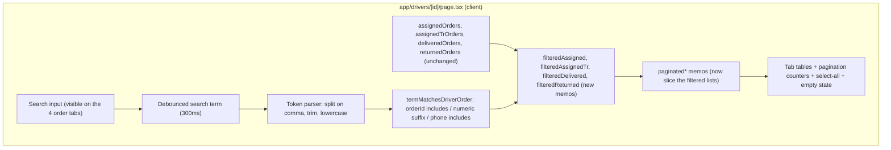

# Search bar in the admin driver profile (all order tabs)

## Overview

Add a single search bar to the admin driver profile page (`/drivers/d0111` →
`app/drivers/[id]/page.tsx`) that filters the tables on **all four order tabs**:

- Assigned - Dr (`assigned`)
- Assigned - Tr (`assigned_tr`)
- Delivered (`delivered`)
- Returns/Exchange (`returns`)

The search matches **order ID** and **customer phone number**, and supports
**one or multiple comma-separated values** (e.g. `10049805, 78981891, 981891`).
Multiple tokens use **OR** logic (an order matching *any* token is shown), which
is the behaviour the owner uses on `/orders` for batch lookups. Numeric tokens
also match as **order-ID suffixes**, so typing the last 4–5 digits works, exactly
like the `/orders` search.

The Payouts and Seller Rates tabs are **not** filtered (they are not order
lists); the search bar is hidden on those two tabs.

All data for these tabs is already loaded client-side (`driver.deliveries` from
`GET /api/admin/drivers/[id]`), so this is a **pure client-side filter** — no
API route changes, no schema changes, no money-math changes.

## Architecture

## Current State Analysis

| File | Line range | Current behaviour |
| --- | --- | --- |
| `app/drivers/[id]/page.tsx` | 17-23 | `Tab` union: `assigned`, `assigned_tr`, `delivered`, `returns`, `payouts`, `rates` |
| `app/drivers/[id]/page.tsx` | 76-96 | Per-tab sort state and per-tab pagination state (`assignedPage`, `deliveredPage`, `returnsPage`, …) — no search state exists |
| `app/drivers/[id]/page.tsx` | 253-298 | Derived lists `assignedOrders`, `assignedTrOrders`, `deliveredOrders`, `returnedOrders` filtered from `driver.deliveries` by location/financialStatus |
| `app/drivers/[id]/page.tsx` | 300-323 | `paginatedAssigned/AssignedTr/Delivered/Returned` slice the **unfiltered** derived lists |
| `app/drivers/[id]/page.tsx` | 331-356 | Summary-card sums use the full derived lists (must stay unfiltered) |
| `app/drivers/[id]/page.tsx` | 975-1019 | Sticky tab bar with per-tab count badges (badges use full counts — keep) |
| `app/drivers/[id]/page.tsx` | 1114-1168 | Assigned-tab pagination bar: "Showing X of {assignedOrders.length}", Prev/Next |
| `app/drivers/[id]/page.tsx` | 1174-1187 | Assigned select-all checkbox uses `assignedOrders` ids |
| `app/drivers/[id]/page.tsx` | 1225-1234 | Empty-state row keyed on `paginatedAssigned.length === 0 && assignedOrders.length === 0` |
| `app/drivers/[id]/page.tsx` | 1320-1620 | Assigned-Tr tab: same pagination/select-all/empty-state pattern |
| `app/drivers/[id]/page.tsx` | 1623-1940 | Delivered tab: settlement action bar + pagination + table (same pattern) |
| `app/drivers/[id]/page.tsx` | 1942-2176 | Returns tab: bulk toolbar + pagination + table (same pattern) |
| `app/orders/page.tsx` | 548-558 | Debounce pattern to copy: `searchTerm` → `debouncedSearchTerm` after 300ms |
| `app/orders/page.tsx` | 1680-1702 | `termMatchesOrder` reference implementation: numeric-suffix + `includes` matching |

## Plan

1. **Search state + debounce** (`app/drivers/[id]/page.tsx`, near line 96)
   - Add `const [searchTerm, setSearchTerm] = useState("")` and a 300 ms
     debounced copy `debouncedSearchTerm`, mirroring `app/orders/page.tsx`
     lines 548-558.
   - Reset all four tab pages to 1 whenever `debouncedSearchTerm` changes
     (same effect that already resets pages on items-per-page change).

2. **Token + match helpers** (module scope, above the component)
   - `parseSearchTokens(term: string): string[]` — split on `,`, trim,
     lowercase, drop empties.
   - `termMatchesDriverOrder(term: string, order: any): boolean` — matches:
     - `order.orderId` case-insensitive `includes`, **plus** suffix match when
       the token is `^\d{4,}$` (last-digits search, same rule as
       `termMatchesOrder` in `/orders`);
     - `order.customerPhone` `includes` (raw and digits-only normalized, so
       `70123456` matches `+961 70 123 456`).
   - `filterOrdersByTokens(list, tokens)` — keep an order if **any** token
     matches (OR logic). Empty token list returns the list unchanged.

3. **Filtered memos** (after the derived lists, ~line 299)
   - `filteredAssigned`, `filteredAssignedTr`, `filteredDelivered`,
     `filteredReturned` = `filterOrdersByTokens(derivedList, tokens)` wrapped in
     `useMemo` keyed on the derived list + `debouncedSearchTerm`.
   - Tab badge counts and summary-card sums keep using the **full** derived
     lists (they describe the driver's totals, not the current filter).

4. **Point pagination at the filtered lists** (~lines 300-323)
   - `paginatedAssigned/AssignedTr/Delivered/Returned` now sort + slice the
     `filtered*` lists instead of the raw derived lists.

5. **Render the search bar** (right below the tab bar, ~line 1019)
   - One shared input shown only when `activeTab` is one of the four order
     tabs. Placeholder:
     `Search by order ID / phone — single or comma-separated (e.g. 10049805, 78981891)…`
   - Styling consistent with the page (dark card, `bg-white/[0.02]`,
     cyan focus ring) and a small ✕ clear button when non-empty.
   - When tokens are present, show a subtle "N of M orders match" hint next to
     the input (M = full tab list, N = filtered list).

6. **Wire each tab's chrome to the filtered list** (4 tabs, same edits each)
   - Pagination bar: "Showing X of **filtered**.length", Next disabled against
     filtered length.
   - Select-all checkbox: checked-state and `toggleSelectAll` ids use the
     filtered list (so "select all" selects exactly what's visible).
   - Empty-state row: show "No orders match your search." when tokens are
     present and the filtered list is empty; keep the existing message when the
     tab is genuinely empty.
   - Bulk toolbars ("N of M selected", Print/Excel on selected) keep operating
     on `selectedOrders` ids — no change needed beyond the select-all source.

7. **Verify**
   - `npm run lint` / `next build` passes.
   - Manual checks on `/drivers/d0111`: single order ID, partial numeric ID,
     phone fragment, comma-separated mixed list, clear button, pagination with
     >50 matches, and that Payouts/Seller Rates tabs are untouched.
   - Run `node scripts/build-ai-context.js` to refresh the context map.

## Out of scope

- No changes to `app/driver/DriverClient.tsx` (the driver's own portal).
- No API changes — everything is already loaded client-side.
- Payouts and Seller Rates tabs are not searchable.
