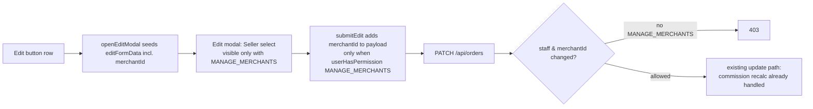

# Change Seller from the Edit Order modal

## Overview

On https://jett.delivery/orders the "Edit" button opens the Edit Order modal, which
currently allows editing customer name/phone/address, zone, amounts, flags and notes —
but not the seller (merchant). Privileged users must today use the separate
ADMIN-only "Seller Change" bulk button. This feature adds a **Seller** dropdown to
the Edit Order modal, visible only to users with the `MANAGE_MERCHANTS` permission
(Admins always see it via the `hasPermission` ADMIN bypass), and enforces the same
permission server-side in `PATCH /api/orders`.

## Architecture

## Current State Analysis

| file | line range | current behaviour |
|---|---|---|
| app/orders/page.tsx | 949-962 | `editFormData` state has no `merchantId` field |
| app/orders/page.tsx | 2560-2575 | `openEditModal` seeds all editable fields except seller |
| app/orders/page.tsx | 2577-2600 | `submitEdit` builds payload; financial fields gated by `userHasPermission("ORDERS_FINANCIAL")` — pattern to mirror |
| app/orders/page.tsx | 5506-5535 | Zone `<select>` in the edit modal — insertion point / styling pattern |
| app/orders/page.tsx | 6231-6255 | Seller `<select>` in the correction modal — option-label pattern (`m.merchantName \|\| owner first+last`) |
| app/orders/page.tsx | 1178-1217 | Reference-data fetch fills `merchants` state; `/api/admin/merchants` itself requires MANAGE_MERCHANTS, so unprivileged staff can't populate the list anyway |
| app/api/orders/route.ts | 582-603 | `STAFF_UPDATABLE_FIELDS` already includes `merchantId` (line 595) |
| app/api/orders/route.ts | 919-938 | Financial-field gate for staff — exact template for the new MANAGE_MERCHANTS gate |
| app/api/orders/route.ts | 1143-1147, 1196-1197 | merchantId change already triggers commission recalculation — no server work needed beyond the gate |

## Plan

1. **Client — app/orders/page.tsx**
   1. Add `merchantId: ""` to the `editFormData` initial state.
   2. Seed `merchantId: order.merchantId || ""` in `openEditModal`.
   3. In `submitEdit`, include `merchantId` in the payload only when
      `userHasPermission("MANAGE_MERCHANTS")` (empty string → `null`).
   4. Add a Seller `<select>` after the Zone block in the edit modal, rendered only
      when `userHasPermission("MANAGE_MERCHANTS")`, populated from the existing
      `merchants` state using the correction-modal label pattern, with a
      "— No seller —" empty option.
2. **Server — app/api/orders/route.ts**
   1. After the financial-field gate, add a seller-change gate: for staff
      (`allowedFields === STAFF_UPDATABLE_FIELDS && !actorIsAdmin`), if `merchantId`
      is present in the update and differs from `existing.merchantId`, require
      `hasPermission(actor, "MANAGE_MERCHANTS")` → otherwise 403.
3. Verify with `npx tsc --noEmit`.

## Deliberately untouched

- The ADMIN-only bulk "Seller Change" toolbar button (unchanged behaviour).
- The dead single-order seller modal (`openSellerModal` is never called).
- Commission recalculation on merchantId change (already implemented server-side).
