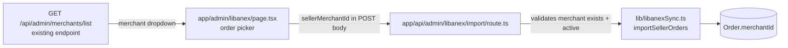

# Assign a merchant (seller) to Libanex-imported orders

## Overview
Orders imported from Libanex currently land on the PWA with `merchantId = NULL`
("— No seller —"), so they never appear in the seller's order list, statements
or payouts. The admin must be able to pick which merchant of **our** system the
selected Libanex orders are assigned to at import time.

## Architecture

## Current State Analysis

| file | line range | current behaviour |
|---|---|---|
| lib/libanexSync.ts | 402-422 (`importSellerOrders` → `prisma.order.create`) | creates orders with no `merchantId` → NULL |
| lib/libanexSync.ts | 344-349 (`importSellerOrders` signature) | accepts only `sellerId` + optional `orderIds` |
| app/api/admin/libanex/import/route.ts | 13-40 | parses `sellerId`/`orderIds` only; requires MANAGE_ORDERS |
| app/admin/libanex/page.tsx | 186-219 (`importSelected`) | posts `{sellerId, orderIds}`; no merchant selector in the picker header (423-444) |
| app/api/admin/merchants/list/route.ts | 8-36 | existing endpoint returning `{id, numericId, name}` of active merchants, gated MANAGE_MERCHANTS |
| plans/edit-order-seller.md | 35-38 | precedent: staff may edit `merchantId` on existing orders; `/api/orders` already recalculates commission on merchant change |

## Plan

1. **UI — app/admin/libanex/page.tsx**
   - In the order-picker header (next to "Import selected"), add a
     "Assign to seller" `<select>` populated from the existing
     `GET /api/admin/merchants/list`. Options: "— No seller —" (default),
     then every active merchant (`#numericId — name`).
   - `importSelected` includes `merchantId` in the POST body when one is
     chosen, and the confirm dialog names the seller.
   - Permission note: the page is ADMIN-gated by middleware, and
     `/api/admin/merchants/list` requires MANAGE_MERCHANTS — admins hold it.
     If the list call fails (403 for a non-admin staff with MANAGE_ORDERS),
     the dropdown shows "loading/…" and import still works without a seller.

2. **API — app/api/admin/libanex/import/route.ts**
   - Accept optional `merchantId` (string). If present: look the merchant up
     with Prisma (`id`, `isActive`); 400 when it does not exist or is
     inactive. Pass it to `importSellerOrders`.

3. **Core — lib/libanexSync.ts**
   - `importSellerOrders(sellerId, orderIds?, merchantId?)`: when `merchantId`
     is given, set `merchantId` on every **newly created** order. Adopted
     (already-existing) orders keep their current merchant untouched — the
     import never overwrites assignment of existing orders.
   - `ImportSummary` unchanged (created/adopted/skipped counts are enough).

4. **Not in scope**
   - Backfilling merchant on the 205 already-linked seller-5272 orders (the
     193 adopted ones already carry their real merchant). Can be done later
     with a small script if the owner wants it.

## Safety
- Merchant validation server-side before any write; a bad id fails the whole
  import call (nothing half-imported).
- Existing orders/links untouched; behavior without a selected merchant is
  identical to today.

## Verification
- `npx tsc --noEmit` clean.
- Manual: open /admin/libanex → pick a seller → dropdown lists active
  merchants → select merchant + 1 test order → import → the created order
  shows that seller in /orders.
