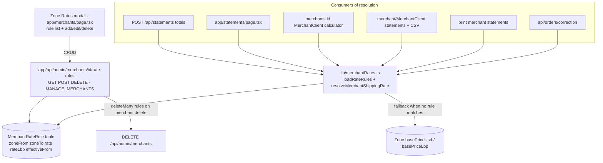

# Merchant Zone Rate Rules (range + effective date)

## Overview

Replace the current **per-zone override grid** in the "Zone Rates" modal on
[`/merchants`](../app/merchants/page.tsx) with a **list of rate rules**. Each rule is:

> **Zones `from`–`to` (e.g. 2–9) · rate USD · rate LBP · effective from date**

Meaning: *orders in zones 2–9 created on/after the effective date are charged this rate.*
A merchant can hold any number of rules — different ranges with different rates, or
successive rates for the same zones on different dates (rate change over time).

**Rate resolution for an order** (single source of truth, new `lib/merchantRates.ts`):

1. Cash sellers → unchanged flat fee (`defaultSellerRate + defaultProfitRate`).
2. Otherwise: among the merchant's rules where
   `rule.zoneFrom ≤ numeric(zone.name) ≤ rule.zoneTo` **and**
   `rule.effectiveFrom ≤ order.createdAt`:
   - pick the rule with the **latest `effectiveFrom`** (a newer rate supersedes an older one);
   - tie-break: **narrower range** wins, then most recently created.
3. No matching rule → **universal zone price** (`Zone.basePriceUsd` / `basePriceLbp`).

Because the lookup is keyed on the order's creation date, historical orders and
historical statements keep resolving to the rate that was in force when the order
was received — no restatement drift when a new rule is added later.

Zone matching uses the **numeric zone name** (`Zone.name` = `"0"`, `"2"`, `"9"`,
`"99"` — the same convention `lib/zoneMatcher.ts` uses for the fallback zone
`"99"`). Ranges may start at zone `"0"`. **Subzones count as their parent**:
`"14B"` is priced by any rule covering zone 14 (single optional letter suffix).
Zone names without a leading number never match a rule. Note `"99"` is
numerically high: a `2–99` rule would also price fallback-zone orders
(deliberate, and visible in the UI since rules show their numeric span).

## Architecture

## Current State Analysis

| File | Line range | Current behaviour |
| --- | --- | --- |
| `prisma/schema.prisma` | 244–254 | `MerchantZoneRate`: one row per `(merchantId, zoneId)` with `rate`/`rateLbp`; no dates, no ranges. |
| `prisma/schema.prisma` | 376–385 | `Zone` has `name` (e.g. `"2"`, `"99"`), `basePriceUsd`, `basePriceLbp` (universal price). |
| `app/merchants/page.tsx` | 42–46, 227–307, 885–1072 | "Zone Overrides" modal: grid of **all zones** with per-zone USD/LBP inputs, override/default badges, Reset + Apply-Universal; saves every overridden zone. |
| `app/merchants/page.tsx` | 309–330 | `handleSaveRates` → `PATCH /api/admin/merchants` with `{merchantId, rates:[{zoneId, rate, rateLbp}]}`. |
| `app/api/admin/merchants/route.ts` | 124–163 | `PATCH` upserts `merchantZoneRate` rows (`merchantId_zoneId` unique). |
| `app/api/admin/merchants/route.ts` | 180 | `DELETE` merchant also `deleteMany` zone rates. |
| `app/api/statements/route.ts` | 207–237 | Payout totals: per-order shipping from `merchant.zoneRates` map by `zoneId`; **0** when no row (will become: rule ∪ universal price). Cash-seller flat fee unchanged. |
| `app/statements/page.tsx` | 23–47 | Recomputes per-order shipping from `merchant.zoneRates` for display. |
| `app/merchants/[id]/page.tsx` | 16–18 | Server page includes `zoneRates` for the merchant page. |
| `app/merchants/[id]/MerchantClient.tsx` | 361–410 | Per-order rate calculator uses `merchant.zoneRates.find(...)` by `zoneId`. |
| `app/merchant/page.tsx` | 110–152 | Passes `zoneRates` (id/zoneId/rate/rateLbp + zone) to `MerchantClient`. |
| `app/merchant/MerchantClient.tsx` | 1004–1010, 1360–1380, 1503–1511, 3620–3625 | Statement view, CSV export, and rate display all `zoneRates.find(...)` by `zoneId`. |
| `app/print/merchant/statements/[id]/page.tsx` | 97–120 | Printed statement lines resolve rate from `merchant.zoneRates`. |
| `app/api/orders/correction/route.ts` | 28–50 | Correction net amounts use `merchantZoneRate.findUnique(merchantId, zoneId)`. |
| `app/api/zones/overrides/route.ts` + `[id]` | whole file | CRUD for `merchantZoneRate` — **not referenced by any UI** (dead-ish; leave untouched or deprecate). |

## Behavioural changes to accept (confirmed direction)

1. **Fallback changes from $0 to universal zone price.** Today, a non-cash merchant
   with no per-zone row is charged $0 shipping in statements. After this change,
   unmatched orders fall back to the zone's universal price. Historical *displayed*
   figures (statements page/print/CSV recompute per order) may therefore change for
   merchants that relied on the $0 default. Existing **created** payout rows keep
   their stored totals untouched.
2. The per-zone grid, "overridden/default" badges, Reset, and Apply-Universal are
   removed entirely; the old `MerchantZoneRate` table is kept in the schema
   (data preserved, no destructive migration) but no longer read or written by any
   live path.

## Plan

### 1. Schema (Prisma)

- Add model `MerchantRateRule` to `prisma/schema.prisma`:
  - `id String @id @default(uuid())`, `merchantId`, relation `Merchant` with
    `onDelete: Cascade`, `zoneFrom Int`, `zoneTo Int` (inclusive numeric zone span),
    `rate Float` (USD), `rateLbp Float @default(0)`,
    `effectiveFrom DateTime` (orders with `createdAt >= effectiveFrom`),
    `createdAt DateTime @default(now())`, `updatedAt DateTime @updatedAt`.
  - `@@index([merchantId, effectiveFrom])`.
- Add back-relation `rateRules MerchantRateRule[]` on `Merchant`.
- Do **not** remove `MerchantZoneRate` (historical data preserved).
- Run `npx prisma migrate dev --name add_merchant_rate_rules` (or `prisma db push`
  if that matches the project's deploy flow — confirm before running).

### 2. Resolution helper — `lib/merchantRates.ts` (new)

- `loadMerchantRateRules(merchantId, client?)` → `findMany` for the merchant (one query).
- `resolveMerchantShippingRate(rules, zoneName, zoneBaseUsd, zoneBaseLbp, orderCreatedAt)`
  → `{ usd, lbp, matched: "rule" | "universal" }`:
  - parse `zoneName` → int (`Number.parseInt`); non-numeric → universal fallback;
  - filter rules where `zoneFrom <= n <= zoneTo` and `effectiveFrom <= orderCreatedAt`;
  - sort by latest `effectiveFrom`, then narrower span, then latest `createdAt`;
  - no match → universal zone price.
- Pure functions (no Prisma inside the resolver) so client components can reuse it
  after receiving rules as props. Money values only flow through here — no inline
  math in pages (project money rule).

### 3. API — `app/api/admin/merchants/[id]/rate-rules/route.ts` (new)

- `GET` — list rules for merchant (permission `MANAGE_MERCHANTS`).
- `POST` — create/update a rule (body: `id?`, `zoneFrom`, `zoneTo`, `rate`, `rateLbp`, `effectiveFrom`).
  Validate: `1 <= zoneFrom <= zoneTo <= 999`, `rate/rateLbp >= 0`, valid date. Wrap
  mutations in a transaction (project convention; no unique constraint conflicts by design).
- `DELETE ?ruleId=` — remove one rule.
- Keep `PATCH /api/admin/merchants` (old zone-rate upsert) in place but it becomes
  unused by the UI; mark deprecated in a comment.

### 4. UI — rebuild the modal in `app/merchants/page.tsx`

- Replace state (`stagedRates` grid state, `handleUpdateRate`, `handleResetRate`,
  `handleApplyUniversal`, `handleSaveRates`) with rule-list state fetched lazily when
  the "Zone Rates" button opens the modal (`GET .../rate-rules`).
- New modal ("Zone Rate Rules: {seller}"):
  - table of rules sorted by `effectiveFrom` desc: **Zones `2–9`**, **USD**, **LBP**,
    **Effective from** (date, human format), edit/delete actions;
  - "+ Add rule" row/panel: numeric from/to, USD, LBP, `type="date"` input
    (default = today), inline validation errors;
  - helper line: "Orders outside these ranges (or created before the effective
    date) are charged the universal zone price."
- Delete-rule confirmation inline (small, matching existing modal styling).
- No permission change needed — the page is already admin/staff-gated and the API
  re-checks `MANAGE_MERCHANTS`.

### 5. Switch all rate consumers to the new resolver

For each site below, replace `zoneRates.find(... by zoneId)` logic with
`lib/merchantRates.ts` resolution using the order's `createdAt`:

- `app/api/statements/route.ts` (207–237): fetch rules per merchant (include
  `rateRules` or bulk `findMany` for the merchants in the batch); shipping per
  order = resolved rate (cash-seller branch unchanged).
- `app/statements/page.tsx` (23–47).
- `app/merchants/[id]/page.tsx` + `app/merchants/[id]/MerchantClient.tsx` (361–410):
  server passes `rateRules` + zones (numeric names already loaded); client uses the pure resolver.
- `app/merchant/page.tsx` (110–152) + `app/merchant/MerchantClient.tsx`
  (1004–1010, 1360–1380, 1503–1511 "Shipping Rates" display → show rule list instead,
  3620–3625 statement rows).
- `app/print/merchant/statements/[id]/page.tsx` (97–120).
- `app/api/orders/correction/route.ts` (28–50): resolve OLD and NEW merchant rate
  for the order using the order's `createdAt` instead of `merchantZoneRate.findUnique`.

Each change is surgical, one section at a time; no reformatting of untouched code.

### 6. Merchant delete

- `DELETE /api/admin/merchants` — add `prisma.merchantRateRule.deleteMany({ where: { merchantId } })`
  next to the existing zone-rate cleanup (or rely on cascade once the relation is
  `onDelete: Cascade`; do both for safety parity with existing code style).

### 7. Verification & wrap-up

- `npx prisma generate` + build passes; no TS errors in touched files.
- Manual checks:
  - create rule 2–9 @ $2.50 effective tomorrow → an existing order in zone 5 still
    prices at universal price; an order created after the date prices at $2.50;
  - second rule 2–9 @ $3.00 later date → older orders keep $2.50, newer get $3.00;
  - rule 10–20 @ different rate → zone 5 unaffected;
  - merchant with **no** rules → every order at universal zone price;
  - cash seller unaffected;
  - statement creation totals match the statement page/print/CSV figures;
  - order correction route still computes nets correctly.
- `node scripts/build-ai-context.js` to refresh the AI map.
- Optionally note in `ai-context/AI-CONTEXT.md` inventory that
  `/api/zones/overrides` is legacy.

## Out of scope

- Driver-side rates (`DriverZoneRate`) — untouched.
- `merchantZoneRate` row deletion/migration — table preserved as historical record.
- Any change to cash-seller flat fees, profit math (`lib/profit.ts`), or driver
  commission precedence (`lib/commission.ts`).
