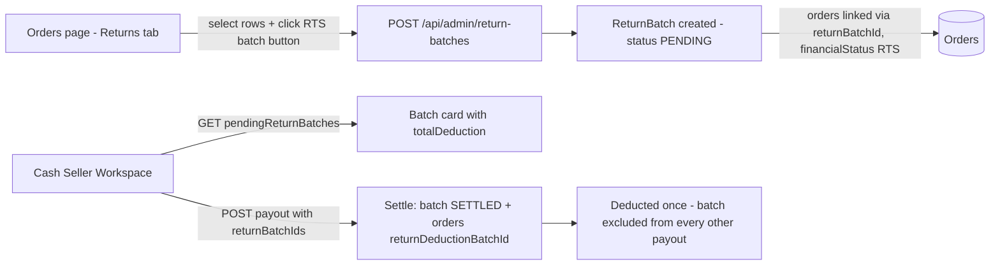

# Returns Batch Creation from the Orders Tab

## Overview

Today, clicking "Returned to Seller" on the Returns tab (`/orders?tab=returns`) performs a **bare status flip** (`Re/EX → RTS`) that creates **no ReturnBatch**. Those orders then fall out of the payout page's pending-returns query and are **never deducted** from the seller's cash payout. Only the Staff Scanner's RTS action creates real `ReturnBatch` records that flow into payouts.

This feature makes the Returns-tab button create a proper `ReturnBatch` (single merchant per batch — mixed selections are blocked, mirroring the scanner rule). The batch then appears as a selectable card on the cash-seller payout workspace, deducts `amountUsd − fee` per order exactly like unbatched returns do, and can be settled into **exactly one** payout batch.

## Architecture

## Current State Analysis

| file | line range | current behaviour |
|---|---|---|
| `app/orders/page.tsx` | 2430-2472 | `handleBulkRTS` — validates selection is Re/EX, then `PATCH /api/admin/orders/returns` with `newStatus: "RTS"`. No merchant consistency check, no batch. |
| `app/orders/page.tsx` | 4639-4661 | Active "↩ Returned to Seller (n)" button in the returns filters bar. |
| `app/orders/page.tsx` | 4752-4759 | Bottom table-header RTS button — already hard-disabled (done earlier). |
| `app/api/admin/orders/returns/route.ts` | 14-131 | PATCH state machine `RWD→Re / EWD→EX / Re/EX→RTS`. Status flip + history log only; no transaction, no batch, no concurrency guard. |
| `app/api/admin/orders/universal-scan/route.ts` | 282-381 | Scanner `RETURN_TO_SELLER` — the reference implementation: single-merchant check, `ReturnBatch` create with retry on `P2002`, links `returnBatchId`, history log. |
| `app/api/admin/return-batches/route.ts` | 5-148 | GET only — lists batches for the Returns tab "Return Batches" sub-view. No POST. |
| `app/api/admin/merchants/[id]/cash-payouts/route.ts` | 83-156 | GET: unbatched pending returns (`Re/EX`, `returnBatchId: null`) + pending `ReturnBatch` cards with `totalDeduction = Σ(amountUsd − fee)`, `-Exchange` proof orders deduct $0. |
| `app/api/admin/merchants/[id]/cash-payouts/route.ts` | 305-349, 426-449 | POST: settling a payout expands selected `returnBatchIds` into orders, deducts each at `amountUsd − fee`, marks orders `RTS` + `returnDeductionBatchId`, marks batches `SETTLED` + `cashPayoutBatchId`. Batches already `SETTLED` are silently skipped — **race gap**: two simultaneous POSTs could both read an unsettled batch. |
| `components/merchants/CashSellerWorkspace.tsx` | 152-472, 850+ | Payout UI already renders ReturnBatch cards, allows selecting them, and sends `returnBatchIds`. **No changes needed.** |
| `prisma/schema.prisma` | 510-527 | `ReturnBatch` model: `batchNumber` unique, `status PENDING/COMPLETED/SETTLED`, `cashPayoutBatchId`, orders relation. Schema already sufficient — **no migration needed.** |
| `lib/order-id.ts` | 1-8 | `orderIdForFinancialStatus` — appends "R" suffix when status becomes RTS. |

## Plan

### 1. Backend: `POST /api/admin/return-batches` (add to existing route file)
- Guard with `requireServerPermission(request, "ACTION_ORDER_RETURN")`.
- Body: `{ orderIds }`. Load orders; reject (400) unless every order:
  - belongs to exactly one merchant — error message: "All selected orders must belong to the same seller" (mirrors scanner's mixed-merchant block),
  - `financialStatus` is `Re` or `EX`,
  - `returnBatchId` is null and `returnDeductionBatchId` is null (not already batched/settled).
- Create `ReturnBatch` inside a transaction: batch number `Returns-M<merchantId>-<YYYYMMDD-HHmm>` (Beirut time, same format as scanner; reuse the same `P2002` retry loop).
- Update orders: `financialStatus: "RTS"`, `orderId` "R" suffix via `orderIdForFinancialStatus`, `returnBatchId`, **keep `location: "RETURN"`** so the batch panel + returns tab display match scanner-created batches.
- `OrderHistory` rows: `action: "RTS_BATCH_CREATED"` with batch number + merchant in meta.
- Wrap with `withConcurrencyRetries` from `lib/concurrency.ts`.

### 2. Close the settlement race (cash-payouts POST)
- Replace the unconditional `returnBatch.updateMany({ status: SETTLED })` with a **guarded conditional update** (`status: { not: "SETTLED" }` + count check → throw + rollback on mismatch), so a batch claimed by payout A can never be claimed by payout B.
- Wrap the whole POST transaction in `withConcurrencyRetries`.

### 3. Frontend: rewire `handleBulkRTS` in `app/orders/page.tsx`
- Require the **Seller filter** to be set (not "All Sellers") before proceeding: alert "Select a seller in the Seller filter first — a Return batch can only contain one seller's orders."
- Client-side mixed-merchant check on the selection as a second guard (same error message as the API).
- Confirmation dialog naming the seller and the order count.
- Call `POST /api/admin/return-batches` with `selectedOrderIds`; on success show the returned `batchNumber`, clear selection, `fetchOrders()`.
- Keep the button's existing Re/EX eligibility gating.
- Note: already-RTS rows remain visible in the table (status filter) but can no longer be batched — the API rejects them with a clear count error.

### 4. Repair script for historical orphan RTS orders
- `scripts/backfill-rts-returns-into-batches.ts`: find orders with `financialStatus = "RTS"`, `location = "RETURN"`, `returnBatchId = null`, `returnDeductionBatchId = null` (damaged by the old bare-flip button); group per merchant; create one `ReturnBatch` per merchant with a backdated batch number; link orders. Report totals before/after. Run only on explicit approval.

### 5. Verify
- `npx tsc --noEmit`.
- Manual flow: Returns tab → filter seller → select Re/EX rows → button → batch appears in "Return Batches" sub-view → appears as card in cash seller workspace → settle into payout → batch `SETTLED`, orders deducted once, second payout no longer lists it.
- `node scripts/build-ai-context.js` to refresh the AI map.

## Decisions locked in
- Mixed-seller selection: **blocked** (no auto-split), matching the scanner.
- Bottom duplicate button stays disabled (already done).
- Deduction formula unchanged: `amountUsd − (sellerRate + profitRate)` per order; `-Exchange` proof orders deduct $0.
- A ReturnBatch can be included in exactly one payout: existing `status != SETTLED` filter + new guarded update enforce it.
