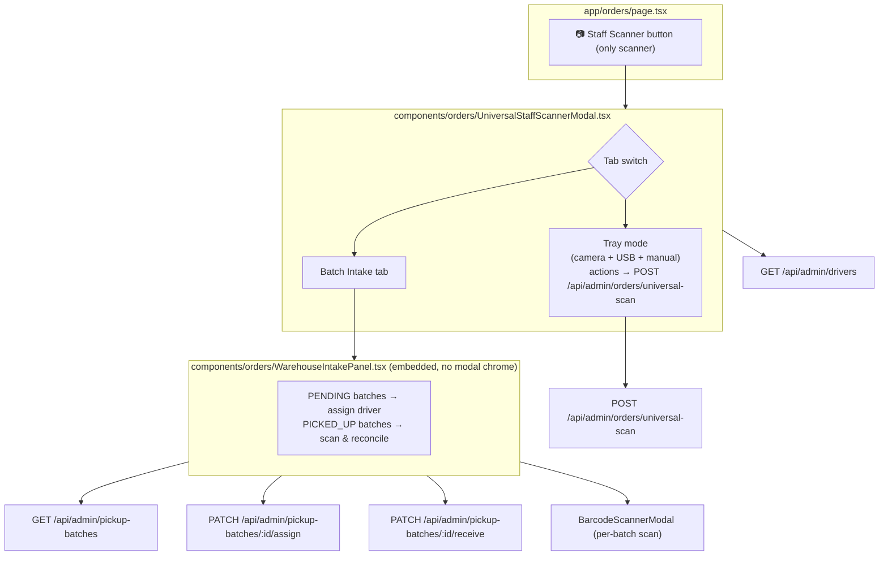

# Unify the three /orders scanners into one Staff Scanner

## Overview

`/orders` currently exposes three separate scanning entry points:

1. **📷 Scan to Assign** — single-order quick assign (inline in `app/orders/page.tsx`)
2. **📦 Warehouse Intake Scan** — pickup-batch manifest reconciliation (`components/orders/WarehouseIntakeModal.tsx`)
3. **📷 Staff Scanner** — universal multi-parcel tray (`components/orders/UniversalStaffScannerModal.tsx`)

This change collapses them into **one** button — the Staff Scanner — which gains a
**Batch Intake** tab that embeds the existing warehouse-intake reconciliation UI.
The **Scan to Assign** flow is removed outright: its behaviour is superseded by the
Staff Scanner's `ASSIGN_DRIVER` action, which sets `location` to `WITH_DRIVER`
(Dr run) or `ASSIGNED_TR` (Tr run) and leaves `financialStatus` untouched (`UD`),
only flipping to `WD` via `MARK_DELIVERED`. That is the semantics the owner wants.

No new API endpoints are created; all existing endpoints are reused.

## Architecture

## Current State Analysis

| File | Line range | Current behaviour |
| --- | --- | --- |
| `app/orders/page.tsx` | 24-27 | Imports `BarcodeScannerModal`, `WarehouseIntakeModal`, `UniversalStaffScannerModal` |
| `app/orders/page.tsx` | 1074-1085 | State for warehouse-intake modal + full scan-to-assign flow (`scannerOpen`, `scannedOrder`, `scannedAssignDriverId`, `scanError`, `scanLoading`) |
| `app/orders/page.tsx` | 1683-1729 | `handleScanOrder` (lookup) and `handleScanAssign` (writes `location: "ASSIGNED"`, `financialStatus: "UD"`, zeroes collections) |
| `app/orders/page.tsx` | 2827-2837 | "📷 Scan to Assign" toolbar button |
| `app/orders/page.tsx` | 2861-2872 | "📦 Warehouse Intake Scan" toolbar button (guarded by `MANAGE_ORDERS`) |
| `app/orders/page.tsx` | 7218-7319 | Scan-to-Assign slide-over (order summary + driver dropdown) |
| `app/orders/page.tsx` | 7321-7334 | Scan error toast |
| `app/orders/page.tsx` | 7336-7353 | Renders `BarcodeScannerModal` + `WarehouseIntakeModal` |
| `components/orders/WarehouseIntakeModal.tsx` | 68-121, 249-290 | Modal shell: fixed overlay, own header/close, `availableDrivers` prop, fetches active batches |
| `components/orders/WarehouseIntakeModal.tsx` | 292-641 | Batch lists, per-batch scan/match/notes/receive, embedded `BarcodeScannerModal` |
| `components/orders/UniversalStaffScannerModal.tsx` | 126-181 | Loads drivers from `/api/admin/drivers` (same payload the page already uses) |
| `components/orders/UniversalStaffScannerModal.tsx` | 298-368 | Continuous camera; starts on open, stops on close |
| `components/orders/UniversalStaffScannerModal.tsx` | 502-828 | Tray UI + action buttons + assign/returns sub-panels |
| `app/api/admin/orders/universal-scan/route.ts` | 187-248 | `ASSIGN_DRIVER` → `WITH_DRIVER`/`ASSIGNED_TR`, never touches `financialStatus` |
| `app/api/admin/orders/universal-scan/route.ts` | 386-433 | `MARK_DELIVERED` → `DELIVERED` + `WD` + `deliveredAt`; blocks unassigned orders |

## Plan

1. **`components/orders/WarehouseIntakeModal.tsx` → `WarehouseIntakePanel`**
   Rename the default export to `WarehouseIntakePanel` and strip the modal chrome:
   the fixed backdrop, the outer `max-w-4xl` card, the header (title/close/refresh
   moves to a compact in-panel refresh button). Keep every handler, the completion
   banner, the PENDING/PICKED_UP sections and the embedded `BarcodeScannerModal`
   exactly as-is. Drop the `isOpen` early-return and the `onClose` prop; keep
   `availableDrivers`. Rename the file to `WarehouseIntakePanel.tsx`.

2. **Add a tab switch to `UniversalStaffScannerModal`**
   Two tabs above the right column: `Scan Tray` and `Batch Intake`.
   - `Scan Tray` → existing camera + tray + actions, unchanged.
   - `Batch Intake` → renders `<WarehouseIntakePanel availableDrivers={drivers} />`
     reusing the driver list the modal already fetches.
   When switching to `Batch Intake`, stop the tray camera (the panel opens its own
   scanner on demand); switching back restarts it. Reset `activeTab` on close.

3. **Remove Scan-to-Assign from `app/orders/page.tsx`**
   Delete the toolbar button, the state block, `handleScanOrder`/`handleScanAssign`,
   the slide-over, the scan-error toast, the `BarcodeScannerModal` render and its
   import.

4. **Remove the Warehouse Intake button/modal from `app/orders/page.tsx`**
   Delete the toolbar button, `warehouseIntakeOpen` state, the `WarehouseIntakeModal`
   render and its import. The Staff Scanner button (already `MANAGE_ORDERS`-guarded)
   becomes the single entry point.

5. **Verify + refresh the map**
   `npx tsc --noEmit` (or `npm run build`) then `node scripts/build-ai-context.js`.

## Deliberately preserved

- `components/BarcodeScannerModal.tsx` stays — still used by `app/driver/DriverClient.tsx`
  and by the intake panel.
- All pickup-batch endpoints stay — the driver app (`/api/driver/pickup-batches`) depends on them.
- `app/admin/page.tsx` Staff Scanner quick-access gains the Batch Intake tab for free.
